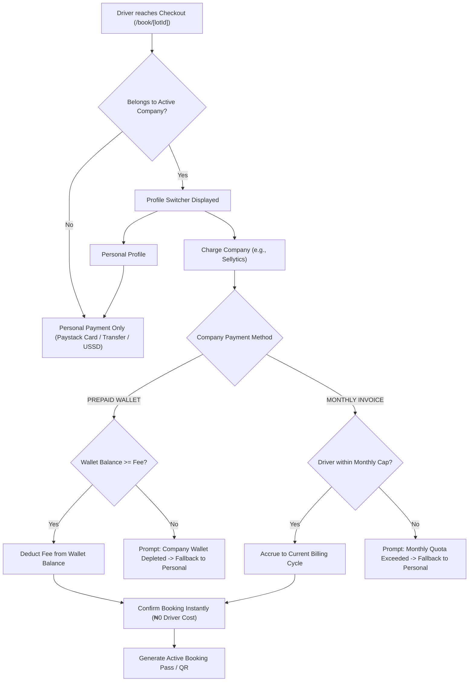

# Sprint Plan: Hybrid Corporate Payment & Invoicing Architecture

**Document Reference:** `corporateParking/comapnypaymentsprints.md`  
**Target Release:** Q4 2026  
**Implementation Date:** Tomorrow  
**Scope:** `@parkly/db`, `@parkly/api`, `@parkly/web` (Driver Checkout), `@parkly/portal` (Enterprise Finance)

---

## 1. Executive Summary

Parkly’s corporate mobility platform must support flexible enterprise payment models tailored to diverse Nigerian B2B operating habits. Companies can choose how they settle parking charges:

1. **Prepaid Corporate Fleet Wallet:**  
   The company funds an escrow balance (e.g., ₦100,000, ₦500,000) via Paystack or direct corporate bank transfer. Driver parking fees deduct from this balance in real time.
2. **Consolidated Monthly E-Invoicing (Postpaid / Credit Line):**  
   Drivers park freely throughout the month without up-front card deductions. On the 1st of each month, Parkly aggregates all company parking into a single consolidated tax invoice (with 7.5% VAT) for the company finance team to settle via bank transfer.

At checkout (`/book/[lotId]`), drivers belonging to a company can toggle between **Personal Account** (paying with their own card/transfer) and **Charge Company** (covered by the enterprise at ₦0 out-of-pocket).

---

## 2. Core Architecture & User Flows



---

## 3. Database Schema Specifications (`packages/db`)

### 3.1 Corporate Billing Configuration (`corporate_billing_settings`)

```sql
CREATE TYPE corporate_billing_model AS ENUM ('PREPAID_WALLET', 'MONTHLY_INVOICE');

CREATE TABLE corporate_billing_settings (
    id UUID PRIMARY KEY DEFAULT gen_random_uuid(),
    corporate_id UUID NOT NULL REFERENCES corporate_accounts(id) ON DELETE CASCADE,
    billing_model corporate_billing_model NOT NULL DEFAULT 'MONTHLY_INVOICE',
    wallet_balance_kobo BIGINT NOT NULL DEFAULT 0,
    credit_limit_kobo BIGINT NOT NULL DEFAULT 50000000, -- ₦500,000 default line
    currency VARCHAR(10) NOT NULL DEFAULT 'NGN',
    tax_id_tin VARCHAR(50),
    billing_contact_email VARCHAR(254) NOT NULL,
    low_balance_alert_kobo BIGINT DEFAULT 2000000, -- ₦20,000 threshold
    require_trip_purpose BOOLEAN NOT NULL DEFAULT false,
    require_plate_match BOOLEAN NOT NULL DEFAULT true,
    is_active BOOLEAN NOT NULL DEFAULT true,
    created_at TIMESTAMPTZ NOT NULL DEFAULT now(),
    updated_at TIMESTAMPTZ NOT NULL DEFAULT now(),
    CONSTRAINT corporate_billing_corp_unique UNIQUE (corporate_id)
);
```

### 3.2 Corporate Wallet Ledger (`corporate_wallet_transactions`)

```sql
CREATE TYPE wallet_tx_type AS ENUM ('TOP_UP', 'PARKING_DEDUCTION', 'PARKING_REFUND', 'ADJUSTMENT');

CREATE TABLE corporate_wallet_transactions (
    id UUID PRIMARY KEY DEFAULT gen_random_uuid(),
    corporate_id UUID NOT NULL REFERENCES corporate_accounts(id) ON DELETE CASCADE,
    booking_id UUID REFERENCES bookings(id) ON DELETE SET NULL,
    type wallet_tx_type NOT NULL,
    amount_kobo BIGINT NOT NULL,
    balance_before_kobo BIGINT NOT NULL,
    balance_after_kobo BIGINT NOT NULL,
    reference VARCHAR(100) NOT NULL UNIQUE,
    description TEXT NOT NULL,
    created_at TIMESTAMPTZ NOT NULL DEFAULT now()
);
```

### 3.3 Driver Spend Controls (`corporate_members` / `corporate_fleet_drivers`)

Add spend guardrails to existing corporate member and fleet driver records:

- `can_charge_company`: `BOOLEAN DEFAULT true`
- `monthly_spend_limit_kobo`: `BIGINT NULL` (null = unlimited company quota)
- `current_month_spent_kobo`: `BIGINT DEFAULT 0`

### 3.4 Booking Schema Extensions (`bookings`)

- `payment_profile`: `'PERSONAL' | 'CORPORATE'` (default `'PERSONAL'`)
- `corporate_id`: `UUID REFERENCES corporate_accounts(id)`
- `corporate_billing_type`: `'PREPAID_WALLET' | 'MONTHLY_INVOICE' | NULL`

---

## 4. API Endpoints & Business Logic (`apps/api`)

### 4.1 Admin Settings & Preferences

- `GET /v1/corp/{slug}/billing`: Returns active billing model, wallet balance, credit limit, and current month accruals.
- `PATCH /v1/corp/{slug}/billing`: Company admin toggles between `PREPAID_WALLET` and `MONTHLY_INVOICE`.
- `POST /v1/corp/{slug}/wallet/topup`: Generates a Paystack checkout authorization or virtual bank account details for funding.
- `POST /hooks/paystack/corporate-wallet`: Webhook handler crediting the company wallet upon verified bank transfer or card charge.

### 4.2 Corporate Driver Booking Checkout

- `POST /v1/bookings`:
  Accepts optional `paymentProfile: 'CORPORATE'`.
  When `'CORPORATE'` is supplied:
  1. Validates caller is an active member or field driver of the tenant.
  2. Enforces vehicle plate verification if `require_plate_match` is enabled.
  3. Checks driver’s `monthly_spend_limit_kobo` against `current_month_spent_kobo`.
  4. If `PREPAID_WALLET`: atomically verifies and deducts `quote.totalKobo` from `wallet_balance_kobo`.
  5. If `MONTHLY_INVOICE`: logs session accrual and increments driver's monthly usage.
  6. Creates booking with `status: 'CONFIRMED'`, `paymentStatus: 'PAID'`, with `authorizationUrl: null`.
  7. Returns 201 Created with instant confirmed pass details (no Paystack redirect needed).

---

## 5. Driver Frontend Experience (`apps/web`)

### 5.1 Payment Profile Selector at Checkout (`/book/[lotId]`)

When a driver is authenticated and has verified corporate affiliations:

- A profile selector card renders above the vehicle picker:
  - **Option A:** `Personal (You Pay: ₦X,XXX via Card/Transfer)`
  - **Option B:** `Charge Company: Sellytics (₦0.00 due now)`
- When **Option B** is toggled:
  - Order Summary updates:
    - Standard Fee: `₦X,XXX`
    - Corporate Subsidy: `-₦X,XXX`
    - **Amount Due Now: ₦0.00**
  - CTA changes from `"Pay ₦X,XXX with Paystack"` to **`"Confirm Corporate Booking"`**.
  - Clicking CTA holds space, validates company policy, and routes directly to `/bookings/paid?id=...` with no external bank redirects.

---

## 6. Corporate Admin Portal (`apps/portal`)

### 6.1 Billing & Finance Management (`/corp/[slug]/settings/billing`)

1. **Model Switcher Card:**
   - Radio group: **Consolidated Monthly Invoicing** vs **Prepaid Corporate Wallet**.
   - Instant toggle with clear explanation of billing cycles.
2. **If Prepaid Wallet Active:**
   - Prominent **Wallet Balance Widget** (e.g. `₦345,000 Balance`).
   - "Top Up Balance" button opening Paystack modal / displaying dedicated NUBAN transfer account.
   - Auto-refill and threshold alert triggers.
3. **If Monthly Invoicing Active:**
   - Display of Current Month Unbilled Usage (e.g. `₦84,200 accrued across 18 drivers`).
   - Credit limit utilization bar.
   - Direct download link for past monthly PDF invoices.

### 6.2 Driver Roster Permissions (`/corp/[slug]/settings/drivers`)

- Column in the Field Driver Roster: **"Company Charging"** (Toggle: Enabled / Suspended).
- Modal to set optional **Monthly Spend Cap** (e.g., ₦20,000/month) per driver.

---

## 7. Tomorrow's Implementation Sprints & Checklist

### Sprint Step 1: Database & Contracts (Morning)

- [ ] Add `corporate_billing_settings` and `corporate_wallet_transactions` to `packages/db/src/schema/corporate.ts`.
- [ ] Add `paymentProfile` to `CreateBookingRequestSchema` in `packages/contracts/src/lots.ts`.
- [ ] Run `pnpm db:generate` and apply migration scripts.

### Sprint Step 2: API Business Logic (Mid-Day)

- [ ] Implement `billingSettings` query & mutations in `apps/api/src/store/drizzle.ts`.
- [ ] Extend `POST /v1/bookings` in `apps/api/src/modules/bookings/routes.ts` to handle zero-cost corporate validation, wallet balance deduction, and monthly accrual.
- [ ] Add unit & integration tests covering wallet balance depletion and spend cap limits.

### Sprint Step 3: Web Checkout Profile Switcher (Afternoon)

- [ ] Build `<PaymentProfileSelector />` component in `apps/web/components/booking-forms.tsx`.
- [ ] Update `startBooking` action in `apps/web/lib/booking-actions.ts` to bypass Paystack authorization when `paymentProfile === 'CORPORATE'`.
- [ ] Verify instant confirmation screen on `https://parkly-web-two.vercel.app/book/[lotId]`.

### Sprint Step 4: Portal Finance & Billing Settings (Evening)

- [ ] Create `/corp/[slug]/settings/billing` page with Prepaid Wallet / Monthly Invoice switcher.
- [ ] Add wallet top-up button and transaction ledger table.
- [ ] Run full CI checks (`pnpm typecheck`, `pnpm test`, `pnpm format`) and deploy to production.
