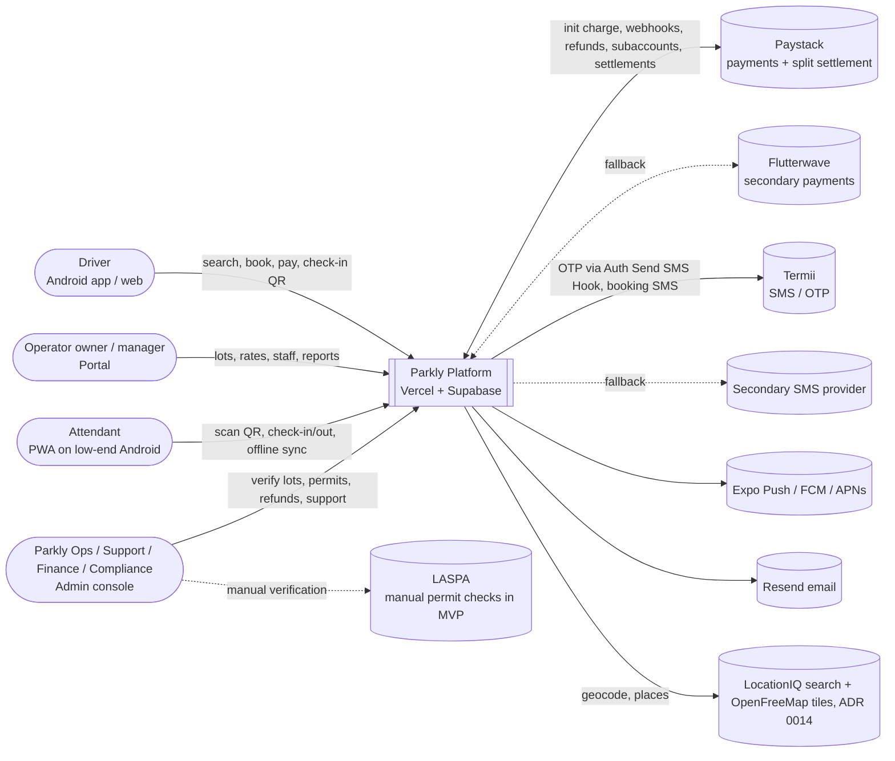
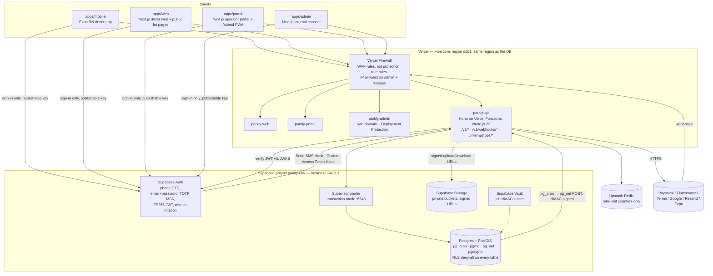
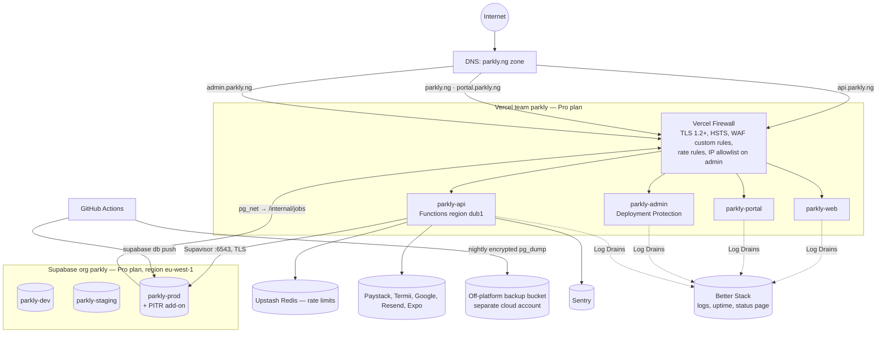

# 01 — System Architecture and System Designs

> **Status:** v1.1 — 14 Oct 2026. Platform switched to Supabase + Vercel per [ADR 0002](decisions/0002-supabase-and-vercel-for-mvp.md). Consistent with [00 — Read Me First](00%20-%20Read%20Me%20First%20-%20Index.md); doc 00 wins on any conflict.
> **Companion docs:** data model and API in [02](02%20-%20Technical%20Design%20Document%20and%20TDD%20Strategy.md); security controls in [05](05%20-%20Security%20and%20Compliance.md); data classes in [06](06%20-%20Data%20Storage%20Classification%20and%20Retention.md).

---

## 1. Architecture principles

1. **Modular monolith first.** One Hono API (`apps/api`) deployed as Vercel Functions, with strict module boundaries. Background work runs either as SQL functions inside Postgres (`pg_cron`) or as the same codebase's `/internal/jobs/:job` routes, triggered from Supabase (`pg_cron` → `pg_net`). Split into services only when a module has a different scaling or security profile **and** an ADR says so.
2. **Domain logic is pure.** Pricing, state machines, availability maths, plate normalisation and QR token format live in `packages/domain` with no I/O. Modules call it.
3. **Every external dependency is behind an interface** (`PaymentProvider`, `SmsProvider`, `PushProvider`, `EmailProvider`, `MapsProvider`, `StorageProvider`, `Clock`) with a fake for tests and local dev.
4. **Money never rests with us.** Driver → Paystack → split to operator subaccount + Parkly main account. Our ledger records; it doesn't hold.
5. **Design for bad networks and power cuts.** Attendant flows work offline; driver flows degrade to SMS codes; all writes are idempotent and retry-safe.
6. **Postgres is the source of truth**, including queues (`pgmq`), schedules (`pg_cron`) and the outbox. Upstash Redis holds rate-limit counters only; losing it must never lose a booking.
7. **Clients use Supabase for Auth only.** All data reads and writes go through `apps/api`. RLS is enabled deny-all on every table as a second line of defence; the Supabase secret key is server-side only.
8. **Secure by default.** Authorisation in the API layer on every request; encrypted everywhere (doc 05).

---

## 2. System context (C4 level 1)



---

## 3. Containers (C4 level 2)



| Container | Responsibility | Scales by |
|---|---|---|
| `parkly-api` (Vercel Functions) | REST `/v1`, authorisation, all synchronous use cases, webhook intake (verify + persist + enqueue), Supabase Auth hooks, `/internal/jobs/:job` handlers | Vercel auto-scales instances; DB connections bounded by Supavisor |
| Supabase Postgres | System of record; SQL functions (`fn_hold_booking`, `fn_expire_pending_bookings`); `pg_cron` schedules; `pgmq` queues; outbox | Supabase compute size; read replica later |
| Supabase Auth | Identities, OTP, passwords, MFA, JWT issue + refresh rotation | Managed |
| Supabase Storage | Permit docs, verification photos, KYB docs, lot photos, incident evidence | Managed |
| `parkly-web`, `parkly-portal`, `parkly-admin` | Next.js SSR/static on Vercel. Portal `/attend` served with a service worker. | Vercel CDN + functions |
| `mobile` | Expo app; OTA updates via EAS Update (JS only, signed) | — |

---

## 4. API module boundaries (`apps/api/src/modules/*`)

Each module owns its tables (doc 02 §2 marks the owner). **Rule:** a module may read another module's data only through that module's exported service — never by querying its tables directly. Cross-module side effects go through **domain events** (an in-process typed event bus for same-transaction needs; the transactional outbox + `pgmq` for async). Each module exports a Hono sub-router mounted under `/v1`.

| Module | Owns tables | Public service API (examples) | Emits events |
|---|---|---|---|
| `auth` | `login_attempts` (identities, OTP challenges, refresh tokens and MFA factors live in Supabase's `auth` schema and are never written directly) | Auth hooks: `sendSmsHook` (→ `SmsProvider`), `customAccessTokenHook` (adds `app_roles`, `operator_id`, `lot_ids`); `authJwt` middleware; `requireAal2` | `user.logged_in` |
| `users` | `users` (1:1 with `auth.users.id`), `user_roles`, `vehicles`, `devices`, `consents` | `getMe`, `addVehicle`, `registerDevice`, `recordConsent`, `requestDeletion` | `user.created`, `user.deletion_requested` |
| `operators` | `operators`, `operator_members`, `operator_kyb_documents`, `payout_accounts` | `createOperator`, `inviteMember`, `assertMembership(userId, operatorId, roles, lotId?)` | `operator.member_added` |
| `lots` | `lots`, `lot_photos`, `lot_opening_hours`, `lot_signing_keys` | `searchLots`, `getLot`, `setStatus`, `getPublicKey` | `lot.status_changed` |
| `verification` (permits + checklist) | `permits`, `verification_records`, `verification_items` | `submitPermit`, `reviewPermit`, `submitChecklist`, `isListable(lotId)` | `permit.approved`, `permit.expired`, `verification.approved` |
| `pricing` | `rate_plans` | `quote(lotId, window, product)` (delegates maths to `packages/domain/pricing`) | `rate_plan.approved` |
| `availability` | `lot_slot_inventory` (+ SQL functions `fn_hold_booking`, `fn_expire_pending_bookings`) | `hold`, `release`, `convertHold`, `extend`, `getAvailability` | — |
| `bookings` | `bookings`, `booking_status_history` | `createBooking`, `cancel`, `extend`, `markNoShow` | `booking.confirmed`, `booking.cancelled`, `booking.expired`, `booking.extended`, `booking.no_show` |
| `passes` | `passes` | `purchasePass`, `getActivePass(vehicle, lot, date)` | `pass.activated`, `pass.expiring` |
| `sessions` (check-in) | `sessions`, `checkin_events`, `attendant_sync_batches` | `checkIn`, `checkOut`, `syncOfflineBatch`, `getManifest(lotId)` | `session.checked_in`, `session.checked_out`, `session.overstay_detected` |
| `payments` | `payments`, `refunds`, `webhook_events`, `payment_provider_customers` | `initiate`, `handleWebhook`, `verify`, `refund` | `payment.succeeded`, `payment.failed`, `refund.succeeded` |
| `ledger` (settlement) | `ledger_accounts`, `ledger_entries`, `settlements`, `reconciliation_runs`, `reconciliation_items` | `postPaymentCaptured`, `postRefund`, `reconcileDay(date)` | `reconciliation.mismatch` |
| `notifications` | `notifications`, `notification_preferences` | `send(templateKey, userId, data, channels)` | — |
| `incidents` | `incidents`, `incident_notes` | `report`, `triage`, `resolve` | `incident.opened`, `incident.critical` |
| `claims` (flag `claims_enabled`) | `claims`, `claim_documents` | `submit`, `review`, `markPaid` | `claim.submitted` |
| `ratings` (flag `ratings_enabled`) | `ratings` | `rate`, `lotSummary` | `rating.low_score` |
| `admin` | — (orchestrates others) | support search, overrides, lot suspension, refunds | — |
| `audit` | `audit_logs` | `record(actor, action, entity, before, after, ip)` | — |
| `feature-flags` | `feature_flags`, `platform_settings` | `isEnabled(key, ctx)`, `getSetting(key)` | — |
| `jobs` | `job_runs` (+ `pgmq` queues) | `/internal/jobs/:job` router, `jobAuth`, per-job advisory lock | — |

Shared infra (`apps/api/src/common`), implemented as Hono middleware and helpers:
- `db`: Drizzle client from `packages/db` over Supavisor transaction mode (`prepare: false`), with a `withTx()` helper.
- `idempotency`: Postgres `idempotency_keys`.
- `authJwt`: verifies the Supabase ES256 JWT against the project JWKS (cached), then loads the actor.
- `requireRoles`, `operatorScope`, `requireAal2`.
- `problemDetails` error handler, `requestContext` (request id, actor, IP).
- `outbox.publish`, `rateLimit` (`@upstash/ratelimit`), `jobAuth` (HMAC for `/internal/jobs/*`).
- `@vercel/otel` instrumentation.

### 4.1 Transactional outbox

Any state change that must trigger async work (SMS, push, ledger posting after webhook) writes an `outbox_events` row **in the same DB transaction**. An `AFTER INSERT` trigger on `outbox_events` calls `pgmq.send` into the target queue and marks the row dispatched; a `pg_cron` backstop (`outbox-relay`, every 10 s) re-sends any row left undispatched. Queue consumers are `/internal/jobs/drain-<queue>` handlers, triggered by `pg_cron` every 10 s. Each one reads up to N messages with `pgmq.read` (visibility timeout), processes them, and `pgmq.delete`s on success. This guarantees "booking confirmed ⇒ SMS eventually sent" with no dual-write gap.

---

## 5. Key sequences

### 5.1 Driver OTP login (Supabase Auth + Send SMS Hook → Termii)

```mermaid
sequenceDiagram
  autonumber
  participant M as Mobile app (supabase-js, publishable key)
  participant A as API /v1
  participant RL as Upstash rate limiter
  participant SA as Supabase Auth
  participant H as API /hooks/supabase/send-sms
  participant S as SmsProvider (Termii→fallback)
  participant DB as Postgres
  M->>A: POST /v1/auth/otp/precheck {phone, deviceId}
  A->>RL: rate-limit (phone: 3/15min, IP: 10/15min, device: 5/15min)
  A-->>M: 204 (or 429 AUTH_RATE_LIMITED)
  M->>SA: signInWithOtp({phone})
  SA->>SA: generate 6-digit OTP (5-min expiry; Auth's own OTP rate limits on)
  SA->>H: Send SMS Hook (Standard Webhooks signature)
  H->>H: verify hook signature
  H->>RL: enforce per-phone send limit (authoritative; precheck is UX only)
  H->>S: send OTP (DND route)
  alt Termii fails / timeout 5s
    H->>S: retry on secondary provider
  end
  H-->>SA: 200
  M->>SA: verifyOtp({phone, token, type: sms})
  SA->>A: Custom Access Token Hook (adds app_roles, operator_id, lot_ids)
  SA-->>M: session {access_token (ES256 JWT, 15 min), refresh_token}
  M->>A: POST /v1/auth/bootstrap {deviceId, platform} (Authorization: Bearer)
  A->>DB: ensure users row (id = auth.users.id, role DRIVER), record device
  A-->>M: {user, roles, memberships, isNewUser}
  M->>A: POST /v1/me/devices {deviceId, pushToken}
```

Supabase Auth rotates refresh tokens on every use; reuse of a rotated token revokes the session (theft detection). Operators/admins sign in with email + password + TOTP through Supabase Auth MFA. The API rejects admin routes and operator-owner actions unless the JWT's `aal` claim is `aal2`. Supabase Auth limits wrong-code attempts (per-IP verify limit in `config.toml`; a new code invalidates the old one; codes expire after 5 min). The precheck endpoint only gives a friendly early 429; the **Send SMS Hook is the authoritative per-phone limit** because a client can skip precheck. OTP send counts feed fraud metrics; there is no separate `login_attempts` table.

### 5.2 Search → book → pay (Paystack) with idempotency

```mermaid
sequenceDiagram
  autonumber
  participant M as Mobile
  participant A as API
  participant DB as Postgres
  participant P as Paystack
  participant J as API job (drain-webhooks)
  M->>A: GET /v1/lots/search?lat&lng&radiusM&start&end
  A->>DB: PostGIS ST_DWithin on LIVE lots + availability for window
  A-->>M: lots[] with quote + availableCount
  M->>A: POST /v1/bookings {lotId, vehicleId, startAt, endAt, product} + Idempotency-Key
  A->>A: idempotency middleware (same key+body ⇒ replay stored response)
  A->>DB: BEGIN; SELECT fn_hold_booking(...) (ordered FOR UPDATE on lot_slot_inventory; capacity check; held+=1; insert booking PENDING_PAYMENT, expires +10m); insert payment INITIATED; outbox(booking.hold_created); COMMIT
  A->>P: POST /transaction/initialize {amount, email-or-placeholder, reference=payment.id, subaccount, transaction_charge, metadata}
  P-->>A: authorization_url, access_code
  A-->>M: 201 {booking, payment: {reference, authorizationUrl}}
  M->>P: Paystack checkout (card / transfer / USSD)
  P-->>A: POST /v1/webhooks/paystack (charge.success) [HMAC-SHA512 signed]
  A->>A: verify x-paystack-signature on raw body
  A->>DB: BEGIN; insert webhook_events (unique provider_event_id, duplicates ignored); pgmq.send('webhooks', eventId); COMMIT
  A-->>P: 200 (fast, <1s)
  Note over J: pg_cron → pg_net POST /internal/jobs/drain-webhooks every 10 s (HMAC)
  J->>P: GET /transaction/verify/:reference (never trust webhook body alone)
  J->>DB: BEGIN; payment SUCCEEDED; booking CONFIRMED; held-=1, booked+=1; ledger entries; outbox(booking.confirmed); COMMIT; pgmq.delete
  J->>M: push + SMS "Booking PK-7HQ4MZ confirmed" (via notifications queue)
  M->>A: GET /v1/bookings/:id (poll every 3s up to 60s while app waits; or push)
```

Edge cases:
- **Callback returns before webhook:** the app calls `POST /v1/payments/:reference/verify`; the API calls Paystack verify and runs the same idempotent `confirmPayment` routine as the `drain-webhooks` job. Whichever arrives first wins; the second is a no-op (guarded by a `payment.status` check inside a row lock).
- **Payment after hold expired:** if the booking is already `EXPIRED` and capacity is gone, the payment is auto-refunded (`refund.reason = HOLD_EXPIRED`) and the driver is notified. If capacity still exists, re-acquire it and confirm.
- **Amount mismatch** between verify response and payment row ⇒ do not confirm; flag `payment.amount_mismatch` incident for finance.

### 5.3 Attendant offline check-in, sync and conflict resolution

```mermaid
sequenceDiagram
  autonumber
  participant PWA as Attendant PWA (/attend)
  participant IDB as IndexedDB
  participant A as API (sessions)
  participant DB as Postgres
  Note over PWA,A: Online at shift start (and every 5 min when online)
  PWA->>A: GET /v1/attend/lots/:lotId/manifest?since=cursor
  A-->>PWA: {lotPublicKeys[], bookings[today±1d: code, plateNorm, window, status], passes[], revocations[], serverTime, cursor}
  PWA->>IDB: store manifest + keys
  Note over PWA: Network lost
  PWA->>PWA: scan driver QR → verify Ed25519 signature with cached lot key, check exp, lotId, window ± grace
  PWA->>IDB: lookup booking in manifest; check not revoked, not already checked in locally
  PWA->>IDB: append checkin_event {clientEventId(UUIDv7), type CHECK_IN, bookingId, plateSeen, deviceTime, attendantId}
  PWA-->>PWA: green "Allow entry" (or amber "Not in manifest — verify plate/code")
  Note over PWA: Network back
  PWA->>A: POST /v1/attend/sync {deviceId, batchId, events[]} + Idempotency-Key=batchId
  A->>DB: per event: insert checkin_events ON CONFLICT(client_event_id) DO NOTHING; apply to session via rules
  A-->>PWA: {results[{clientEventId, status: APPLIED|DUPLICATE|CONFLICT|REJECTED, reason}], manifestDelta}
```

**Conflict rules.** The server is authoritative. Events are applied in `deviceTime` order per booking, with a server-side clock-skew correction per batch (offset = `serverReceivedAt − deviceSentAt`).

| Situation | Resolution |
|---|---|
| Same booking checked in on two devices | First `deviceTime` wins; the other becomes `DUPLICATE`, kept in `checkin_events` for audit. |
| Check-in for a booking cancelled/refunded while device was offline | `CONFLICT`. Session still created (car is physically inside) with `flag=ENTRY_AFTER_CANCEL`; ops notified; driver charged nothing extra automatically. |
| Check-out without a check-in | Create session with `check_in_at = null`, `flag=MISSING_CHECKIN`; overstay calculated from booking start. |
| Event older than 48 h or signed by revoked device | `REJECTED`; visible in portal "Sync issues". |
| QR not in manifest but signature valid (booked after last sync) | Allowed offline (signature proves it was issued by us); server reconciles on sync. |
| Manual plate entry, no QR | Allowed only if plate matches manifest booking/pass; otherwise attendant may record a **walk-in** (not paid through Parkly in MVP; counted for occupancy only). |

### 5.4 Extend booking

```mermaid
sequenceDiagram
  autonumber
  participant M as Mobile
  participant A as API
  participant DB as Postgres
  participant P as Paystack
  M->>A: POST /v1/bookings/:id/extensions {newEndAt} + Idempotency-Key
  A->>DB: BEGIN; lock booking; status in (CONFIRMED, CHECKED_IN); newEndAt > endAt, on 15-min grid, within opening hours
  A->>DB: fn_hold_booking for extra slots [endAt,newEndAt) (ordered FOR UPDATE; capacity check; held+=1); insert booking_extensions PENDING; payment INITIATED (kind=EXTENSION); COMMIT
  A->>P: initialize (or charge_authorization if reusable card auth exists)
  A-->>M: {extension, authorizationUrl?}
  P-->>A: webhook charge.success → drain-webhooks job verifies
  A->>DB: extension CONFIRMED; booking.end_at=newEndAt; held→booked; ledger; outbox(booking.extended)
  Note over A: Extension holds expire in 10 min like bookings. Manifest delta pushes new end time to the lot.
```

### 5.5 Overstay at exit

```mermaid
sequenceDiagram
  autonumber
  participant PWA as Attendant PWA
  participant A as API
  participant D as Driver (SMS/push)
  participant P as Paystack
  PWA->>PWA: scan at exit; compare now vs booking.endAt + overstayGraceMin (10)
  alt within window
    PWA->>A: CHECK_OUT event (online or queued)
  else overstay
    PWA-->>PWA: show "Overstay 45 min — ₦X due" (computed offline via domain pricing + cached rate plan)
    PWA->>A: POST /v1/attend/sessions/:id/overstay (or queued event OVERSTAY_FLAGGED)
    A->>A: compute authoritative overstay charge
    A->>P: initialize payment (kind=OVERSTAY); create pay link
    A->>D: SMS + push with pay link
    D->>P: pays
    P-->>A: webhook → session.overstay_status=PAID
    A-->>PWA: manifest/session update → "Paid, release"
    Note over PWA: If unpaid after 10 min or offline: attendant may release car; session.overstay_status=UNPAID; ops queue + dunning SMS (day 0, 1, 3). No wallet debits.
  end
```

### 5.6 Refund

```mermaid
sequenceDiagram
  autonumber
  participant U as Driver / Admin Finance
  participant A as API
  participant DB as Postgres
  participant P as Paystack
  U->>A: POST /v1/bookings/:id/cancel (driver) or POST /v1/admin/payments/:id/refunds (finance)
  A->>DB: BEGIN; lock booking+payment; compute refundable amount (domain policy); insert refunds PENDING; booking CANCELLED; release slots; COMMIT
  A->>P: POST /refund {transaction: reference, amount}
  P-->>A: webhook refund.processed / refund.failed
  A->>DB: refund SUCCEEDED; payment REFUNDED|PARTIALLY_REFUNDED; ledger reversal (incl. split reversal from operator subaccount per Paystack rules)
  A->>U: notification "Refund of ₦X initiated, 3–10 business days"
```

Admin refunds above `refund.approval_threshold_kobo` (default ₦50,000) need a second `ADMIN_FINANCE` approver (four-eyes), recorded in `audit_logs`.

### 5.7 Daily reconciliation (03:00 Africa/Lagos)

```mermaid
sequenceDiagram
  autonumber
  participant C as pg_cron → pg_net
  participant J as API job /internal/jobs/reconcile-daily
  participant P as Paystack
  participant DB as Postgres
  participant F as Finance (admin)
  C->>J: POST (HMAC-signed); repeated every 2 min until run COMPLETED
  J->>DB: get or create reconciliation_runs(date=D-1); resume from stored cursor
  J->>P: list transactions (next page, D-1) + settlements + refunds
  J->>DB: load payments, refunds, ledger entries for that page
  J->>J: match by reference: amount, status, fees, split, subaccount
  J->>DB: insert reconciliation_items: MATCHED / MISSING_INTERNAL / MISSING_PROVIDER / AMOUNT_MISMATCH / STATUS_MISMATCH; save cursor
  alt provider SUCCEEDED but internal pending
    J->>DB: run confirmPayment (self-heal), item=AUTO_FIXED
  end
  J->>DB: last page → run status COMPLETED | COMPLETED_WITH_EXCEPTIONS
  J->>F: email + admin dashboard alert when exceptions > 0
```

Each invocation processes a bounded number of provider pages and stores its cursor in `reconciliation_runs`, so the job always finishes inside the Vercel function time limit and resumes on the next tick.

### 5.8 Permit expiry auto-suspend (daily 06:00 Africa/Lagos)

```mermaid
sequenceDiagram
  autonumber
  participant J as API job /internal/jobs/permit-expiry-check (pg_cron → pg_net)
  participant DB as Postgres
  participant N as Notifications
  J->>DB: permits APPROVED with expires_at in 30/14/7/1 days
  J->>N: reminders to operator owners/managers (email+SMS) and ops
  J->>DB: permits with expires_at <= now(): status EXPIRED
  J->>DB: lots with no valid permit: status SUSPENDED (reason PERMIT_EXPIRED); audit_logs actor=system
  J->>DB: future CONFIRMED bookings at those lots → notify drivers; ops decides honour vs cancel+refund (default: honour bookings already confirmed within 72 h, cancel+refund the rest)
  J->>N: alert ops channel
```

---

## 6. Availability and overbooking strategy

**Decision: per-lot, per-15-minute-slot inventory rows locked with `SELECT … FOR UPDATE`, inside the Postgres function `fn_hold_booking(...)`.**

Table `lot_slot_inventory(lot_id, slot_start, capacity, booked, held, pass_reserved, blocked)`: one row per lot per 15-min slot (see doc 02 §2). Available = `capacity − booked − held − pass_reserved − blocked`.

Booking flow inside one transaction:
1. The API computes the slot list `[startAt, endAt)` on the 15-min grid in `packages/domain` (max 96 slots for 24 h; daily product = opening-hours slots of that day).
2. `INSERT … ON CONFLICT DO NOTHING` any missing rows (lazy materialisation, capacity copied from `lots.capacity_bookable`).
3. `SELECT … FROM lot_slot_inventory WHERE lot_id=$1 AND slot_start = ANY($2) ORDER BY slot_start FOR UPDATE`. **Always ordered** to prevent deadlocks.
4. If any slot has available < 1 → raise, the API rolls back and returns `409 BOOKING_SLOT_UNAVAILABLE`.
5. `UPDATE … SET held = held + 1`; insert booking. The API then inserts the payment and outbox rows and commits.
6. On payment success: `held−1, booked+1`. On expiry/cancel: decrement accordingly.

Steps 2–5 are the function `fn_hold_booking(p_lot_id uuid, p_slots timestamptz[], p_booking jsonb)`:
- It is `SECURITY DEFINER` with `search_path` pinned to `public, extensions`.
- `EXECUTE` is granted only to the API's DB role and revoked from `anon` and `authenticated`.
- The API calls it inside its own transaction, so the hold, payment row and outbox event commit atomically.
- Pricing never moves into SQL; it stays in `packages/domain`.
- The function is covered by integration tests against local Supabase, including a concurrency test (N parallel holds on the last bay ⇒ exactly one succeeds).

**Why not an exclusion constraint / range overlap?** `EXCLUDE USING gist` prevents overlap for *one* resource; our lots sell **N interchangeable bays** (capacity counts), which exclusion constraints can't express. Counting overlapping bookings at query time with `SERIALIZABLE` works but causes high retry rates at peak and expensive scans. Slot rows make contention local (only the touched slots of one lot), keep the check O(slots), and make availability reads cheap index lookups.

Rules:
- `capacity_bookable` ≤ physical capacity; operators set a **buffer** (default 10% of capacity kept for walk-ins/overrun). Changing capacity re-materialises future rows via a job; reductions below current `booked` are rejected with `LOT_CAPACITY_BELOW_COMMITTED`.
- Monthly passes reserve 1 unit in `pass_reserved` for every slot in the lot's opening hours across the pass period (rows materialised at purchase).
- Holds older than 10 min are released by the pure-SQL `pg_cron` job `expire-pending-bookings` (`fn_expire_pending_bookings()`, every minute) **and** lazily inside `fn_hold_booking` if a held booking is past `expires_at` (belt and braces).
- A nightly `inventory-integrity-check` recomputes counts from bookings/passes and alerts on drift.
- Rows older than 90 days are deleted (`booked` history is derivable from bookings).

---

## 7. Offline QR design

**Goal:** an attendant phone with no network can prove a QR was issued by Parkly for this lot and this time window.

- Each lot has an **Ed25519 key pair** in `lot_signing_keys`. Columns: `kid`, `public_key`, `private_key_ciphertext` and `status ACTIVE|RETIRING|REVOKED`. The ciphertext uses app-level AES-256-GCM envelope encryption (`packages/domain/crypto`, versioned key `ENC_KEY_Vn` from Vercel Sensitive env). Rotation: every 90 days; old key `RETIRING` for 30 days (still accepted).
- QR payload (compact, base45 → QR alphanumeric mode):
  ```
  PK1.<base64url(header)>.<base64url(claims)>.<base64url(sig)>
  header = {kid}
  claims = {b: bookingId|passId, t: "B"|"P", l: lotId, p: plateNorm, s: startEpoch, e: endEpoch, c: bookingCode, i: issuedAtEpoch, x: expiresAtEpoch}
  sig = Ed25519(private_lot_key, header + "." + claims)
  ```
- **Issuing:** the API issues the token on booking confirmation and on every change (extension, plate change). The driver app stores it, so **the driver's phone also works offline**.
- **Static QR is acceptable:** validity is bound to the window, plate and lot. Replays are caught by local "already checked in" state and by server dedupe.
- **Manual fallback:** the app shows the booking code `PK-XXXXXX` and plate beside the QR.
- **PWA verification** (in `packages/domain/qr`, shared):
  1. Parse the token and find `kid` in the cached keys.
  2. Verify the signature (`@noble/ed25519`).
  3. Check `l == current lot` and `now ∈ [s − earlyArrivalMin(30), e + overstayAllowance]`.
  4. Check the plate matches what the attendant sees (the attendant confirms).
  5. Check the revocation list.
- **Manifest sync:** `GET /v1/attend/lots/:lotId/manifest?since=<cursor>` returns the delta of bookings/passes for `[today−1, today+1]`, plus revocations and keys. It's polled every 5 min when online and on app foreground. The full manifest is cached in IndexedDB; target payload < 200 KB gzip for 300-bay lots.
- **SMS fallback:** a driver with a dead phone gives the booking code or plate; the attendant looks it up in the manifest.

---

## 8. Background jobs and queues (`pg_cron` + `pgmq`)

There are two kinds of jobs:
- **SQL jobs** run entirely in Postgres via `pg_cron`, with no network hop. Use them for fast data housekeeping.
- **App jobs** are `apps/api` routes `POST /internal/jobs/:job`, which `pg_cron` calls with `pg_net.http_post`:
  - **Headers:** `x-parkly-job-id` (unique per call, used for replay dedupe), `x-parkly-job-timestamp` (unix seconds) and `x-parkly-job-signature = hex(HMAC-SHA256(JOB_HMAC_SECRET, job + "." + timestamp + "." + rawBody))`. The secret is stored in Supabase Vault and in Vercel Sensitive env.
  - **Handler rules:** reject bad signatures and timestamps older than 5 min, and take a Postgres advisory lock per job name (single runner).
  - **Bounded chunks:** each run must finish well inside the Vercel function max duration (target < 60 s). Work that doesn't fit is left for the next tick.
  - **Logging:** each run is recorded in `job_runs`.

Queues (`pgmq`): `webhooks`, `notifications`, `reconciliation`, `exports`. Messages are read with a visibility timeout. A message whose `read_ct` exceeds the job's max attempts moves to `<queue>_dlq` and alerts Sentry.

| Job | Kind | Schedule (Africa/Lagos) | Retry / notes |
|---|---|---|---|
| `outbox-relay` | SQL | trigger on insert + backstop every 10 s | Moves `outbox_events` → `pgmq` queues |
| `drain-webhooks` | App | every 10 s | Max 8 reads, then DLQ alert; verifies with provider before acting |
| `drain-notifications` (`send-sms`, `send-push`, `send-email`) | App | every 10 s | Max 5 reads; SMS falls back to secondary provider after 2 failures |
| `expire-pending-bookings` | SQL (`fn_expire_pending_bookings`) | every 1 min | Releases holds, status EXPIRED, writes outbox event |
| `mark-no-shows` | App | every 5 min | CONFIRMED and start+30 min passed, no check-in → NO_SHOW (no refund by default) |
| `booking-reminders` | App | every 5 min | 30 min before start; 15 min before end (extend nudge) |
| `detect-overstays` | App | every 5 min | Checked-in past end+grace → flag, notify driver with extend/pay link |
| `verify-stale-payments` | App | every 5 min | PENDING > 3 min → provider verify |
| `pass-expiry-reminders` | App | daily 09:00 | 7 / 3 / 1 days before end |
| `reconcile-daily` | App (chunked, cursor in `reconciliation_runs`) | daily 03:00, then every 2 min until complete | See §5.7 |
| `settlement-sync` | App | daily 05:00 | Pull Paystack settlements into `settlements` |
| `permit-expiry-check` | App | daily 06:00 | See §5.8 |
| `inventory-materialise` | SQL | nightly 01:00 | Materialise next 14 days of slots for LIVE lots |
| `inventory-integrity-check` | SQL + alert via outbox | nightly 02:00 | Drift detection |
| `rotate-lot-keys` | App | daily | Rotate keys older than 90 days |
| `process-deletion-requests` | App | daily | Anonymise per retention rules (doc 06); deletes the `auth.users` identity via the Supabase Auth Admin API |
| `purge-expired` | SQL | nightly | Idempotency keys > 48 h, old slot rows, `pgmq` archives, data per doc 06 |
| `operator-daily-statement` | App | daily 07:00 | Email statement per operator (Resend) |
| `offsite-backup` | GitHub Actions (not `pg_cron`) | nightly 02:30 | See §14 |

`pg_cron` schedules are defined in SQL migrations (`supabase/migrations/*_cron.sql`) using UTC cron expressions (Lagos = UTC+1, so 03:00 Lagos = `0 2 * * *`). All jobs must be idempotent (safe to run twice). A `job-health` check reads `cron.job_run_details`, `net._http_response` and `job_runs` and pings a Better Stack heartbeat per job, so missed runs alert.

---

## 9. Caching

There is no application cache tier in MVP; Postgres with proper indexes handles pilot load. Caching is limited to:

| Data | Where | TTL | Invalidation |
|---|---|---|---|
| Lot public profile pages (`apps/web`) | Vercel CDN (ISR / `revalidate`) | 5 min | On-demand `revalidateTag('lot:<id>')` called by the API on `lot.status_changed`, rate plan approved, photo change |
| `GET /v1/lots/:id` API response | `Cache-Control: public, s-maxage=60` at the Vercel edge (no PII in response) | 60 s | — |
| Search results / availability | **Not cached** (availability-sensitive); geo query is index-backed | — | — |
| Platform settings, feature flags | In-memory per function instance | 60 s | Natural expiry (instances are short-lived) |
| Supabase JWKS | In-memory per instance (`jose` remote JWKS) | 10 min | Refetch on unknown `kid` |
| Geocoding / Places results | Postgres table `geocode_cache` | 24 h | — (respect Google ToS caching limits: place IDs only long-term) |
| Lot public keys for QR | PWA IndexedDB | until rotation | Manifest |

Rate limiting is separate from caching: Vercel Firewall rate rules at the edge, plus `@upstash/ratelimit` (sliding window) per user, phone and IP in the API. The limits are in doc 05.

---

## 10. Deployment topology (Vercel + Supabase)



- **Network:** Supabase **Network Restrictions** limit direct Postgres connections to CI and break-glass IPs. Vercel functions connect over TLS through the pooler, and the pooler password is rotated every 90 days. Supabase SSL enforcement is on.
- **Database roles:**
  - `parkly_api` is used by the API and owns no schema. Authorisation happens in the API; instead of `BYPASSRLS` each table has one explicit RLS policy for this role (doc 02 §1).
  - Migrations run only from CI via `supabase db push` (`postgres` role).
  - `parkly_analyst` (Grow phase) is for support analytics, through masked views only.
  - The Supabase secret (`service_role`) key is used only for Auth Admin and Storage URL signing in server code.
- **RLS:** enabled on every table in `public`, with no policies for `anon`/`authenticated` (deny-all). A CI check fails if any table lacks RLS. The Data API (PostgREST) and `pg_graphql` are not exposed on `public`.
- **Secrets:** Vercel environment variables marked Sensitive, scoped per environment (Preview → dev, staging, Production). They hold the Paystack secret, Termii key, Supabase secret key, DB URL, `ENC_KEY_Vn` and the job HMAC secret. Never committed; `.env.example` lists names only.
- **Admin console:** `admin.parkly.ng` is its own Vercel project, protected by a Firewall IP allowlist, Supabase Auth `aal2` and Vercel Deployment Protection on previews.
- **Internal job routes:** the Firewall blocks `/internal/jobs/*` unless the job headers are present, and the handler verifies the HMAC.
- **Webhooks:** `/v1/webhooks/paystack` is allowed only from Paystack's published IP list (Firewall rule), and the HMAC is verified.
- **Builds:** Vercel builds from the Git commit, and production is promoted from the exact staging-tested commit. CI applies Supabase migrations **before** promotion. Migrations must stay backward compatible with the previous deployment (expand → migrate → contract) so Instant Rollback stays safe.

---

## 11. Scalability targets (pilot → Grow)

| Dimension | Pilot target (months 2–5) | Design headroom (no re-architecture) |
|---|---|---|
| Lots live | 10–15 | 1,000 |
| Bays | ~2,000 | 150,000 |
| Registered drivers | 5,000 | 500,000 |
| Bookings / day | 500 | 50,000 |
| Peak API RPS | 20 | 500 (Vercel auto-scaling + larger Supabase compute + read replica) |
| Concurrent attendant devices | 40 | 3,000 |

Known future split points, each of which needs an ADR:
- A dedicated long-running worker runtime, if jobs regularly approach the function time limit.
- A notifications service.
- A search read model, if geo queries exceed 50 ms p95.
- Ledger/settlement as a separate service with its own DB, for finance isolation.

ADR 0002 lists the triggers for revisiting the platform itself.

---

## 12. Resilience

| Risk | Mechanism |
|---|---|
| Paystack outage | Circuit breaker (`opossum`: 50% failures over 20 calls → open 60 s; state kept per instance + a shared flag in `platform_settings` set by ops). When open, new payment initiation routes to **Flutterwave** if `payments.secondary_enabled`; otherwise show `PAYMENT_PROVIDER_UNAVAILABLE` with retry. Existing payments are never re-routed. |
| SMS provider outage | The Send SMS Hook falls back from Termii to the secondary provider after 2 failures or a 5 s timeout. OTP via WhatsApp is possible later (flag). |
| Webhook loss | Client verify endpoint + reconciliation self-heal + `verify-stale-payments` job (every 5 min, PENDING > 3 min → provider verify). |
| Low connectivity (driver) | The app caches the active booking and QR offline. Requests use exponential backoff, and every mutation carries an Idempotency-Key so retries are safe. Payloads are small (gzip, sparse fields). |
| Low connectivity / power (attendant) | The PWA is offline-first (Workbox) with an IndexedDB queue and background sync. The UI is battery-light (dark mode, no animations). 8 h offline guarantee. |
| DB outage / restart | Supabase-managed. The API retries idempotent reads once on connection errors, clients retry writes via Idempotency-Key, and the health endpoint reports degraded. The attendant PWA continues offline. |
| Upstash Redis loss | Only rate limits are affected. They fail **open** for general driver endpoints (Vercel Firewall rules still apply) and **closed** for OTP precheck. Queues live in Postgres and are unaffected. |
| Job trigger failure (`pg_net` / function error) | Jobs are idempotent and re-run on the next tick. A Better Stack heartbeat per job alerts on missed runs, and the `pgmq` visibility timeout returns unprocessed messages to the queue. |
| Bad deploy | Vercel **Instant Rollback** to the previous production deployment (safe because migrations are backward compatible). Mobile OTA updates are staged 10% → 100%. |
| Third-party timeouts | Every outbound HTTP call: timeout 5 s (payments 10 s), 2 retries with jitter for idempotent calls only. |

---

## 13. Observability and SLOs

- **Tracing:** `@vercel/otel` (OpenTelemetry) for HTTP and outbound fetch, plus manual spans around DB calls and jobs. The trace id is propagated into `pgmq` message headers and returned as `x-request-id`.
- **Logs:** pino JSON to stdout → Vercel **Log Drains → Better Stack**. Supabase Postgres/Auth logs are viewed in Supabase and exported for incidents. The redaction list lives in `common/logging/redact.ts` (phone → `+234******1234`, tokens, OTP, Authorization, card fields). Retention per doc 06.
- **Errors:** Sentry for the API (including job handlers), web apps and mobile (release + source maps).
- **Business metrics:** SQL views in Postgres, charted in the admin console dashboard. Better Stack monitors alert on a `/internal/metrics` endpoint. Metrics: bookings created/confirmed/expired, payment success rate by provider and method, check-in success/failure, offline sync conflicts, SMS delivery rate, and the North Star (completed paid sessions/week).

| SLO | Target | Alert |
|---|---|---|
| API availability (non-5xx) | 99.5% monthly (pilot), 99.9% (Grow) | burn rate 2%/h |
| API latency p95 (excluding provider calls) | < 300 ms; search < 500 ms | p95 > target for 10 min |
| Payment success rate (initiated → succeeded, excl. user abandon) | ≥ 95% | < 90% over 30 min |
| Webhook-to-confirmed latency p95 | < 30 s | > 2 min |
| Check-in success rate (valid QR accepted first scan) | ≥ 99% | < 97% per lot per hour |
| Offline sync applied within 5 min of reconnect | ≥ 99% | sync errors > 1% |
| OTP delivery within 30 s | ≥ 95% | < 90% |

On-call: Better Stack on-call rota for engineering in pilot; ops runbooks in `docs/runbooks/` (created in Sprint 9).

---

## 14. Disaster recovery

| Item | Target / mechanism |
|---|---|
| **RPO** | **≤ 15 min.** Supabase Pro daily backups + **Point-in-Time Recovery add-on** on `parkly-prod` (WAL-based; restore to any point in the retention window). |
| **RTO** | **4 h.** Restore in place via PITR. For a vendor-level failure, create a new Postgres (another Supabase region or managed Postgres) from the latest off-platform dump, re-point `DATABASE_URL` in Vercel and redeploy. |
| Off-platform copy | Nightly `pg_dump` (custom format) from GitHub Actions, encrypted with `age` before upload to a bucket in a **separate cloud account**. Retained 35 days. Covers vendor loss or account compromise. |
| Supabase Storage | Nightly encrypted sync of private buckets to the same off-platform bucket (versioned). |
| Auth data | The `auth` schema is included in PITR and in the `pg_dump`. |
| Upstash Redis | Not backed up (rate-limit counters only). |
| Restore drill | Quarterly, alternating PITR and off-platform restore; first drill before pilot launch (doc 17). |
| Runbooks | `docs/runbooks/dr-restore.md`, `payment-provider-outage.md`, `sms-outage.md`, `data-breach.md`, `vercel-rollback.md` (Sprint 9). |

---

## 15. Environment strategy

| Env | Purpose | Platform | Data | Payments | Deploy |
|---|---|---|---|---|---|
| `local` | Dev | `supabase start` (Postgres+PostGIS, Auth, Storage, Studio, Inbucket mail) + `pnpm dev` | `supabase/seed.sql` + `pnpm db:seed` (VI demo lots) | `FakePaymentProvider` + optional Paystack test keys | — |
| `dev` | Integration of PRs and `main` | Supabase `parkly-dev`; Vercel **Preview** deployments | Synthetic seed | Paystack test | Every PR gets a preview; merge to `main` → CI runs `supabase db push` to dev |
| `staging` | Release candidate, UAT, load tests | Supabase `parkly-staging`; Vercel `staging` branch environment | Synthetic, anonymised-by-construction | Paystack test | Merge to `staging`; CI pushes migrations first |
| `prod` | Live | Supabase `parkly-prod` (+ PITR); Vercel Production | Real | Paystack live | Manual approval (2 reviewers) to promote the staging-tested commit; migrations pushed first |

Config comes from environment variables, validated at cold start with a Zod schema (`apps/api/src/config.ts`); startup fails on invalid config. Mobile build profiles: `development`, `preview` (staging API + `parkly-staging` Auth), `production`.

---

## 16. ADRs (`docs/decisions/`)

Numbering follows [ADR 0001](decisions/0001-record-architecture-decisions.md).

| ADR | Title | Status |
|---|---|---|
| 0001 | Record architecture decisions | Accepted |
| 0002 | Supabase + Vercel as the MVP platform (Hono API, Drizzle, Supabase Auth/Storage, `pg_cron` + `pgmq`) | Accepted |
| 0003 | Monorepo with pnpm + Turborepo | Accepted |
| 0004 | Paystack split payments; no stored balances; Flutterwave fallback | Accepted, pending counsel (Q3) |
| 0005 | Attendant app as offline-first PWA instead of native | Accepted |
| 0006 | Slot-row inventory with `SELECT FOR UPDATE` in `fn_hold_booking` | Proposed (accept in S4) |
| 0007 | Offline QR: per-lot Ed25519 signed tokens + manifest sync | To write (§7) |
| 0008 | Transactional outbox + `pgmq` for async side effects | To write (§4.1) |
| 0009 | Capacity-count model (no numbered bays) for MVP | To write |
| 0010 | Idempotency-key storage and replay semantics | To write |
| 0011 | Feature flags in DB (no vendor) | To write |
| 0012 | Data residency: Supabase Ireland region, NDPA transfer basis | To write, pending counsel (Q6) |
