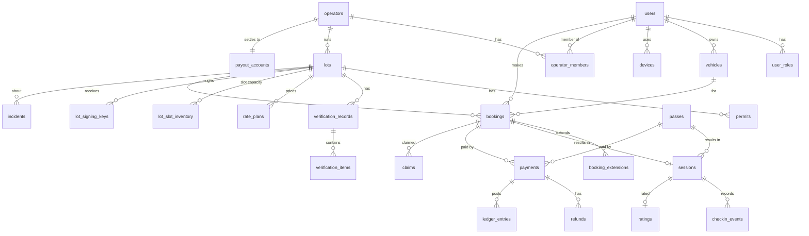
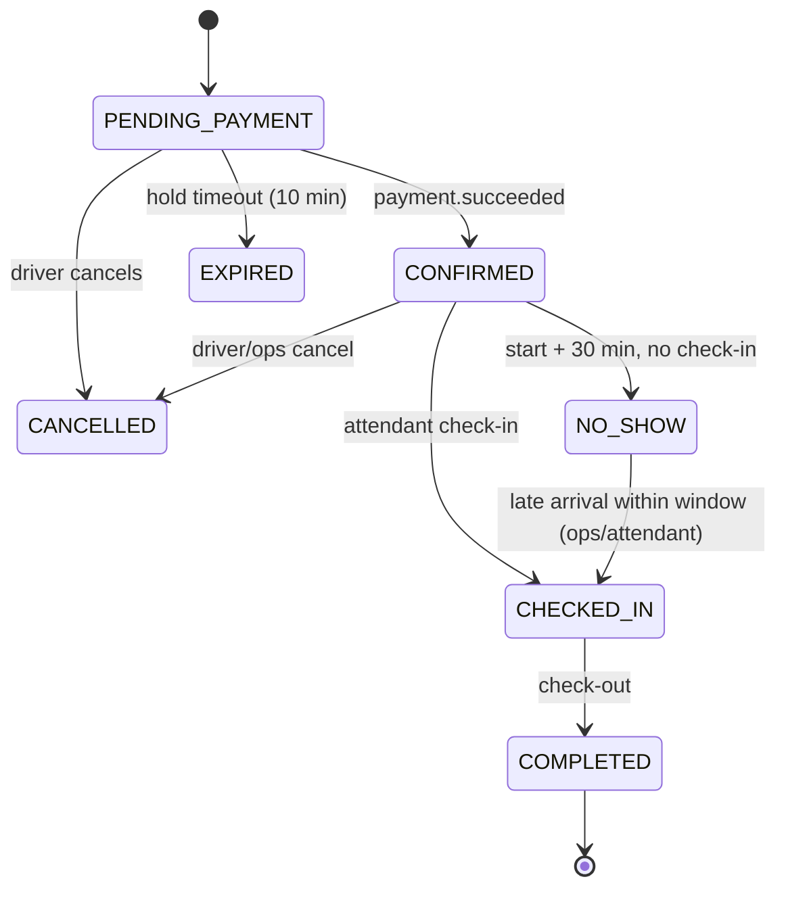

# 02 — Technical Design Document and TDD Strategy

> **Status:** v1.1 — 14 Oct 2026. Updated for [ADR 0002](decisions/0002-supabase-and-vercel-for-mvp.md) (Supabase + Vercel, Hono API, Drizzle). Consistent with [00](00%20-%20Read%20Me%20First%20-%20Index.md) (wins on conflict) and [01](01%20-%20System%20Architecture%20and%20System%20Designs.md).
> **Classification tags** (defined in [06](06%20-%20Data%20Storage%20Classification%20and%20Retention.md)): **C1** Public · **C2** Internal · **C3** Confidential (personal data) · **C4** Restricted (secrets, credentials, financial identifiers, ID documents, precise location trails). Every column holding personal data carries a tag below; untagged columns are C2.

---

## 1. Conventions

- Schema is defined with **Drizzle ORM** in `packages/db/src/schema/<module>.ts`: table objects in `camelCase` TS names, mapped to `snake_case` tables/columns (`pgTable('bookings', { startAt: timestamp('start_at', { withTimezone: true }) … })`). All tables live in the `public` schema; Supabase-managed schemas (`auth`, `storage`) are referenced, never altered by us except via documented hooks.
- Every table: `id UUID PK (UUIDv7, generated in app)`, `created_at TIMESTAMPTZ NOT NULL DEFAULT now()`, `updated_at TIMESTAMPTZ NOT NULL` (maintained by a shared `set_updated_at` trigger) unless marked *append-only*.
- Soft delete only where stated (`deleted_at`). Append-only tables never get UPDATE/DELETE grants for the API role (enforced by DB grants in migration).
- Money: `*_kobo BIGINT NOT NULL CHECK (>= 0)` + `currency CHAR(3) DEFAULT 'NGN'`.
- Enums: Postgres enums via Drizzle `pgEnum`.
- Optimistic concurrency: `version INT NOT NULL DEFAULT 0` on `bookings`, `lots`, `rate_plans`, `sessions`.
- **Migrations:** SQL files in `supabase/migrations/` (timestamp-prefixed). Table/column/index changes are generated with `drizzle-kit generate` from the Drizzle schema; RLS policies, grants, SQL functions (`fn_*`), triggers, auth hooks and `pg_cron` schedules are **hand-written SQL migrations** in the same folder. Applied with the Supabase CLI (`supabase db reset` locally, `supabase db push` in CI/CD). Every migration reviewed; destructive changes use expand → migrate → contract over two releases.
- **DB roles:** the API connects as a dedicated role `parkly_api` (NOLOGIN in migrations; LOGIN + password set per environment by runbook; not superuser, **no BYPASSRLS** — hosted Supabase may not allow granting it — so every table carries an explicit `<table>_api_all` RLS policy `TO parkly_api`, defined in the Drizzle schema via `apiAccess()`/`apiAppendOnly()`; explicit table grants) through **Supavisor transaction mode** (port 6543, `prepare: false`). Migrations run from CI only (`supabase db push`, direct connection, `postgres` role). A read-only `parkly_analyst` role (masked views only) arrives in the Grow phase. Nobody uses `postgres`/service role day-to-day (doc 05). `anon` and `authenticated` get **no** table grants beyond what RLS denies anyway.
- **Row Level Security:** `ALTER TABLE … ENABLE ROW LEVEL SECURITY` on **every** `public` table in the migration that creates it, with **no policies** for `anon`/`authenticated` (deny-all) and one policy for `parkly_api`. Supabase's default privileges for `anon`/`authenticated` on `public` are revoked in the first migration. Clients use Supabase only for Auth; all data flows through `apps/api`. A migration test enforces this (§12.10).
- Encryption at the application layer (`EncryptedString` helper in `packages/domain/crypto`, AES-256-GCM envelope encryption with versioned master keys `ENC_KEY_V<n>` held in Vercel Sensitive env vars; ciphertext carries the key version) for columns marked **[enc]**. Lookups on encrypted values use a keyed HMAC column `*_hash` (HMAC-SHA256 with a pepper `HASH_PEPPER_V<n>` from the same store).
- **Files:** columns named `*storage_path` hold `<bucket>/<object path>` in Supabase Storage (private buckets per ADR 0002). Never a public URL.

---

## 2. Data model

### 2.1 ER overview



### 2.2 Identity & access (module `auth`, `users`)

**Owned by Supabase Auth (schema `auth`, not ours to migrate):** credentials and identity — `auth.users` (phone, email, `phone_confirmed_at`, `email_confirmed_at`, password hash for staff), sessions and **refresh tokens** (rotation + reuse detection), **OTP** codes and their expiry/attempt limits, **MFA factors** (TOTP) and challenges, and `auth.audit_log_entries` (sign-ins, failures). We therefore have **no** `otp_challenges`, `refresh_tokens`, `mfa_factors`, `mfa_recovery_codes` or `login_attempts` tables. Supabase TOTP has no recovery codes: staff must enrol **two** TOTP factors (e.g. phone + backup device); lost-all-factors recovery is an admin-assisted, audited `mfa.reset` (SA only, identity re-verified out of band). Phone and email are C3 and stay in `auth.users`; the API reads them with the server-side admin client only when needed (masking rules, doc 05/06).

**`users`** — module `users` (profile; 1:1 with `auth.users`)
| Column | Type | Constraints | Class |
|---|---|---|---|
| id | uuid | PK, **FK → `auth.users(id)` ON DELETE RESTRICT** (same id) | C2 |
| phone_hash | bytea | HMAC of E.164 phone; UNIQUE where not null; for admin/attendant lookup without decrypting | C3 |
| phone_last4 | text | display/masking | C3 |
| email_hash | bytea | UNIQUE where not null | C3 |
| first_name | text | ≤ 50 | C3 |
| last_name | text | ≤ 50 | C3 |
| status | enum `UserStatus` (`ACTIVE`,`LOCKED`,`SUSPENDED`,`PENDING_DELETION`,`DELETED`) | default ACTIVE | C2 |
| locale | text | default `en-NG` | C2 |
| marketing_opt_in | boolean | default false | C3 |
| deleted_at | timestamptz | | C2 |
Indexes: `phone_hash` unique partial, `email_hash` unique partial, `status`.
Row creation: SQL trigger `on_auth_user_created` (AFTER INSERT on `auth.users`, SECURITY DEFINER) inserts the `users` row and the `DRIVER` role for phone sign-ups; `phone_hash`/`email_hash` are kept in sync by the API on `/v1/me` bootstrap and on phone/email change webhooks. Suspending a user also calls the Supabase admin API to ban the auth user (revokes refresh tokens). Deletion follows doc 06 (anonymise `users`, then delete the `auth.users` row).

**`user_roles`** — `(user_id FK, role enum Role, operator_id FK null, granted_by uuid, created_at)`; UNIQUE `(user_id, role, operator_id)`. Role enum = doc 00 §3.7. Operator roles are mirrored here from `operator_members`. **Source for JWT claims:** the Custom Access Token Hook `public.fn_custom_access_token_hook(event jsonb)` (SQL, `SECURITY DEFINER`, executable only by `supabase_auth_admin`) adds `app_roles text[]`, `operator_id`, `lot_ids uuid[]` and `aal`-relevant flags to every issued JWT. Claims are a **hint for the UI and fast pre-checks**; the API re-checks role/scope against the DB on every privileged or tenant-scoped request (role changes take effect immediately, not at token expiry).

**`vehicles`** — `id`, `user_id FK`, `plate_raw` (C3), `plate_norm` (C3) , `make` , `model`, `colour`, `is_default bool`, `deleted_at`. UNIQUE `(user_id, plate_norm) WHERE deleted_at IS NULL`. Index `plate_norm` (attendant lookups). Max 5 active vehicles per user (app rule).

**`devices`** — `id`, `user_id FK`, `platform enum (ANDROID, IOS, WEB, PWA)`, `push_token` [enc] (C3), `app_version`, `last_seen_at`, `revoked_at`, `auth_session_id` (Supabase session id, so revoking a device can sign that session out). For attendant PWAs also `operator_id`, `lot_id`, `device_key_public` (used to sign sync batches), `approved_by`, `approved_at` (manager approval, doc 05). The attendant local PIN never leaves the device.

**`consents`** *append-only* — `id`, `user_id`, `type enum (TERMS, PRIVACY, MARKETING, LOCATION, OPERATOR_AGREEMENT)`, `version text`, `granted bool`, `ip_hash` (C3), `created_at`.

### 2.3 Operators (module `operators`)

**`operators`**
| Column | Type | Notes | Class |
|---|---|---|---|
| id | uuid | PK | C2 |
| legal_name | text | | C2 |
| trading_name | text | shown to drivers | C1 |
| type | enum `OperatorType` (`HOTEL`,`OFFICE`,`COMMERCIAL_LOT`,`EVENT_CENTRE`,`OTHER`) | | C2 |
| cac_number [enc] | text | CAC RC/BN | C3 |
| tin [enc] | text | | C3 |
| contact_email | text | | C3 |
| contact_phone_e164 [enc] | text | | C3 |
| status | enum (`ONBOARDING`,`ACTIVE`,`SUSPENDED`,`OFFBOARDED`) | | C2 |
| commission_bps | int | default from settings (1200 = 12%); CHECK 1000–1500 unless SUPER_ADMIN override | C2 |
| tier | enum (`FREE`,`PRO`) | default FREE | C2 |
| kyb_status | enum (`NOT_STARTED`,`SUBMITTED`,`APPROVED`,`REJECTED`) | | C2 |

**`operator_members`** — `id`, `operator_id FK`, `user_id FK`, `role enum (OWNER, MANAGER, ATTENDANT)`, `lot_ids uuid[]` (attendant scope; empty = all), `status enum (INVITED, ACTIVE, REMOVED)`, `invited_by`, `invitee_name` (C3), `invitee_phone_hash` / `invitee_email_hash` (C3 blind indexes), `invite_token_hash` (C4), `invite_expires_at`, `accepted_at`, `removed_at`. `user_id` is null until the invite is accepted. UNIQUE `(operator_id, user_id)` among non-REMOVED rows. Active members also hold a `user_roles` row (the source for JWT claims); `user_roles.operator_id` references `operators`.

**`operator_kyb_documents`** — `id`, `operator_id`, `type enum (CAC_CERT, DIRECTOR_ID, UTILITY_BILL, OTHER)`, `file_id` → `files` (bucket `kyb-docs`, C4; mime, size, sha256 live on the file row), `status review_status`, `reviewed_by`, `reviewed_at`, `rejection_reason`.

**`payout_accounts`** — `id`, `operator_id` UNIQUE, `bank_code`, `bank_name`, `account_number_last4` (C4 masked), `account_name` (C4), `pending_account_number_enc` [enc] (C4; held **only** until the subaccount is created on KYB approval, then nulled — doc 06 §3.5), `name_mismatch bool` (resolved name ≠ legal name → ops checks), `provider enum (PAYSTACK, FLUTTERWAVE)`, `provider_subaccount_code` (C4), `verified_at` (via Paystack resolve-account), `activated_at`, `status enum (PENDING, VERIFIED, ACTIVE, DISABLED)`; CHECK ACTIVE ⇒ subaccount code set.

### 2.4 Lots & verification (modules `lots`, `verification`)

**`lots`**
| Column | Type | Notes | Class |
|---|---|---|---|
| id | uuid | | C1 |
| operator_id | uuid FK | | C2 |
| type | enum `OperatorType` | lot kind shown to drivers (doc 03 §2.2 step 1) | C1 |
| name | text | ≤ 80 | C1 |
| slug | text | UNIQUE | C1 |
| description | text | ≤ 1000 | C1 |
| address_line | text | | C1 |
| area | text | e.g. "Victoria Island" | C1 |
| lga | text | | C1 |
| location | `geography(Point,4326)` | Drizzle `customType`; geo queries via parameterised `sql\`\`` | C1 |
| entrance_notes | text | | C1 |
| capacity_total | int | physical, CHECK > 0 | C1 |
| capacity_bookable | int | CHECK 0 < x ≤ capacity_total | C2 |
| amenities | text[] | `GUARD`,`CCTV`,`LIGHTING`,`COVERED`,`EV`,`ACCESS_CONTROL`,`TOILET` | C1 |
| vehicle_types | text[] | `CAR`,`SUV`,`BUS` | C1 |
| status | enum `LotStatus` (doc 00 §3.6) | | C2 |
| status_reason | text | | C2 |
| verified_badge | boolean | derived; true when listable | C1 |
| timezone | text | `Africa/Lagos` | C1 |
| version | int | | C2 |
Indexes: GIST `location`; `(status)`; `(operator_id)`; `slug` unique.

**`lot_opening_hours`** — `id`, `lot_id`, `weekday smallint 0–6`, `opens_at time`, `closes_at time`, `is_24h bool`; plus `lot_closures(lot_id, starts_at, ends_at, reason)` for holidays/events.

**`lot_photos`** — `id`, `lot_id`, `file_id` → `files` (bucket `lot-photos`), `public_file_id` → `files` (copy in `lot-photos-public` after approval), `sort`, `caption`, `status (PENDING, APPROVED, REJECTED)`, `reviewed_by`, `reviewed_at`. Public after approval (C1). 3–10 per lot (PRD FR-LOT-002).

**`lot_signing_keys`** — `id`, `lot_id`, `kid text UNIQUE`, `public_key bytea` (C1), `private_key_ciphertext text` (C4, FieldCrypto envelope ciphertext with `ENC_KEY_V<n>`; ADR 0007), `status enum (ACTIVE, RETIRING, REVOKED)`, `activated_at`, `retire_after`. At most one ACTIVE per lot (partial unique index).

**`permits`**
| Column | Type | Notes | Class |
|---|---|---|---|
| id, lot_id | uuid | | C2 |
| issuer | text | default `LASPA` | C2 |
| permit_number | text | | C2 |
| issued_at, expires_at | date | CHECK expires > issued | C2 |
| document_file_id | uuid FK → `files` | bucket `permits` | C3 |
| status | enum `PermitStatus` (`SUBMITTED`,`IN_REVIEW`,`APPROVED`,`REJECTED`,`EXPIRED`) | | C2 |
| reviewed_by, reviewed_at, rejection_reason | | | C2 |
| review_note | text | how ops checked with LASPA + reference (doc 03 §4.2) | C2 |
| last_reminder_days | int | 30/14/7/1 dedupe | C2 |
Index `(lot_id, status)`, `(status, expires_at)`.

**`verification_records`** — `id`, `lot_id`, `inspector_user_id`, `inspected_at`, `status enum (SUBMITTED, IN_REVIEW, APPROVED, REJECTED)`, `capacity_counted int`, `gps_at_inspection geography(Point)` (C2), `notes`, `reviewed_by`, `reviewed_at`, `valid_until date` (= inspected_at + 12 months).
**`verification_items`** — `id`, `record_id`, `item enum (LASPA_PERMIT, GUARD_PRESENCE, LIGHTING, CCTV, ACCESS_CONTROL, CAPACITY_COUNT, OWNER_IDENTITY, ENTRANCE_SIGNAGE, FIRE_SAFETY)`, `result enum (PASS, FAIL, NA)`, `evidence_file_ids uuid[]` (→ `files`, bucket `verification`), `comment`. UNIQUE `(record_id, item)`. Required-to-pass: LASPA_PERMIT, GUARD_PRESENCE, LIGHTING, CAPACITY_COUNT, OWNER_IDENTITY.

### 2.5 Pricing & availability (modules `pricing`, `availability`)

**`rate_plans`**
| Column | Type | Notes |
|---|---|---|
| id, lot_id | uuid | |
| product | enum `Product` (`HOURLY`,`DAILY`,`MONTHLY`) | |
| status | enum (`DRAFT`,`PENDING_APPROVAL`,`ACTIVE`,`RETIRED`,`REJECTED`) | one ACTIVE and one PENDING_APPROVAL per (lot, product) — partial uniques; `rejection_reason` on REJECTED |
| hourly_rate_kobo | bigint | HOURLY: price per hour |
| min_minutes | int | HOURLY default 60 |
| block_minutes | int | default 15 |
| daily_cap_kobo | bigint | optional cap for HOURLY within a calendar day |
| daily_rate_kobo | bigint | DAILY |
| monthly_rate_kobo | bigint | MONTHLY |
| early_bird | jsonb | reserved for Grow, null in MVP |
| effective_from | timestamptz | |
| approved_by, approved_at | | |

**`lot_slot_inventory`** (see 01 §6)
| Column | Type | Constraints |
|---|---|---|
| lot_id | uuid | PK part |
| slot_start | timestamptz | PK part; CHECK minute % 15 = 0 |
| capacity | int | ≥ 0 |
| booked | int | ≥ 0 |
| held | int | ≥ 0 |
| pass_reserved | int | ≥ 0 |
| blocked | int | ≥ 0 (operator blocks for events) |
| | | CHECK `booked + held + pass_reserved + blocked <= capacity` |
PK `(lot_id, slot_start)`. No `id`/timestamps (high-volume).

### 2.6 Bookings, passes, sessions

**`bookings`** — module `bookings`
| Column | Type | Notes | Class |
|---|---|---|---|
| id | uuid | | C2 |
| code | text | `PK-XXXXXX`, UNIQUE | C2 |
| driver_id | uuid FK users | | C3 |
| vehicle_id | uuid FK | | C3 |
| plate_norm_snapshot | text | plate at booking time | C3 |
| lot_id | uuid FK | | C2 |
| product | enum `HOURLY`,`DAILY` | | C2 |
| start_at, end_at | timestamptz | 15-min grid; CHECK end > start | C3 (movement) |
| status | enum `BookingStatus` | doc 00 §3.6 | C2 |
| hold_expires_at | timestamptz | PENDING_PAYMENT only | C2 |
| price_kobo | bigint | parking amount | C2 |
| service_fee_kobo | bigint | | C2 |
| total_kobo | bigint | = price + fee | C2 |
| commission_bps | int | snapshot | C2 |
| rate_plan_id | uuid | snapshot ref | C2 |
| pricing_breakdown | jsonb | output of domain quote | C2 |
| cancelled_at, cancel_reason, cancelled_by | | | C2 |
| source | enum (`MOBILE`,`WEB`,`ADMIN`) | | C2 |
| version | int | | C2 |
Indexes: `(driver_id, start_at desc)`, `(lot_id, start_at)`, `(status, hold_expires_at)`, `(status, start_at)`, `code` unique.

**`booking_status_history`** *append-only* — `id`, `booking_id`, `from_status`, `to_status`, `actor_type (USER, SYSTEM, ADMIN, ATTENDANT)`, `actor_id`, `reason`, `created_at`.

**`booking_extensions`** — `id`, `booking_id`, `old_end_at`, `new_end_at`, `price_kobo`, `status enum (PENDING_PAYMENT, CONFIRMED, EXPIRED, FAILED)`, `hold_expires_at`, `payment_id`.

**`passes`** — module `passes`: `id`, `code`, `driver_id` (C3), `vehicle_id` (C3), `plate_norm_snapshot` (C3), `lot_id`, `period_start date`, `period_end date` (inclusive, calendar month by default), `status enum PassStatus (PENDING_PAYMENT, ACTIVE, EXPIRED, CANCELLED, REFUNDED)`, `price_kobo`, `service_fee_kobo` (0), `total_kobo`, `commission_bps`, `employer_account_id null` (Grow). Index `(lot_id, status, period_start)`, `(vehicle_id, status)`. One ACTIVE pass per (vehicle, lot, overlapping period) — enforced by exclusion constraint on `daterange(period_start, period_end, '[]')` with `btree_gist` (this *is* a single-resource overlap, so exclusion fits here).

**`sessions`** — module `sessions`
| Column | Type | Notes | Class |
|---|---|---|---|
| id | uuid | | C2 |
| booking_id | uuid null UNIQUE | | C2 |
| pass_id | uuid null | | C2 |
| lot_id | uuid | | C2 |
| plate_norm | text | | C3 |
| check_in_at, check_out_at | timestamptz | | C3 |
| check_in_by, check_out_by | uuid (attendant user) | | C2 |
| entry_method | enum (`QR`,`CODE`,`PLATE`,`ADMIN`) | | C2 |
| overstay_minutes | int | | C2 |
| overstay_amount_kobo | bigint | | C2 |
| overstay_status | enum (`NONE`,`DUE`,`PAID`,`UNPAID`,`WAIVED`) | | C2 |
| flags | text[] | `ENTRY_AFTER_CANCEL`,`MISSING_CHECKIN`,`PLATE_MISMATCH` | C2 |
| version | int | | |
CHECK exactly one of booking_id / pass_id is not null. Index `(lot_id, check_in_at)`, `(pass_id, check_in_at)`.

**`checkin_events`** *append-only* — `id`, `client_event_id uuid UNIQUE`, `session_id null`, `booking_id null`, `pass_id null`, `lot_id`, `type enum (CHECK_IN, CHECK_OUT, OVERSTAY_FLAGGED, WALK_IN, MANUAL_OVERRIDE)`, `method`, `plate_seen` (C3), `attendant_id`, `device_id`, `device_time`, `server_received_at`, `batch_id`, `result enum (APPLIED, DUPLICATE, CONFLICT, REJECTED)`, `result_reason`.

**`attendant_sync_batches`** — `id (= batchId from client)`, `device_id`, `lot_id`, `event_count`, `device_sent_at`, `server_received_at`, `clock_offset_ms`, `signature_valid bool`.

### 2.7 Payments, ledger, settlement (modules `payments`, `ledger`)

**`payments`**
| Column | Type | Notes | Class |
|---|---|---|---|
| id | uuid | also the provider `reference` | C2 |
| kind | enum `PaymentKind` (`BOOKING`,`EXTENSION`,`OVERSTAY`,`PASS`) | | C2 |
| booking_id / extension_id / session_id / pass_id | uuid null | exactly one set (CHECK) | C2 |
| payer_user_id | uuid | | C3 |
| provider | enum (`PAYSTACK`,`FLUTTERWAVE`,`FAKE`) | | C2 |
| provider_reference | text | UNIQUE (provider, provider_reference) | C2 |
| provider_access_code | text | | C2 |
| authorization_url | text | | C2 |
| amount_kobo | bigint | | C2 |
| fees_kobo | bigint | provider fee from verify | C2 |
| platform_amount_kobo | bigint | commission + service fee | C2 |
| operator_amount_kobo | bigint | | C2 |
| subaccount_code | text | snapshot | C4 |
| status | enum `PaymentStatus` | doc 00 §3.6 | C2 |
| channel | text | card/bank_transfer/ussd | C2 |
| card_last4, card_brand | text | **only** these from card data | C3 |
| paid_at | timestamptz | | C2 |
| failure_code, failure_message | text | | C2 |
| raw_verify | jsonb | provider verify payload, redacted (no authorization codes) | C3 |
Indexes `(status, created_at)`, `(booking_id)`, `(pass_id)`.

**`payment_provider_customers`** — `user_id`, `provider`, `customer_code` (C3), `authorization_code` [enc] (C4, reusable card token for extensions; only if driver opted "save card"), `card_last4`, `exp_month/year`. UNIQUE `(user_id, provider)`.

**`refunds`** — `id`, `payment_id`, `amount_kobo`, `reason enum (DRIVER_CANCEL, HOLD_EXPIRED, LOT_UNAVAILABLE, OPS_GOODWILL, DUPLICATE, PERMIT_SUSPENSION, OTHER)`, `status (PENDING, SUCCEEDED, FAILED)`, `provider_refund_id`, `requested_by`, `approved_by` (four-eyes), `note`. CHECK sum of refunds ≤ payment amount (enforced in service under row lock).

**`webhook_events`** *append-only* — `id`, `provider`, `provider_event_id` / dedupe key (`event + data.reference + data.id`) UNIQUE, `event_type`, `signature_valid`, `payload jsonb` (C3, retained 180 days), `received_at`, `processed_at`, `processing_status (PENDING, PROCESSED, FAILED, IGNORED)`, `error`.

**`ledger_accounts`** — `id`, `code` UNIQUE (`DRIVER_RECEIVABLE`, `PROVIDER_CLEARING:PAYSTACK`, `OPERATOR_PAYABLE:<operatorId>`, `PLATFORM_REVENUE_COMMISSION`, `PLATFORM_REVENUE_SERVICE_FEE`, `PAYMENT_FEES_EXPENSE`, `REFUNDS_CLEARING`), `type (ASSET, LIABILITY, REVENUE, EXPENSE)`, `operator_id null`.

**`ledger_entries`** *append-only* — `id`, `journal_id uuid` (groups lines), `account_id`, `direction (DEBIT, CREDIT)`, `amount_kobo`, `payment_id`, `refund_id`, `settlement_id`, `description`, `created_at`. Invariant: per `journal_id`, Σdebits = Σcredits (DB constraint trigger `ledger_balanced_check` deferred to commit).

Posting on booking payment of ₦2,100 (2,000 parking + 100 fee, 12%):
| Account | Dr | Cr |
|---|---|---|
| PROVIDER_CLEARING:PAYSTACK | 210,000 | |
| OPERATOR_PAYABLE:op | | 176,000 |
| PLATFORM_REVENUE_COMMISSION | | 24,000 |
| PLATFORM_REVENUE_SERVICE_FEE | | 10,000 |
Plus provider fee journal: Dr PAYMENT_FEES_EXPENSE / Cr PROVIDER_CLEARING.

**`settlements`** — `id`, `provider`, `provider_settlement_id` UNIQUE, `operator_id null` (null = Parkly main), `amount_kobo`, `settled_at`, `status`, `raw jsonb`.
**`reconciliation_runs`** — `id`, `business_date date UNIQUE per provider`, `status (RUNNING, COMPLETED, COMPLETED_WITH_EXCEPTIONS, FAILED)`, counts.
**`reconciliation_items`** — `id`, `run_id`, `payment_id null`, `provider_reference`, `result enum (MATCHED, MISSING_INTERNAL, MISSING_PROVIDER, AMOUNT_MISMATCH, STATUS_MISMATCH, AUTO_FIXED)`, `details jsonb`, `resolved_by`, `resolved_at`.

### 2.8 Trust (modules `incidents`, `claims`, `ratings`)

**`incidents`** — `id`, `lot_id`, `session_id null`, `booking_id null`, `reporter_user_id` (C3), `reporter_role`, `category enum (SAFETY, DAMAGE, THEFT, OVERCHARGE, TOUT, ACCESS_DENIED, LOT_FULL, APP_ISSUE, OTHER)`, `severity enum (LOW, MEDIUM, HIGH, CRITICAL)`, `description` (C3), `status` (doc 00), `assignee_id`, `resolution`, `resolved_at`. `incident_notes(incident_id, author_id, body, internal bool)`. `incident_attachments(incident_id, storage_path)` (C3).

**`claims`** (flag) — `id`, `booking_id`, `session_id`, `driver_id` (C3), `type (DAMAGE, THEFT)`, `description` (C3), `amount_claimed_kobo`, `amount_approved_kobo`, `status` (doc 00), `insurer_reference`, `decided_by`, `decided_at`, `paid_at`, `payout_reference` (C4). `claim_documents(claim_id, type (PHOTO, POLICE_REPORT, RECEIPT, ID), storage_path)` (C4 for ID).

**`ratings`** (flag) — `id`, `session_id UNIQUE`, `driver_id`, `lot_id`, `stars smallint 1–5`, `tags text[]`, `comment` (C3), `visible bool`. Lot aggregate stored in `lots.rating_avg`, `lots.rating_count` (added in Sprint 11 migration).

### 2.9 Platform (modules `notifications`, `audit`, `feature-flags`, common)

- **`notifications`** — `id`, `user_id`, `template_key`, `channel (SMS, PUSH, EMAIL, IN_APP)`, `status (QUEUED, SENT, DELIVERED, FAILED)`, `provider`, `provider_message_id`, `to_masked` (C3), `rendered_preview` (C3; no OTPs), `error`, `sent_at`.
- **`notification_preferences`** — `user_id`, `channel`, `category (TRANSACTIONAL, REMINDERS, MARKETING)`, `enabled`. Transactional cannot be disabled.
- **`audit_logs`** *append-only* — `id`, `actor_user_id`, `actor_role`, `action text` (`lot.suspend`, `refund.approve`, `permit.approve`, `user.pii_view`…), `entity_type`, `entity_id`, `before jsonb`, `after jsonb` (redacted), `ip_hash`, `user_agent`, `request_id`, `created_at`. Index `(entity_type, entity_id)`, `(actor_user_id, created_at)`. Retained 7 years.
- **`feature_flags`** — `key` PK, `enabled bool`, `rules jsonb` (e.g. `{"operatorIds":[…],"percent":10}`), `updated_by`.
- **`platform_settings`** — `key` PK, `value jsonb`, `description`, `updated_by`. Keys in §8.
- **`idempotency_keys`** — `key`, `actor_id`, `method`, `path`, `request_hash`, `status (IN_PROGRESS, COMPLETED)`, `response_status`, `response_body jsonb`, `expires_at (+48h)`. PK `(actor_id, key)`.
- **`outbox_events`** — `id`, `aggregate_type`, `aggregate_id`, `event_type`, `payload jsonb`, `created_at`, `dispatched_at`, `attempts`. Index `(dispatched_at) WHERE dispatched_at IS NULL`.
- **`files`** — one row per Storage object: `id`, `bucket` (`kyb-docs`, `permits`, `verification`, `incident-evidence`, `lot-photos`, `lot-photos-public`, `exports`), `path`, `data_class (C1–C4)`, `retention_policy`, `owner_entity_type`, `owner_entity_id`, `uploaded_by`, `mime`, `size_bytes`, `sha256`, `status (PENDING, VERIFIED, REJECTED)` (PENDING = signed upload URL issued; VERIFIED after the server re-checks size, MIME and sha256), `verified_at`, `created_at`, `deleted_at`. Unique `(bucket, path)`. Retention jobs delete through this table (doc 06).
- **`job_runs`** — `id`, `job` text, `run_key` (idempotency, e.g. `reconcile:2026-10-14`), `status (RUNNING, SUCCEEDED, FAILED)`, `cursor jsonb` (resume point for chunked jobs), `started_at`, `finished_at`, `error`. Unique `(job, run_key)`. Retained 90 days.
- **`geocode_cache`** — `query_hash` PK (sha256 of normalised query), `place_id`, `lat`, `lng`, `formatted_address`, `expires_at` (+24 h; only `place_id` may be kept longer, per Google ToS). C1.
- **`data_subject_requests`** — `id`, `user_id`, `type (ACCESS, CORRECTION, DELETION, PORTABILITY, OBJECTION)`, `status`, `due_at` (+30 days), `handled_by`, `completed_at`, `export_storage_path` (C3).

---

## 3. State machines (implement in `packages/domain/state`; transitions not listed are rejected with `INVALID_STATE_TRANSITION`)

### 3.1 Booking



| From | To | Actor | Guard | Side effects |
|---|---|---|---|---|
| PENDING_PAYMENT | CONFIRMED | SYSTEM | payment SUCCEEDED, amount matches | held→booked; issue QR token; notify |
| PENDING_PAYMENT | EXPIRED | SYSTEM | now > hold_expires_at, **or** verify says the charge failed, **or** checkout could not start | release held (a PENDING payment stays open so late money is refunded or re-booked) |
| PENDING_PAYMENT | CANCELLED | DRIVER | — | release held; abandon payment |
| CONFIRMED | CHECKED_IN | ATTENDANT/SYSTEM(sync) | lot matches; now ≥ start − 30 min | create session |
| CONFIRMED | CANCELLED | DRIVER/ADMIN | driver: refund per policy | release booked; refund |
| CONFIRMED | NO_SHOW | SYSTEM | now > start + grace | release remaining future slots |
| NO_SHOW | CHECKED_IN | ATTENDANT | now < end_at, capacity re-acquired | create session |
| CHECKED_IN | COMPLETED | ATTENDANT/SYSTEM | — | close session; overstay calc; rating prompt |

Refunds don't change booking status beyond CANCELLED; refund state lives on `payments`/`refunds` (doc 00: `REFUNDED`/`PARTIALLY_REFUNDED` are **payment** states).

### 3.2 Payment
| From | To | Trigger |
|---|---|---|
| INITIATED | PENDING | provider initialize OK |
| INITIATED/PENDING | SUCCEEDED | verified charge.success |
| INITIATED/PENDING | FAILED | verified failure |
| PENDING | ABANDONED | no success 30 min after init |
| SUCCEEDED | PARTIALLY_REFUNDED | refund < remaining |
| SUCCEEDED/PARTIALLY_REFUNDED | REFUNDED | refunds total = amount |

### 3.3 Lot
| From | To | Actor | Guard |
|---|---|---|---|
| DRAFT | PENDING_VERIFICATION | OPERATOR_OWNER/MANAGER | profile complete, ≥1 photo, opening hours, ACTIVE-pending rate plan, permit submitted, payout account verified |
| PENDING_VERIFICATION | LIVE | ADMIN_OPS | `isListable` = permit APPROVED & not expired, verification APPROVED & valid, rate plan ACTIVE |
| PENDING_VERIFICATION | DRAFT | ADMIN_OPS | rejection with reason |
| LIVE | PAUSED | OPERATOR_OWNER/MANAGER | — (existing bookings honoured) |
| PAUSED | LIVE | OPERATOR_OWNER/MANAGER | `isListable` |
| LIVE/PAUSED | SUSPENDED | SYSTEM/ADMIN_OPS/ADMIN_COMPLIANCE | permit expired, safety, compliance |
| SUSPENDED | LIVE | ADMIN_OPS | `isListable` + reason |
| any except LIVE | ARCHIVED | OWNER/ADMIN | no future bookings |

### 3.4 Permit / Verification
`SUBMITTED → IN_REVIEW → APPROVED | REJECTED`; `APPROVED → EXPIRED` (system). Verification `APPROVED` becomes non-listable after `valid_until` (not a status change; checked by `isListable`).

### 3.5 Pass: `PENDING_PAYMENT → ACTIVE → EXPIRED`; `PENDING_PAYMENT → CANCELLED`; `ACTIVE → REFUNDED` (ops only, pro-rata).
### 3.6 Incident: `OPEN → TRIAGED → RESOLVED → CLOSED`; `RESOLVED → OPEN` (reopen within 7 days).
### 3.7 Claim: `SUBMITTED → UNDER_REVIEW → APPROVED | REJECTED`; `APPROVED → PAID → CLOSED`; `REJECTED → CLOSED`.

---

## 4. Pricing algorithm (`packages/domain/pricing`)

```ts
quote(input: {
  product: 'HOURLY'|'DAILY'|'MONTHLY';
  ratePlan: RatePlan; startAt: Date; endAt: Date;        // MONTHLY: period start/end
  settings: { serviceFeeKobo: number; serviceFeeMaxDurationMin: number; commissionBps: number };
}): Quote { priceKobo; serviceFeeKobo; totalKobo; commissionKobo; operatorAmountKobo; lines: QuoteLine[] }
```

**HOURLY**
1. `durationMin = (endAt − startAt)/60000`; must be multiple of 15 and ≥ `min_minutes` (else `PRICING_INVALID_DURATION`).
2. First hour: `hourly_rate_kobo` (minimum charge = `min_minutes` worth).
3. After `min_minutes`: each started 15-min block = `round_half_up(hourly_rate_kobo × block_minutes / 60)`.
4. If `daily_cap_kobo` set: per Africa/Lagos calendar day, the sum for that day is capped.
5. Service fee = `serviceFeeKobo` if duration < `serviceFeeMaxDurationMin` (1440) else 0.
6. Commission = `round_half_up(priceKobo × commissionBps / 10000)` — **on parking price only**, not service fee. `operatorAmountKobo = priceKobo − commissionKobo`. Platform amount = commission + service fee.

**DAILY** — `daily_rate_kobo × number of Africa/Lagos calendar days touched`; service fee applies (< 24 h is one day; exactly the lot's opening hours).
**MONTHLY** — `monthly_rate_kobo` per calendar month; partial first month not supported in MVP (pass starts on chosen date, runs 30 days → `period_end = start + 29 days`). Service fee 0.
**EXTENSION** — price of the *whole new duration* minus price already paid for the original duration (so caps and blocks stay consistent); never negative.
**OVERSTAY** — `overstayMin = ceil15(checkOutAt − (endAt + overstay_grace_min))`; amount = blocks × block price at hourly rate (falls back to `daily_rate_kobo/24` per hour if lot has only DAILY). No service fee.

**Worked examples** (rate ₦1,000/h = 100,000 kobo; block 15 min; min 60; fee ₦100 = 10,000 kobo; commission 1200 bps)

| # | Case | Calculation | price | fee | total | commission | operator |
|---|---|---|---|---|---|---|---|
| 1 | 1 h | first hour | 100,000 | 10,000 | 110,000 | 12,000 | 88,000 |
| 2 | 2 h 15 m | 100,000 + 5 blocks × 25,000 | 225,000 | 10,000 | 235,000 | 27,000 | 198,000 |
| 3 | 10 h, daily cap ₦6,000 | 100,000 + 36×25,000 = 1,000,000 → cap 600,000 | 600,000 | 10,000 | 610,000 | 72,000 | 528,000 |
| 4 | Rate ₦750/h, 1 h 15 m | 75,000 + round(75,000×15/60 = 18,750) | 93,750 | 10,000 | 103,750 | 11,250 | 82,500 |
| 5 | Extend #2 to 3 h | quote(3 h)=300,000 − 225,000 | 75,000 | 0 | 75,000 | 9,000 | 66,000 |
| 6 | Overstay 22 min, grace 10 | ceil15(12)=15 → 1 block | 25,000 | 0 | 25,000 | 3,000 | 22,000 |
| 7 | Monthly ₦45,000 | flat | 4,500,000 | 0 | 4,500,000 | 540,000 | 3,960,000 |
| 8 | Rate ₦333/h, 1 h 15 m, 1250 bps | 33,300 + round(8,325) | 41,625 | 10,000 | 51,625 | round(5,203.125)=5,203 | 36,422 |

These are mandatory unit-test cases (table-driven) in `packages/domain/pricing/quote.spec.ts`.

---

## 5. Availability algorithm (`availability` module + `packages/domain/availability`)

- `slotsFor(startAt, endAt)` → array of slot starts on the 15-min grid, `[start, end)`. Validates within opening hours / not in `lot_closures` (else `BOOKING_OUTSIDE_OPENING_HOURS`).
- `hold(tx, lotId, slots)`: materialise → lock ordered → check `capacity − booked − held − pass_reserved − blocked ≥ 1` for every slot → `held += 1`. Implemented as the SQL function below, called by the API inside its transaction.
- `convertHold(tx, lotId, slots)`: `held −= 1, booked += 1`. `release(tx, lotId, slots, from: 'held'|'booked')`.
- `getAvailability(lotId, startAt, endAt)` → `min(available)` over slots (no lock; read-committed). Search shows `availableCount` and `isAvailable`.
- Passes: `reservePass(tx, lotId, periodStart, periodEnd)` reserves every opening-hour slot; fails with `PASS_CAPACITY_UNAVAILABLE` if any slot has 0 available. Monthly pass capacity is further limited by `platform_settings.pass.max_share_of_capacity` (default 0.5) to protect hourly supply.
- Booking window limits: start ≥ now + `booking.min_lead_min` (0) rounded up to next slot; start ≤ now + `booking.max_advance_days` (30); duration ≤ `booking.max_duration_hours` (24) for HOURLY.

**`fn_hold_booking` (SQL function, hand-written migration)**

```sql
-- SECURITY INVOKER (parkly_api holds the table grants), SET search_path = ''
-- EXECUTE granted to parkly_api only; REVOKE from public, anon, authenticated.
create function public.fn_hold_booking(
  p_booking_id uuid, p_code text, p_driver_id uuid, p_vehicle_id uuid,
  p_plate_norm text, p_lot_id uuid, p_product product, -- HOURLY|DAILY (bookings CHECK)
  p_start_at timestamptz, p_end_at timestamptz, p_hold_expires_at timestamptz,
  p_price_kobo bigint, p_service_fee_kobo bigint, p_commission_bps int,
  p_rate_plan_id uuid, p_pricing_breakdown jsonb, p_source booking_source
) returns uuid
```

Behaviour, in one transaction (the caller's):
1. Validate `p_start_at`/`p_end_at` on the 15-min grid and `p_end_at > p_start_at` (raise `22023` with `BOOKING_WINDOW_INVALID` in `MESSAGE`).
2. Check the lot is `LIVE` (`SELECT … FROM lots WHERE id = p_lot_id FOR SHARE`); else raise `LOT_NOT_BOOKABLE`.
3. Lock the vehicle row (`FOR UPDATE`, so two requests for one car take turns) and check no overlapping CONFIRMED/CHECKED_IN/PENDING_PAYMENT booking for it; else `BOOKING_OVERLAP_SAME_VEHICLE`.
4. Materialise missing `lot_slot_inventory` rows for `generate_series(p_start_at, p_end_at - interval '15 min', interval '15 min')` with `INSERT … ON CONFLICT DO NOTHING` (capacity = `lots.capacity_bookable`).
5. `SELECT … FROM lot_slot_inventory WHERE lot_id = p_lot_id AND slot_start >= p_start_at AND slot_start < p_end_at ORDER BY slot_start FOR UPDATE` (ordered locking prevents deadlocks).
6. If any row has `capacity − booked − held − pass_reserved − blocked < 1` → raise `BOOKING_SLOT_UNAVAILABLE`.
7. `UPDATE … SET held = held + 1` for those rows; `INSERT INTO bookings (…) VALUES (… 'PENDING_PAYMENT' …)`; insert `booking_status_history`. Return `p_booking_id`.

Prices are computed in TypeScript (`packages/domain/pricing`) and passed in; the function does no pricing. Business failures raise with the code as `MESSAGE` (`P0001`; `22023` for the window). Sibling functions with the same locking discipline: `fn_convert_hold(booking_id)` (held → booked), `fn_release_slots(booking_id, 'held'|'booked')` (both built in S4 on `fn_move_booking_slots`, which refuses to touch a window with missing slot rows), `fn_hold_extension(...)`, `fn_reserve_pass(...)`, `fn_expire_holds()` (used by cron, §9). The API maps raised codes to problem+json errors. Integration tests live in `packages/db/test/booking-hold.int-spec.ts` against local Supabase; logic stays mirrored in `packages/domain/availability` for the pure maths.

Concurrency test (mandatory): 50 parallel bookings for a lot with capacity 10 → exactly 10 succeed, 40 get `BOOKING_SLOT_UNAVAILABLE`, inventory counts consistent.

---

## 6. REST API catalogue (`/v1`)

Legend — **Role**: `PUB` public (no auth), `DRV` driver, `OWN`/`MGR`/`ATT` operator roles (scoped to `:operatorId`/lot), `ADM-*` admin roles (`SUP` support, `OPS`, `FIN`, `CMP` compliance, `SA` super). **Idem**: ✅ Idempotency-Key required; ○ optional. All list endpoints are cursor-paginated.

### 6.1 Auth

**Handled by the Supabase Auth client SDK (`@supabase/supabase-js`, publishable key) — not our endpoints:**

| Flow | SDK call | Notes |
|---|---|---|
| Driver OTP request / verify | `auth.signInWithOtp({ phone })` → `auth.verifyOtp({ phone, token, type: 'sms' })` | OTP length 6, expiry 300 s, rate limits set in `supabase/config.toml` + dashboard. SMS is sent by **our** Send SMS Hook (below). Attendants use the same flow on first device registration. |
| Token refresh / logout | `auth.refreshSession()` (automatic), `auth.signOut({ scope: 'local' | 'global' })` | Rotation + reuse detection on; access token 15 min; ES256 signing keys. Mobile stores the session in SecureStore via a custom storage adapter. |
| Staff password login | `auth.signInWithPassword({ email, password })` | Leaked-password protection and min length 12 enabled. |
| MFA enrol / challenge / verify | `auth.mfa.enroll({ factorType: 'totp' })`, `auth.mfa.challenge`, `auth.mfa.verify` | `aal2` required for admin roles, `OPERATOR_OWNER` and `OPERATOR_MANAGER` (per FR-AUTH-004; enforced by the API, §6 guard `requireAal2`). |
| Password reset | `auth.resetPasswordForEmail` → `auth.updateUser({ password })` | Email via Resend SMTP. |

The API verifies every request's `Authorization: Bearer <jwt>` against the project JWKS (`/auth/v1/.well-known/jwks.json`, cached), checks `iss`, `aud=authenticated`, `exp`, and reads `sub`, `aal`, `session_id` and our custom claims. Error mapping: missing/invalid JWT → `AUTH_REQUIRED`; `aal1` where `aal2` needed → `AUTH_MFA_REQUIRED`.

**Our endpoints:**

| Method | Path | Role | Idem | Request → Response | Errors |
|---|---|---|---|---|---|
| POST | `/auth/otp/precheck` | public | — | `{phone, deviceId}` → 204; Upstash limits phone 3/15 min, IP 10/15 min, device 5/15 min. UX only — the Send SMS Hook enforces the same per-phone limit authoritatively (returns an error to Supabase Auth so no SMS is sent). | `OTP_RATE_LIMITED`, `VALIDATION_FAILED` |
| POST | `/auth/bootstrap` | any (fresh JWT) | ○ | first call after sign-in: `{deviceId, platform, consents?}` → `{user, roles, memberships, isNewUser}`; ensures `users` row, syncs `phone_hash`/`email_hash`, records device | `AUTH_REQUIRED`, `AUTH_ACCOUNT_LOCKED` |
| POST | `/invites/preview` | public (rate limited 30/min/IP) | — | `{inviteToken}` → `{state: OPEN, role, businessName, expiresAt} \| {state: EXPIRED, businessName} \| {state: INVALID}`: lets the invite page say who invited them and as what before sign-in. POST keeps the token out of URLs and logs; unknown, used and cancelled links all read INVALID | `RATE_LIMITED` |
| POST | `/auth/invites/accept` | authenticated | ✅ | `{inviteToken}` → `{operatorId, role}`: only for the account whose phone/email hash matches the invite, before it expires; one transaction makes the membership ACTIVE and grants the role (client then refreshes its session). Audited `member.invite_accepted` | `INVITE_INVALID` (unknown, used or someone else's), `INVITE_EXPIRED`, `MEMBER_EXISTS` |
| POST | `/auth/sessions/revoke` | any | — | `{scope: 'device'|'all', deviceId?}` → 204; revokes our `devices` row and the Supabase session(s) via admin API | — |
| POST | `/hooks/supabase/send-sms` | Supabase Auth only | — | **Send SMS Hook**: Standard Webhooks signature (`webhook-id`, `webhook-timestamp`, `webhook-signature`, secret `SUPABASE_SMS_HOOK_SECRET`) verified in constant time; body `{user, sms: {otp}}` → per-phone send limit check (Upstash; over limit → error response, no SMS) → `SmsProvider.sendOtp` (Termii DND route; fallback provider on failure) → 200 `{}`. Never logs the OTP or full phone. Not under `/v1` versioning rules. | `WEBHOOK_SIGNATURE_INVALID`, `SMS_PROVIDER_UNAVAILABLE` |

The **Custom Access Token Hook** is a SQL function (`fn_custom_access_token_hook`, §2.2), not an HTTP endpoint. Staff accounts (operators/admins) are created by invite: the API calls `auth.admin.inviteUserByEmail` (or `generateLink`) and the user sets a password through the SDK.

### 6.2 Me / users / vehicles / devices
| Method | Path | Role | Idem | Notes | Errors |
|---|---|---|---|---|---|
| GET | `/me` | any | — | profile, roles, memberships | — |
| PATCH | `/me` | any | — | `{firstName, lastName, email}` | `VALIDATION_FAILED` |
| POST | `/me/consents` | any | — | `{type, version, granted}` | — |
| GET/POST | `/me/vehicles` | DRV | ○ | `{plate, make, model, colour, isDefault}` | `VEHICLE_LIMIT_REACHED`, `VEHICLE_DUPLICATE`, `PLATE_INVALID` |
| PATCH/DELETE | `/me/vehicles/:id` | DRV | — | delete blocked if active booking | `VEHICLE_IN_USE` |
| POST | `/me/devices` | any | — | `{platform, pushToken, appVersion}` | — |
| GET | `/me/notification-preferences` · PATCH | any | — | | — |
| POST | `/me/data-requests` | any | ✅ | `{type: ACCESS|DELETION|CORRECTION|PORTABILITY}` | `DSR_ALREADY_OPEN` |
| DELETE | `/me` | DRV | ✅ | starts deletion (blocked with active bookings/unpaid overstay) | `ACCOUNT_HAS_OBLIGATIONS` |

### 6.3 Lots (driver-facing)
| Method | Path | Role | Notes | Errors |
|---|---|---|---|---|
| GET | `/lots/search` | PUB/DRV | `lat,lng,radiusM(100–5000, default 2000),startAt,endAt,product(HOURLY\|DAILY),amenities(csv),sort(distance\|price)` → `{items[{id, slug, name, type, addressLine, area, location, distanceM, amenities, photoUrl, isOpen, availableCount, isAvailable, quote}], radiusM}`: up to 50 listable lots (LIVE + operator active + approved permit and verification valid today), nearest first; lots that don't sell the product or whose minimum stay is longer are left out; quotes from the domain engine (no commission) | `SEARCH_INVALID_WINDOW` |
| GET | `/lots/:idOrSlug` | PUB/DRV | listable lots only: profile, hours, amenities, up to 8 public photo URLs, ACTIVE prices, verified sheet `{permitNumberLast4, verifiedOn, checksPassed}` (no document); `cache-control: public, s-maxage=60` | `LOT_NOT_FOUND` |
| GET | `/lots/:id/availability` | PUB/DRV | `startAt,endAt,product` → `{isOpen, availableCount, isAvailable}` (minimum over the window's slots; 0 when closed) | `SEARCH_INVALID_WINDOW`, `LOT_NOT_FOUND` |
| POST | `/lots/:id/quote` | PUB/DRV | `{product, startAt, endAt}` → `{product, priceKobo, serviceFeeKobo, totalKobo, lines}`; MONTHLY runs 30 days from the start date | `PRICING_INVALID_DURATION`, `BOOKING_OUTSIDE_OPENING_HOURS`, `BOOKING_WINDOW_INVALID`, `LOT_NOT_BOOKABLE` (product not sold), `LOT_NOT_FOUND` |
| GET | `/places/autocomplete?q=` | PUB/DRV | ADR 0014: LocationIQ through `MapsProvider` (key server-side only), Nigeria + Lagos State only, `q` 2–100 chars → `{items[{id, label, detail, lat, lng}]}`; rate limited 60/min per IP; `cache-control: public, s-maxage=86400`. Without `LOCATIONIQ_API_KEY` (dev) a fake list of Lagos places answers; prod requires the key | `MAPS_UNAVAILABLE`, `RATE_LIMITED` |

### 6.4 Bookings (driver)
| Method | Path | Role | Idem | Request → Response | Errors |
|---|---|---|---|---|---|
| POST | `/bookings` | DRV | ✅ | `{lotId, vehicleId, product, startAt, endAt, provider?}` → 201 `{booking, payment{reference, authorizationUrl, expiresAt}}` | `BOOKING_SLOT_UNAVAILABLE`, `LOT_NOT_BOOKABLE`, `BOOKING_WINDOW_INVALID`, `BOOKING_OUTSIDE_OPENING_HOURS`, `BOOKING_OVERLAP_SAME_VEHICLE`, `PAYMENT_PROVIDER_UNAVAILABLE` |
| GET | `/bookings` | DRV | — | `?status=upcoming|active|past` | |
| GET | `/bookings/:id` | DRV(owner) | — | incl. `qrToken` when CONFIRMED/CHECKED_IN | `BOOKING_NOT_FOUND` |
| POST | `/bookings/:id/cancel` | DRV | ✅ | `{reason}` → `{booking, refund?}` | `BOOKING_NOT_CANCELLABLE`, `INVALID_STATE_TRANSITION` |
| POST | `/bookings/:id/extensions/quote` | DRV | — | `{newEndAt}` → Quote | `EXTENSION_UNAVAILABLE` |
| POST | `/bookings/:id/extensions` | DRV | ✅ | `{newEndAt, useSavedCard?}` → `{extension, payment}` | `EXTENSION_UNAVAILABLE`, `BOOKING_NOT_EXTENDABLE` |
| PATCH | `/bookings/:id/vehicle` | DRV | ✅ | change vehicle before check-in; reissues QR | `BOOKING_NOT_EDITABLE` |
| GET | `/bookings/:id/receipt` | DRV | — | JSON + `?format=pdf` | |
| POST | `/payments/:reference/verify` | DRV | ○ | client-triggered verify (§01 5.2) → `{status, booking}` | `PAYMENT_NOT_FOUND` |
| GET | `/sessions/:id/overstay` · POST `/sessions/:id/overstay/pay` | DRV | ✅ | pay overstay | `OVERSTAY_NOT_DUE` |
| POST | `/bookings/:id/self-check-in` · `/self-check-out` | DRV(owner) | ✅ (clientEventId) | ADR 0016: `{clientEventId, code: "PKG1.<lotId>", lat, lng}` → `{result: APPLIED|DUPLICATE|CONFLICT|REJECTED, reason}`; the position is checked, never stored | `SELF_CHECKIN_OFF`, `QR_WRONG_LOT`, `SELF_CHECKIN_TOO_FAR` (>150 m), `QR_OUTSIDE_WINDOW`, `BOOKING_NOT_ACTIVE` |
| GET · POST | `/operators/:operatorId/lots/:lotId/self-check-in` | OWN (POST, audited) · OWN/MGR (GET) | — | `{enabled}` → `{lotId, enabled, gateCode}`; `lots.self_checkin_enabled`, default off | `LOT_NOT_FOUND` |

### 6.5 Passes
| Method | Path | Role | Idem | Notes | Errors |
|---|---|---|---|---|---|
| POST | `/passes` | DRV | ✅ | `{lotId, vehicleId, periodStart}` → `{pass, payment}` | `PASS_CAPACITY_UNAVAILABLE`, `PASS_OVERLAP`, `PASS_NOT_OFFERED` |
| GET | `/passes` · `/passes/:id` | DRV | — | incl. `qrToken` | |
| POST | `/passes/:id/renew` | DRV | ✅ | next period | `PASS_CAPACITY_UNAVAILABLE` |

### 6.6 Operator portal (`/operators/:operatorId/...`, `operatorScope` middleware)
| Method | Path | Role | Idem | Notes | Errors |
|---|---|---|---|---|---|
| POST | `/operators` | any signed-in user, incl. no role yet | ✅ | O-03 business details + `agreementVersion` (must equal `legal.operator_agreement_version`). One transaction: operator (`ONBOARDING`, KYB `NOT_STARTED`, commission from `fees.commission_bps_default`), OWNER membership, `OPERATOR_OWNER` role. Records `OPERATOR_AGREEMENT` + `PRIVACY` consents; CAC, TIN and phone stored [enc]; CAC normalised (`RC123456`). One operator per owner (advisory lock). Audited `operator.created`. | `OPERATOR_DUPLICATE`, `AUTH_PHONE_INVALID`, `VALIDATION_FAILED` |
| GET/PATCH | `/operators/:operatorId` | OWN, MGR(read) | — | decrypted business details for the operator's own members; other operators → 404. PATCH only while KYB is `NOT_STARTED`/`REJECTED`; audited `operator.updated` with changed field names only | `INVALID_STATE_TRANSITION` |
| GET | `/operators/:operatorId/kyb-documents` | OWN, MGR | — | newest first; stored mime/size (images become WebP) | |
| POST | `/operators/:operatorId/kyb-documents` | OWN | ✅ | `{type, contentType, sha256, sizeBytes}` → `{fileId, uploadUrl, expiresInSec}`: signed upload URL into private bucket `kyb-docs` at an API-chosen path (`operator/<id>/<fileId>`), `files` row PENDING; max 10 documents; only while KYB is `NOT_STARTED`/`REJECTED` | `UPLOAD_TYPE_NOT_ALLOWED`, `INVALID_STATE_TRANSITION` |
| POST | `/operators/:operatorId/kyb-documents/:fileId/complete` | OWN | ✅ (idempotent per file) | `{type}` → re-reads the object: size, SHA-256, magic bytes, image re-encode / PDF scan, 10-min window; then records the document. Audited `operator.kyb_document_added` | `UPLOAD_NOT_RECEIVED` (409), `UPLOAD_REJECTED` (422, detail = reason), `NOT_FOUND` (other operator's file) |
| DELETE | `/operators/:operatorId/kyb-documents/:documentId` | OWN | — | removes the object; `files` row → REJECTED (`DELETED`) for retention; audited | |
| GET | `/banks` | OWN, MGR, OPS, FIN, SA | — | provider bank list (cached 1 h) | `PAYMENT_PROVIDER_UNAVAILABLE` |
| GET | `/operators/:operatorId/payout-account` | OWN, MGR | — | `{account: …|null}`: bank, masked number, resolved name, `nameMatchesLegalName` | |
| PUT | `/operators/:operatorId/payout-account` | OWN | ✅ | `{bankCode, accountNumber}` → resolves the name with the provider; stores masked number + name, full number [enc] until the subaccount is created **on KYB approval**; flags a name that differs from the legal name (ops reviews) instead of refusing it; audited with masked number only | `PAYOUT_ACCOUNT_UNRESOLVED`, `PAYMENT_PROVIDER_UNAVAILABLE`, `VALIDATION_FAILED` (unknown bank) |
| POST | `/operators/:operatorId/kyb/submit` | OWN | ✅ | needs business details, a VERIFIED CAC certificate, director ID and proof of address, and a verified payout account → KYB `SUBMITTED`, then details/documents/bank lock; audited `operator.kyb_submitted` | `KYB_INCOMPLETE` (422, `errors[].path` = missing items), `INVALID_STATE_TRANSITION` |
| GET/POST | `/operators/:operatorId/members` | OWN, MGR (MGR may invite ATT only) | ✅ | GET: active members + open invites (O-20). POST `{role: MANAGER, name, email} \| {role: ATTENDANT, name, phone, lotIds?}` → INVITED row with phone/email stored only as blind-index hashes and the token as a SHA-256 hash; returns `inviteToken` once (link expires 72 h). Attendant lots must belong to the operator; empty = all lots. Audited `member.invited` (role + lots only) | `MEMBER_EXISTS`, `FORBIDDEN_ROLE_GRANT`, `VALIDATION_FAILED` |
| DELETE | `/operators/:operatorId/members/:memberId` | OWN | — | Cancels an invite or removes an active member: role grant deleted, all their sessions and devices revoked at once. The owner cannot be removed. Audited `member.removed` / `member.invite_cancelled`. Changing an attendant's lots (PATCH) comes with the attendant app (S5) | `INVALID_STATE_TRANSITION` |
| GET/POST | `/operators/:operatorId/lots` | OWN, MGR | ✅ | create DRAFT lot (name, type, address, entrance `location {lat,lng}` inside Lagos State, capacity with bookable ≤ total, amenities, vehicle types); slug = name + 4 random base-36 characters; audited `lot.created`. List returns summaries with photo counts | `VALIDATION_FAILED` (`errors[].path` = field) |
| GET/PATCH | `/operators/:operatorId/lots/:lotId` | OWN, MGR | — | GET includes opening hours and photos. PATCH needs the current `version` (bumped on save) and, until S2 slice D / S4, only DRAFT lots change; capacity is checked against the saved values | `CONFLICT_STALE_VERSION`, `INVALID_STATE_TRANSITION`, `LOT_CAPACITY_BELOW_COMMITTED` (S4) |
| PUT | `.../lots/:lotId/opening-hours` · POST `.../closures` | OWN, MGR | — | PUT replaces the week: `{days: [{weekday 0–6, is24h} | {weekday, opensAt, closesAt}]}`, days left out are closed, overnight windows allowed. Closures: S2 slice F / FR-LOT-008 | `VALIDATION_FAILED` (`days.<weekday>`) |
| POST | `.../lots/:lotId/photos` · `/photos/:fileId/complete` · DELETE `/photos/:photoId` | OWN, MGR | ✅ | signed upload URL into private bucket `lot-photos` (JPG/PNG/WebP ≤ 10 MB, max 10 per lot); complete re-encodes to WebP and strips metadata; photos stay `PENDING` until admin approval, then copied to `lot-photos-public` (S2 slice E) | `UPLOAD_REJECTED`, `UPLOAD_NOT_RECEIVED` |
| POST | `.../lots/:lotId/permits/document` · `.../lots/:lotId/permits` | OWN, MGR | ✅ | 1) `{contentType, sizeBytes, sha256}` → signed upload URL into private bucket `permits` (PDF/JPG/PNG ≤ 10 MB); 2) `{permitNumber, issuedAt, expiresAt, fileId}` (Lagos dates): checks the dates, re-checks the scan, records the permit `SUBMITTED` (issuer LASPA); the lot shows the latest permit. Audited `lot.permit_submitted` | `PERMIT_EXPIRED`, `VALIDATION_FAILED`, `UPLOAD_NOT_RECEIVED`, `UPLOAD_REJECTED` |
| PUT | `.../lots/:lotId/rate-plans` | OWN, MGR | ✅ | `{product: HOURLY, hourlyRateKobo, minMinutes, dailyCapKobo?} \| {product: DAILY, dailyRateKobo} \| {product: MONTHLY, monthlyRateKobo}` → `PENDING_APPROVAL`; replaces that product's pending change (one ACTIVE + one pending per product). Allowed while the lot is DRAFT, LIVE or PAUSED: on a live lot the old price stays live until the change is approved, then applies to new bookings only. The lot response also shows the newest REJECTED change per product with its reason until a new one is submitted. Audited `lot.rate_plan_submitted` | `RATE_PLAN_INVALID` (`errors[].path` = field), `INVALID_STATE_TRANSITION` (under review, suspended or archived) |
| POST | `.../lots/:lotId/submit` | OWN, MGR | ✅ | DRAFT → PENDING_VERIFICATION (doc 02 §3.3) when the lot has ≥ 3 photos, opening hours, a price, a usable permit (submitted/in review/approved, not expired) and the operator a verified payout account; conditional on the lot still being DRAFT; locks the lot. Audited `lot.submitted` | `LOT_INCOMPLETE` (`errors[].path` = PHOTOS, OPENING_HOURS, RATE_PLAN, PERMIT, PAYOUT_ACCOUNT), `INVALID_STATE_TRANSITION` |
| POST | `.../lots/:lotId/pause` · `/resume` | OWN, MGR | ✅ | | `LOT_NOT_LISTABLE` |
| POST | `.../lots/:lotId/blocks` | OWN, MGR | ✅ | block N bays for a window | `LOT_CAPACITY_BELOW_COMMITTED` |
| GET | `.../lots/:lotId/bookings` | OWN, MGR, ATT(lot) | — | filter by date/status; driver PII masked (first name + plate) | |
| GET | `.../lots/:lotId/occupancy` | OWN, MGR | — | live + timeseries | |
| GET | `/operators/:operatorId/reports/earnings` | OWN, MGR | — | `from,to,lotId` → gross, commission, fees, net, settlements | |
| GET | `/operators/:operatorId/reports/export` | OWN | ✅ | CSV via async job → download URL | |
| GET | `/operators/:operatorId/settlements` | OWN | — | | |
| GET | `/operators/:operatorId/incidents` · POST | OWN, MGR, ATT | ✅ | | |

### 6.7 Attendant (`/attend/...`, role ATT/MGR/OWN, lot-scoped)

*Sprint 5 as built:* `POST /attend/devices {clientDeviceId, lotId}` (owners and managers are approved at once; attendant phones wait for `POST /operators/:operatorId/devices/:deviceId {decision: approve|revoke}`, audited; a blocked phone gets `DEVICE_REVOKED` and the app wipes its cache); `GET /attend/lots/:lotId/manifest?clientDeviceId=` returns the **whole** manifest for now−24 h…now+24 h (no delta cursor yet; pilot lots stay small); `POST /attend/sync {clientDeviceId, lotId, batchId, deviceSentAt, events[≤500]}` is idempotent per batch and per `clientEventId`. Batches are not yet signed with the device key (the JWT plus an approved, unblocked device is required); `/attend/lookup`, `/attend/check-in`, `/attend/check-out` and `/attend/walk-ins` are covered by the manifest and `sync`.
| Method | Path | Idem | Notes | Errors |
|---|---|---|---|---|
| POST | `/attend/devices` | ✅ | register PWA device `{lotId, devicePublicKey}` | `DEVICE_LIMIT_REACHED` |
| GET | `/attend/lots/:lotId/manifest` | — | `?since=cursor` (§01 7) | `MANIFEST_CURSOR_INVALID` |
| POST | `/attend/lookup` | — | `{lotId, code | plate | qrToken}` → booking/pass status | `NOT_FOUND` |
| POST | `/attend/check-in` | ✅ | online single event `{clientEventId, lotId, qrToken|code|plate, plateSeen}` | `QR_INVALID_SIGNATURE`, `QR_WRONG_LOT`, `QR_OUTSIDE_WINDOW`, `ALREADY_CHECKED_IN`, `BOOKING_NOT_FOUND` |
| POST | `/attend/check-out` | ✅ | → `{session, overstay?}` | `NOT_CHECKED_IN` |
| POST | `/attend/sessions/:id/overstay` | ✅ | create overstay charge, SMS pay link | |
| POST | `/attend/sync` | ✅ (batchId) | `{deviceId, batchId, deviceSentAt, events[], signature}` → per-event results + manifest delta | `SYNC_SIGNATURE_INVALID`, `SYNC_BATCH_TOO_LARGE` (>500) |
| POST | `/attend/walk-ins` | ✅ | occupancy-only record | |

### 6.8 Admin (`/admin/...`, separate host, MFA required)
| Method | Path | Role | Idem | Notes |
|---|---|---|---|---|
| GET | `/admin/search` | ADM-* | — | by phone, plate, booking code, email (PII view audited `user.pii_view`) |
| GET | `/admin/users/:id` · POST `/admin/users/:id/suspend` | SUP, OPS, SA | ✅ | |
| POST | `/admin/users/:id/sessions/revoke` | SA | — | FR-AUTH-006; deletes the user's `auth.sessions` via `fn_revoke_user_sessions` (refresh tokens cascade), revokes `devices`; audited `user.sessions_revoked` |
| GET | `/admin/operators?kybStatus=` · `/admin/operators/:id` · GET `/kyb-documents/:docId/url` · POST `/kyb/review` | OPS, CMP, SA | ✅ | Queue oldest-first with the bank-name flag; detail with decrypted CAC/TIN/phone, documents, masked bank account and owner (view audited `operator.kyb_viewed`); document links valid 5 min (C4, audited `operator.kyb_document_viewed`). Review `{decision: APPROVE} \| {decision: REJECT, reason}` from SUBMITTED only: APPROVE creates the Paystack subaccount (legal name, bank, account number, commission %) and saves the code at once so a retry reuses it, then in one transaction operator ACTIVE + documents APPROVED + payout ACTIVE with the full number erased; REJECT stores the reason the owner sees and unlocks editing. Audited `operator.kyb_approved` / `operator.kyb_rejected` | `INVALID_STATE_TRANSITION`, `PAYMENT_PROVIDER_UNAVAILABLE` |
| GET | `/admin/lots?status=` (default PENDING_VERIFICATION) · `/admin/lots/:id` | OPS, CMP, SA | — | Queue oldest-first with operator name and photo count; detail = the operator's lot view + operator status/KYB, photos with 5-min links, the LASPA check note, latest visit, the listing gate (`listability.problems`) and whether four-eyes is on |
| POST | `/admin/lots/:id/status` | OPS, CMP, SA | ✅ | `{status: LIVE \| DRAFT \| SUSPENDED \| ARCHIVED, reason?}` through the domain transition table (doc 02 §3.3): go-live and reinstate need the listing gate (and ops), every move except a first go-live needs a reason the operator sees; verified badge follows LIVE. Audited `lot.went_live` / `lot.reinstated` / `lot.sent_back` / `lot.suspended` / `lot.archived` | `LOT_PERMIT_INVALID`, `LOT_NOT_LISTABLE` (`errors[].path` = problem), `LOT_HAS_FUTURE_BOOKINGS`, `INVALID_STATE_TRANSITION` |
| GET | `/admin/permits/:id/document-url` · POST `/admin/permits/:id/review` | CMP, OPS, SA | ✅ | Scan link valid 5 min (audited `permit.document_viewed`). `{decision: APPROVE, note}` (how LASPA confirmed it + reference, doc 03 §4.2) \| `{decision: REJECT, reason}` from SUBMITTED/IN_REVIEW; an expired permit cannot be approved. Audited `permit.approved` / `permit.rejected` | `PERMIT_EXPIRED`, `INVALID_STATE_TRANSITION` |
| POST | `/admin/lots/:id/verifications` · POST `/admin/verifications/:id/review` | OPS, SA | ✅ | Visit: `{inspectedAt, capacityCounted, gps?, notes?, items[{item, result, comment?}]}`, valid 12 months from the Lagos visit day; one open visit per lot; not on DRAFT/ARCHIVED lots. Review approve needs every required item PASS; with flag `four_eyes_verification` the inspector cannot approve their own visit; approval lowers the lot's capacity to the count when lower (same transaction). Evidence photos arrive with X-03 field use (S8). Audited `lot.verification_recorded` (no GPS) / `_approved` / `_rejected` | `VERIFICATION_CHECKLIST_FAILED`, `FOUR_EYES_REQUIRED`, `INVALID_STATE_TRANSITION` |
| POST | `/admin/rate-plans/:id/review` | OPS, SA | ✅ | `{decision: APPROVE} \| {decision: REJECT, reason}` from PENDING_APPROVAL: approval makes it ACTIVE from now (new bookings only) and retires the product's previous ACTIVE plan in one transaction. Audited with the amounts |  |
| POST | `/admin/lot-photos/:id/review` | OPS, CMP, SA | ✅ | From PENDING: approve copies the WebP to `lot-photos-public` (C1, `files` row) and records it; reject keeps it private (reason in the audit log). Audited `lot.photo_approved` / `lot.photo_rejected` | `UPLOAD_NOT_RECEIVED`, `INVALID_STATE_TRANSITION` |
| GET | `/admin/bookings/:id` · POST `/cancel` · `/force-check-out` | SUP, OPS | ✅ | |
| GET | `/admin/payments/:id` · POST `/admin/payments/:id/refunds` | FIN (SUP can request) | ✅ | four-eyes above threshold |
| POST | `/admin/refunds/:id/approve` | FIN | ✅ | approver ≠ requester |
| GET | `/admin/reconciliation/runs` · `/runs/:id/items` · POST `/items/:id/resolve` | FIN | ✅ | |
| GET/PATCH | `/admin/incidents` · `/admin/incidents/:id` | SUP, OPS | — | |
| GET/PATCH | `/admin/claims/...` | OPS, FIN | ✅ | flag `claims_enabled` |
| GET/PUT | `/admin/settings/:key` · `/admin/feature-flags/:key` | SA | ✅ | audited |
| GET | `/admin/audit-logs` | CMP, SA | — | |
| GET/PATCH | `/admin/data-requests` | CMP | ✅ | |

### 6.9 Webhooks
| Method | Path | Auth |
|---|---|---|
| POST | `/webhooks/paystack` | HMAC-SHA512 of raw body with secret key in `x-paystack-signature` + IP allowlist |
| POST | `/webhooks/flutterwave` | `verif-hash` header equals configured secret + IP allowlist |
| POST | `/webhooks/termii` | delivery reports; shared secret in path token |

### 6.10 Internal jobs (`/internal/jobs/:job`, not public)
| Method | Path | Auth | Notes |
|---|---|---|---|
| POST | `/internal/jobs/:job` | headers `x-parkly-job-id`, `x-parkly-job-timestamp` (unix s), `x-parkly-job-signature` = hex HMAC-SHA256 over `job + "." + timestamp + "." + raw body` (job name in the MAC stops cross-job replay), secret `JOB_HMAC_SECRET` (Vercel env; same value in Supabase Vault for `pg_net`); reject if timestamp skew > 300 s or signature reused (dedupe by `x-parkly-job-id`) | Called by `pg_cron` → `pg_net.http_post`. Returns 202 with `{processed, remaining}`; each job is idempotent and stops before the function time limit, leaving work for the next tick. Blocked at Vercel Firewall for all sources except Supabase egress where possible. |

### 6.11 Ops/health
`GET /health/live` (process), `GET /health/ready` (DB via Supavisor; Upstash ping), `GET /v1/meta/app-config` (min app version, feature flags for clients, support phone/WhatsApp, Supabase URL + publishable key).

---

## 7. Webhook handling

1. Read the **raw body** in Hono (`await c.req.arrayBuffer()` before any JSON parsing). Verify signature with constant-time compare. Invalid → 401 + log `webhook.signature_invalid` (no payload logged).
2. Compute dedupe key; `INSERT INTO webhook_events … ON CONFLICT DO NOTHING`, and in the same transaction `pgmq.send('webhooks', {eventId})`. If conflict → 200 (already have it).
3. Return 200 within 1 s. *(Sprint 4 interim: `charge.success` is verified and settled inline before the 200. The `settle-payments` app job (every minute) retries rows left `PENDING`/`FAILED` up to 5 times and also verifies checkouts still `PENDING` 2–35 min after they opened, so a missing webhook cannot leave a paid booking unconfirmed. Senders outside Paystack's published IPs get 403 (not checked locally); the stored `payload` keeps only event, id, reference, status, amount, currency, channel and paid_at, never customer or authorization data.)* Processing starts immediately after the response via `waitUntil()` (`@vercel/functions`); the durable copy in `pgmq` guarantees it is retried by the `process-webhooks` job (every minute) if the function dies. Never do provider calls before responding.
4. Processor: route by `event` — `charge.success` → `confirmPayment(reference)`; `refund.processed`/`refund.failed` → `applyRefundResult`; `transfer.*`/`subaccount.*` → log; unknown → `IGNORED`.
5. `confirmPayment` always calls **verify** and checks `status=success`, `amount === payments.amount_kobo`, `currency === NGN`, `reference` exists. Runs inside a transaction with `SELECT … FOR UPDATE` on the payment row; no-op if already SUCCEEDED.
6. Failures retry via pgmq visibility timeout (backoff 1, 5, 15, 60 min); after 5 attempts the message is moved with `pgmq.archive` and `webhook_events.processing_status = FAILED` → Sentry + admin "Webhook failures" view with manual replay (audited).

---

## 8. `platform_settings` keys (defaults)

| Key | Default | Notes |
|---|---|---|
| `fees.commission_bps_default` | 1200 | range 1000–1500 |
| `fees.service_fee_kobo` | 10000 | ₦100 |
| `fees.service_fee_max_duration_min` | 1440 | |
| `fees.fee_bearer` | `PLATFORM` | who bears provider fees |
| `booking.hold_minutes` | 10 | |
| `booking.min_lead_min` | 0 | |
| `booking.max_advance_days` | 30 | |
| `booking.max_duration_hours` | 24 | |
| `booking.free_cancel_before_start_min` | 30 | |
| `booking.no_show_grace_min` | 30 | |
| `booking.early_arrival_min` | 30 | |
| `session.overstay_grace_min` | 10 | |
| `session.overstay_payment_wait_min` | 10 | |
| `pass.max_share_of_capacity` | 0.5 | |
| `pass.length_days` | 30 | |
| `lot.default_bookable_buffer_pct` | 10 | |
| `lot.verification_validity_months` | 12 | |
| `permit.reminder_days` | `[30,14,7,1]` | |
| `permit.honour_bookings_within_hours` | 72 | on suspension |
| `refund.approval_threshold_kobo` | 5000000 | ₦50,000 four-eyes |
| `payments.primary_provider` | `PAYSTACK` | |
| `payments.secondary_enabled` | false | |
| `otp.*` | — | **Not in this table.** OTP length (6), expiry (300 s), resend interval (60 s) and Auth rate limits are Supabase Auth settings, versioned in `supabase/config.toml` and mirrored in the dashboard for hosted projects |
| `attend.max_offline_hours` | 48 | events older rejected |
| `attend.manifest_poll_sec` | 300 | |
| `app.min_supported_version.android` | `1.0.0` | force-update gate |
| `support.phone` / `support.whatsapp` | — | |

Feature flags: `claims_enabled`, `ratings_enabled`, `passes_enabled`, `events_enabled`, `employer_passes_enabled`, `referrals_enabled`, `operator_pro_tier_enabled`, `saved_cards_enabled`, `payments_flutterwave_enabled`, `driver_web_booking_enabled`.

---

## 9. Background jobs spec

See 01 for the schedule. Two kinds of job:

| Kind | Where | Trigger | Examples |
|---|---|---|---|
| **SQL job** (no external calls) | SQL function in `supabase/migrations`, e.g. `fn_expire_holds()` | `cron.schedule('expire-holds', '* * * * *', 'select fn_expire_holds()')` | expire unpaid holds + release `held`, mark payments `ABANDONED`, purge expired `idempotency_keys` (built S4: `fn_expire_holds`, every minute, 500 per run); mark `NO_SHOW` (built S5: `fn_mark_no_shows`, every 5 min; releases the slots from now to the end, and `fn_rebook_no_show` takes them again for a late arrival); materialise next 30 days of `lot_slot_inventory` (not needed while rows are created on demand) |
| **App job** (needs providers or TS logic) | `apps/api/src/modules/<module>/jobs/<name>.job.ts`, exposed at `POST /internal/jobs/<name>` (§6.10) | `pg_cron` → `pg_net.http_post(url, headers incl. HMAC, body)`; signing done by SQL helper `fn_call_job(name, body)` reading `JOB_HMAC_SECRET` from Supabase Vault | `process-webhooks`, `dispatch-outbox`, `send-notifications` (each minute); `reconcile-payments` (daily 02:00 WAT), `permit-reminders` + `suspend-expired-permits` (daily 06:00 WAT), `operator-daily-statement` (daily 07:00 WAT), `retention-sweeps` (daily 03:00 WAT), `paystack-settlements-sync` (hourly) |

Work queues use **pgmq** (`webhooks`, `outbox`, `notifications`, `reconciliation`): producers `pgmq.send` inside the business transaction; the job reads with `pgmq.read(queue, vt, qty)`, processes, then `pgmq.delete`; failures become visible again after `vt`; after 5 reads → `pgmq.archive` + Sentry. The transactional **outbox** (`outbox_events`) remains the source for domain events; `dispatch-outbox` fans them out to queues.

Every app job has: input schema (Zod), idempotency strategy, a **time budget** (stop at 80% of the Vercel function max duration and return `{remaining > 0}`; the next tick continues), metrics (`job_duration_seconds`, `job_failures_total` via OTel), a `cron.job_run_details` + Better Stack heartbeat monitor per schedule, and a unit test with the `FakeClock`. Batches process in pages of 500 with a cursor and are resumable. Local dev: `supabase start` runs pg_cron; `pg_net` calls `http://host.docker.internal:<api port>`.

---

## 10. Notification templates (`notifications/templates/<key>.<channel>.hbs`)

| Key | Channels | Trigger |
|---|---|---|
| `auth.otp` | SMS | OTP request — body: "Your Parkly code is {{code}}. It expires in 5 minutes. Don't share it." (never logged) |
| `booking.confirmed` | SMS, PUSH, EMAIL | booking.confirmed (code, lot, time, directions link) |
| `booking.reminder_start` | PUSH (SMS fallback) | 30 min before start |
| `booking.reminder_end` | PUSH | 15 min before end + extend link |
| `booking.extended` | PUSH | |
| `booking.cancelled` | SMS, PUSH, EMAIL | |
| `booking.expired` | PUSH | hold expired |
| `booking.no_show` | PUSH | |
| `booking.lot_suspended` | SMS, PUSH, EMAIL | permit suspension |
| `payment.failed` | PUSH | |
| `refund.initiated` / `refund.completed` | SMS, EMAIL | |
| `session.checked_in` / `session.checked_out` | PUSH | receipt link on check-out |
| `session.overstay_due` | SMS, PUSH | pay link |
| `session.overstay_dunning` | SMS | day 1, 3 |
| `pass.activated` / `pass.expiring` | SMS, PUSH, EMAIL | |
| `operator.invite` | EMAIL, SMS | |
| `operator.lot_approved` / `operator.lot_rejected` | EMAIL | |
| `operator.permit_expiring` / `operator.permit_expired` | EMAIL, SMS | |
| `operator.daily_statement` | EMAIL | |
| `operator.incident_reported` | EMAIL, SMS | |
| `admin.reconciliation_exceptions` | EMAIL | |
| `admin.incident_critical` | EMAIL, SMS | |
| `dsr.completed` | EMAIL | |

SMS ≤ 160 GSM-7 chars; no PII beyond first name/booking code. Copy reviewed against brand voice (doc 04).

---

## 11. Error code catalogue (stable; `problem+json.code`)

| HTTP | Codes |
|---|---|
| 400 | `VALIDATION_FAILED`, `AUTH_PHONE_INVALID`, `PLATE_INVALID`, `SEARCH_INVALID_WINDOW`, `BOOKING_WINDOW_INVALID`, `PRICING_INVALID_DURATION`, `RATE_PLAN_INVALID`, `UPLOAD_TYPE_NOT_ALLOWED`, `SYNC_BATCH_TOO_LARGE`, `MANIFEST_CURSOR_INVALID`, `IDEMPOTENCY_KEY_MISSING` |
| 401 | `AUTH_REQUIRED`, `AUTH_OTP_INVALID`, `AUTH_OTP_EXPIRED`, `AUTH_INVALID_CREDENTIALS`, `AUTH_MFA_INVALID`, `AUTH_REFRESH_INVALID`, `AUTH_REFRESH_REUSED`, `SYNC_SIGNATURE_INVALID`, `WEBHOOK_SIGNATURE_INVALID` |
| 403 | `FORBIDDEN`, `FORBIDDEN_ROLE_GRANT`, `FOUR_EYES_REQUIRED` (inspector reviewing their own visit), `AUTH_MFA_REQUIRED`, `AUTH_ACCOUNT_LOCKED`, `AUTH_OTP_LOCKED`, `APP_VERSION_UNSUPPORTED` |
| 404 | `NOT_FOUND`, `LOT_NOT_FOUND`, `BOOKING_NOT_FOUND`, `PAYMENT_NOT_FOUND` |
| 409 | `BOOKING_SLOT_UNAVAILABLE`, `BOOKING_OVERLAP_SAME_VEHICLE`, `BOOKING_NOT_CANCELLABLE`, `BOOKING_NOT_EXTENDABLE`, `BOOKING_NOT_EDITABLE`, `EXTENSION_UNAVAILABLE`, `INVALID_STATE_TRANSITION`, `CONFLICT_STALE_VERSION`, `IDEMPOTENCY_KEY_REUSED` (same key, different body), `IDEMPOTENCY_IN_PROGRESS`, `ALREADY_CHECKED_IN`, `NOT_CHECKED_IN`, `PASS_CAPACITY_UNAVAILABLE`, `PASS_OVERLAP`, `LOT_CAPACITY_BELOW_COMMITTED`, `VEHICLE_DUPLICATE`, `VEHICLE_IN_USE`, `MEMBER_EXISTS`, `OPERATOR_DUPLICATE`, `DSR_ALREADY_OPEN`, `ACCOUNT_HAS_OBLIGATIONS`, `OVERSTAY_NOT_DUE`, `LOT_HAS_FUTURE_BOOKINGS`, `UPLOAD_NOT_RECEIVED` |
| 422 | `LOT_NOT_BOOKABLE`, `LOT_NOT_LISTABLE`, `LOT_INCOMPLETE`, `LOT_PERMIT_INVALID` (permit missing, unapproved or expired at go-live), `KYB_INCOMPLETE`, `UPLOAD_REJECTED`, `BOOKING_OUTSIDE_OPENING_HOURS`, `PERMIT_EXPIRED`, `VERIFICATION_CHECKLIST_FAILED` (required checklist items failed or missing), `PAYOUT_ACCOUNT_UNRESOLVED`, `QR_INVALID_SIGNATURE`, `QR_WRONG_LOT`, `QR_OUTSIDE_WINDOW`, `PASS_NOT_OFFERED`, `VEHICLE_LIMIT_REACHED`, `DEVICE_LIMIT_REACHED`, `INVITE_INVALID`, `INVITE_EXPIRED`, `AUTH_PASSWORD_WEAK`, `AUTH_RESET_INVALID` |
| 429 | `RATE_LIMITED`, `OTP_RATE_LIMITED` (both with `Retry-After`) |
| 500 | `INTERNAL_ERROR` (unexpected; details only in logs/Sentry, never in the body) |
| 502/503 | `PAYMENT_PROVIDER_UNAVAILABLE`, `SMS_PROVIDER_UNAVAILABLE`, `MAPS_UNAVAILABLE`, `SERVICE_UNAVAILABLE` |

Error codes are exported as a const enum from `packages/contracts/errors.ts`; clients map them to user copy (doc 04 voice).

The codes `AUTH_PHONE_INVALID`, `AUTH_OTP_INVALID`, `AUTH_OTP_EXPIRED`, `AUTH_OTP_LOCKED`, `AUTH_INVALID_CREDENTIALS`, `AUTH_MFA_INVALID`, `AUTH_REFRESH_INVALID`, `AUTH_REFRESH_REUSED`, `AUTH_PASSWORD_WEAK` and `AUTH_RESET_INVALID` are **never returned by our API**. They are produced on the client by `mapSupabaseAuthError()` in `packages/contracts/auth-errors.ts`, which maps Supabase Auth error codes (e.g. `otp_expired`, `invalid_credentials`, `over_sms_send_rate_limit`, `weak_password`, `mfa_verification_failed`) to them so that all apps share one set of user-facing messages.

---

## 12. TDD strategy

### 12.1 Rules

1. **Red → Green → Refactor.** For every behaviour: write a failing test that names the behaviour, make it pass with the simplest code, refactor with tests green. Commit at green.
2. **Test-first is mandatory** for: `packages/domain/*` (pricing, state machines, availability maths, plate normalisation, QR token sign/verify, refund policy, encryption helpers), payment confirmation & webhook handling, idempotency middleware, availability SQL functions (`fn_hold_booking` and siblings), authorisation middleware (every role × endpoint matrix, incl. `aal2` checks), JWT verification (expired, wrong `aud`/`iss`, bad signature, unknown `kid`), Send SMS Hook signature verification, internal-job HMAC verification, offline sync conflict rules, ledger postings (balanced journals), permit/listability rules, RLS deny-all.
3. **Test-alongside** is acceptable for: UI components, CRUD endpoints with no business rules, infra code.
4. A bug fix starts with a failing regression test that reproduces it.
5. No test touches real external services. Network calls outside localhost fail the test run (`nock.disableNetConnect()` / MSW `onUnhandledRequest: 'error'`).
6. Tests are deterministic: inject `Clock` (`FakeClock`) and `IdGenerator`; no `Date.now()` / `Math.random()` in domain code.

### 12.2 Pyramid and coverage gates

| Layer | Tool | Scope | Coverage gate (CI fails below) |
|---|---|---|---|
| Unit — domain | Vitest | `packages/domain` | **≥ 95% lines & branches** |
| Unit — api services | Vitest with fakes | module services, middleware, jobs | — (counted in api total) |
| Integration — api | Vitest + Hono **`app.request()`** (in-process, no HTTP server) against **local Supabase** (`supabase start`: Postgres+PostGIS+pg_cron+pgmq, Auth, Storage) with all migrations applied via `supabase db reset` | HTTP handler → Drizzle → real Postgres, real SQL functions, real Auth-issued JWTs | **api total ≥ 85% lines** |
| DB / RLS | Vitest + `pg` client | SQL functions, triggers, RLS, grants, auth hooks | every `fn_*` and hook has tests |
| Contract | Vitest | requests/responses validated against `packages/contracts` Zod schemas; OpenAPI diff check | 100% of endpoints have a contract test |
| Web components | Vitest + Testing Library | `packages/ui`, apps | ≥ 70% |
| E2E web | Playwright | portal, admin, attendant PWA (incl. offline via `context.setOffline(true)`) | critical paths below |
| E2E mobile | Maestro | Android emulator against staging-like local stack | critical flows below |
| Load | k6 | staging | thresholds below |
| Security | Semgrep, `pnpm audit`, gitleaks, Trivy (filesystem/dependency scan), OWASP ZAP baseline (staging), Supabase advisors (`supabase db lint` + security advisor) | — | no high/critical |

### 12.3 Naming and structure

- Files: `*.spec.ts` (unit) next to source; `test/integration/<module>/*.int-spec.ts`; `e2e/*.e2e.ts`.
- Names describe behaviour: `describe('quote')` → `it('charges first hour as minimum when duration is 60 minutes')`; `it('rejects booking when any slot is at capacity')`.
- Arrange/Act/Assert with blank lines; one behaviour per test; table-driven (`it.each`) for pricing and state transitions.

### 12.4 Fixtures and factories

- `apps/api/test/factories/*.ts` using a builder pattern (`aLot().live().withCapacity(10).build()`, `aDriver().withVehicle('LND123AB')`), persisting via Drizzle in integration tests.
- **Auth in tests:** `asUser(role, opts)` helper creates the user with the local Supabase admin API (`auth.admin.createUser({ phone | email, phone_confirm: true })`), inserts roles/memberships, then signs in (password, or `verifyOtp` with the local test OTP configured in `config.toml` `[auth.sms.test_otp]`) to obtain a **real JWT** issued through the custom access token hook. `asUser(…, { aal: 'aal2' })` also enrols and verifies a TOTP factor with a known secret.
- `packages/domain/test/builders` for pure objects.
- Seed scenario `test/scenarios/vi-pilot.ts`: 3 operators, 10 lots in Victoria Island, rate plans, 20 drivers — reused by e2e and k6. `supabase/seed.sql` holds only static reference data (settings, flags, ledger accounts).
- Isolation: each integration test runs inside a transaction rolled back afterwards **where the code accepts an injected transaction**; tests where the code manages its own transactions (bookings, payments, SQL functions) use unique data from factories and a `truncateDomainTables()` helper in `afterAll`. Integration files run with `fileParallelism: false` against the single local database (Supabase local has one DB); unit tests stay fully parallel.

### 12.5 Fake providers (`apps/api/src/providers/fakes`)

| Fake | Behaviour controls |
|---|---|
| `FakePaymentProvider` | `nextInitResult`, `simulateWebhook(reference, 'success'|'failed')`, `verifyResult` override, amount-mismatch mode, latency/timeout injection |
| `FakeSmsProvider` | in-memory outbox (`lastOtpFor(phone)`), failure injection to test fallback |
| `FakePushProvider`, `FakeEmailProvider` | in-memory capture |
| `FakeMapsProvider` | fixed geocodes for VI/Ikoyi/Lekki/Ikeja |
| `FakeStorageProvider` | in-memory objects; `put()` plays the client's direct upload; signed upload/download URLs (integration tests may instead use local Supabase Storage) |
| `FakeSettlementProvider` | banks list, resolvable accounts map, subaccount capture, `failNext` outage |
| `FakeMalwareScanner` | flags the EICAR test string; records scanned files |
| `FakeClock` | `advance(minutes)` to trigger expiry/no-show jobs |

Local dev runs with fakes by default (`PROVIDERS_MODE=fake`); `PROVIDERS_MODE=sandbox` uses Paystack/Termii test credentials. Provider **adapter** code is tested against recorded sandbox responses (fixtures in `test/fixtures/paystack/*.json`) and a nightly sandbox smoke test.

### 12.6 Contract tests

- `packages/contracts` exports Zod schemas per endpoint (`BookingCreateRequest`, `BookingResponse` …). The API declares routes with `@hono/zod-openapi` (`createRoute`) using those schemas for request validation and response typing; in dev/test an `assertResponse` middleware validates outgoing bodies and throws on drift.
- `pnpm contracts:openapi` generates `apps/api/openapi.json`; CI fails if regenerated output differs from committed (`git diff --exit-code`).
- Breaking-change check: `oasdiff breaking` against `main`; a breaking change requires `/v2` or an ADR.

### 12.7 E2E critical paths (must be green to merge to `main` from Sprint 5 onward)

1. Driver: OTP login → add vehicle → search VI → book 2 h → pay (fake) → booking CONFIRMED with QR.
2. Attendant PWA: login → load manifest → **go offline** → scan QR → check in → check out → **go online** → sync → session COMPLETED on server.
3. Concurrent capacity: last bay booked by two drivers → one succeeds, one gets `BOOKING_SLOT_UNAVAILABLE`.
4. Extend booking while checked in → pay → new end time reflected in manifest.
5. Overstay at exit → pay link → paid → release.
6. Cancel within free window → refund SUCCEEDED → ledger reversed.
7. Operator onboarding: create org → payout account → lot → permit upload → submit → admin verifies → LIVE → visible in search.
8. Permit expiry: FakeClock past expiry → job → lot SUSPENDED → not in search → operator notified.
9. Admin refund above threshold requires second approver.
10. Monthly pass purchase → QR → check-in on two different days.

### 12.8 Mobile (Maestro) flows — `apps/mobile/.maestro/`

`login_otp.yaml`, `add_vehicle.yaml`, `search_and_book.yaml`, `pay_and_confirm.yaml` (fake checkout page), `view_qr_offline.yaml` (airplane mode), `extend_booking.yaml`, `cancel_booking.yaml`, `buy_monthly_pass.yaml`, `report_incident.yaml`. Run on PR for changes under `apps/mobile` and nightly on a low-end profile emulator (2 GB RAM, Android 10).

### 12.9 Load tests (k6, `tests/load/`)

| Scenario | Shape | Thresholds |
|---|---|---|
| `search.js` | ramp to 100 VUs, 10 min, mixed VI/Ikeja | p95 < 500 ms, errors < 0.5% |
| `booking-contention.js` | 200 VUs booking the same 5 lots (capacity 20) | 0 overbookings (post-check SQL), p95 < 800 ms, no deadlocks |
| `webhook-burst.js` | 1,000 webhooks in 60 s incl. 20% duplicates | all processed once, queue drains < 2 min |
| `attend-sync.js` | 300 devices syncing 50 events each after reconnect | p95 < 1.5 s, 0 lost events |
| `soak.js` | 30 VUs mixed, 2 h | no memory growth > 20%, error < 0.1% |

Run before pilot launch (Sprint 10) and before each major release.

### 12.10 CI gates (GitHub Actions; required checks on `main`)

1. `lint` (eslint, prettier, `tsc --noEmit` all workspaces)
2. `unit` (Vitest; domain ≥95%, api ≥85% via `--coverage` thresholds)
3. `integration` (`supabase start` in the runner via `supabase/setup-cli`, `supabase db reset`, then Vitest integration + DB/RLS suites)
4. `contracts` (OpenAPI regenerate diff + oasdiff breaking)
5. `e2e-web` (Playwright against `supabase start` + apps in `next start` / local Hono server)
6. `security` (Semgrep, gitleaks, `pnpm audit --audit-level=high`, Trivy fs scan, `supabase db lint`)
7. `migrations`:
   - apply from scratch (`supabase db reset`) and on top of the previous release's schema;
   - **schema drift:** `drizzle-kit check` plus `drizzle-kit generate` must produce no new migration (Drizzle schema = migrations);
   - **RLS guard:** `select relname from pg_class c join pg_namespace n on n.oid = c.relnamespace where n.nspname = 'public' and c.relkind = 'r' and not c.relrowsecurity` must return **0 rows**; and a test using the **publishable (anon) key** and an `authenticated` driver JWT asserts `select` on every public table returns 0 rows / permission error, and `insert` fails;
   - **function guard:** every `SECURITY DEFINER` function has a pinned `search_path` and no `EXECUTE` grant to `anon`/`authenticated` (except auth hooks granted to `supabase_auth_admin`).
8. `build` (all apps via `vercel build` per project or `turbo build`; mobile `expo export` + `eas build --profile preview` on release branches)

Deploy (after checks on `main`/`staging`): `supabase db push --linked` to the target project **first**, then Vercel promotes the already-built deployment. Migrations must be backward compatible with the currently-live API (expand → contract), since the DB changes a few minutes before the code.

PR rules: 1 approving review (2 for `payments`, `ledger`, `auth`, `supabase/migrations` with RLS/grants/functions, Vercel/Supabase config); conventional commits; PR template links the sprint story ID (doc 20).
