# 03 — User Flow Diagrams (MVP)

> **Status:** v1.0 — 14 Oct 2026. Canonical names, states and rules come from [00 — Read Me First](00%20-%20Read%20Me%20First%20-%20Index.md). Visual rules come from [04 — Design System](04%20-%20Design%20System%20and%20Brand%20Foundation.md). API endpoints and payloads come from [02 — TDD](02%20-%20Technical%20Design%20Document%20and%20TDD%20Strategy.md).
>
> **How to use this doc:** each flow has a diagram (Mermaid) and a step table. Build every row in the step table, including the edge and error cases. Each step lists the analytics event to fire. All events are defined in [§6 Analytics event dictionary](#6-analytics-event-dictionary).

**Conventions**

- Screen IDs are fixed: `D-` driver mobile and web, `O-` operator portal, `A-` attendant PWA, `X-` admin console. Use them in file names, test IDs and analytics `screen` properties.
- Error codes (`BOOKING_SLOT_UNAVAILABLE`, etc.) are the API's RFC 9457 `code` values. The UI maps each code to copy. It never shows raw codes to drivers.
- "Toast" = transient message. "Sheet" = bottom sheet (mobile). "Banner" = persistent inline message.
- Every money value shown is formatted from kobo as `₦1,500`. Every time is shown in `Africa/Lagos`.
- Every network action shows a loading state, handles offline, and is safe to retry because it sends an `Idempotency-Key`.

---

## Contents

1. [Driver flows](#1-driver-flows-appsmobile-appsweb)
2. [Operator flows](#2-operator-flows-appsportal)
3. [Attendant PWA flows](#3-attendant-pwa-flows-appsportal-attend)
4. [Admin / Ops flows](#4-admin--ops-flows-appsadmin)
5. [Screen inventory](#5-screen-inventory)
6. [Analytics event dictionary](#6-analytics-event-dictionary)

---

## 1. Driver flows (`apps/mobile`, `apps/web`)

### 1.0 Driver journey overview

```mermaid
flowchart LR
  A[Install / open app] --> B{Signed in?}
  B -- No --> C[Onboarding: phone OTP]
  C --> D[Name + vehicle + consents]
  B -- Yes --> E[Home / Search]
  D --> E
  E --> F[Results map / list]
  F --> G[Lot detail]
  G --> H[Choose time + vehicle]
  H --> I[Review price]
  I --> J[Pay via Paystack]
  J -- success --> K[Booking confirmed + QR ticket]
  J -- fail --> I
  K --> L[Navigate to lot]
  L --> M[Check-in at gate]
  M --> N[Parked: session active]
  N --> O{Extend?}
  O -- yes --> P[Extend + pay]
  P --> N
  O -- no --> Q[Check-out]
  Q --> R{Overstay?}
  R -- yes --> S[Pay overstay]
  S --> T[Receipt]
  R -- no --> T
```

### 1.1 Onboarding: phone OTP, name, vehicle, consents

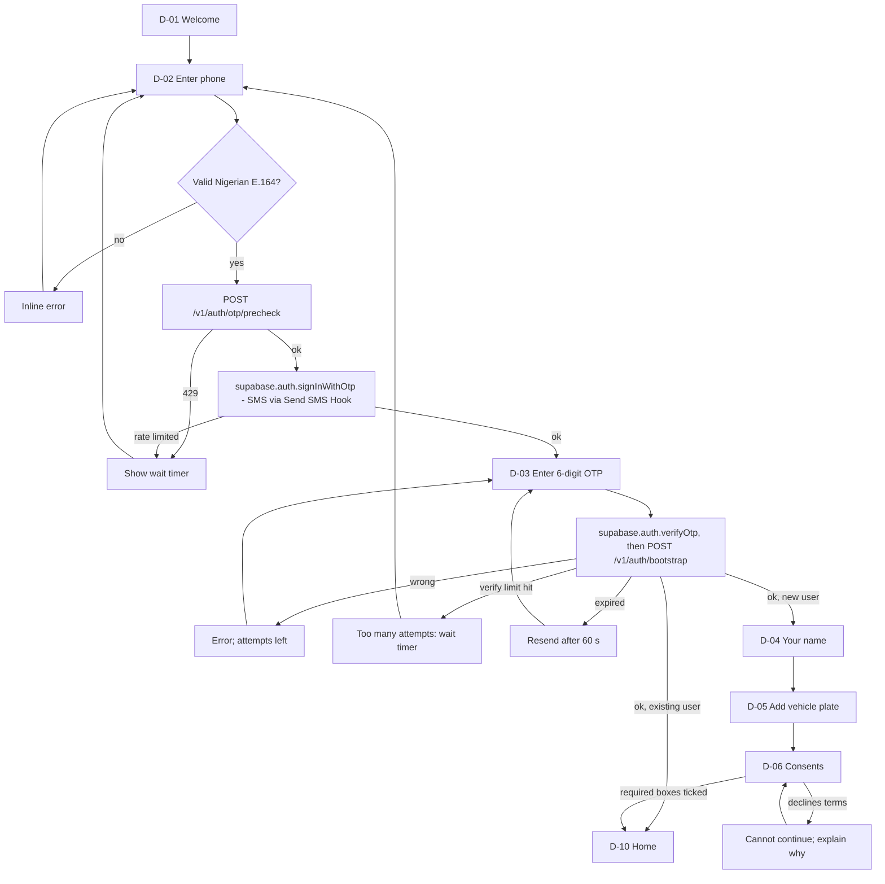

| # | Screen | User action | System response | Edge / error cases | Event |
|---|---|---|---|---|---|
| 1 | D-01 Welcome | Taps "Get started" | Shows phone entry. Shows "Browse lots without signing in" link (search only, no booking). | First launch offline: show cached welcome and an "You're offline" banner. Disable "Get started" until online. | `onboarding_started` |
| 2 | D-02 Enter phone | Enters number. `+234` is fixed and the leading `0` is stripped. | Validates with libphonenumber. Calls `supabase.auth.signInWithOtp({ phone })`; Supabase Auth calls our Send SMS Hook (`/hooks/supabase/send-sms`), which sends via Termii. | Invalid number: inline error. `OTP_RATE_LIMITED` (mapped from the Supabase Auth rate-limit error): countdown timer. SMS provider down: the hook falls back to the secondary provider. If both fail, show `OTP_DELIVERY_FAILED` and a "Call support" option. | `otp_requested` |
| 3 | D-03 OTP | Enters 6 digits. On Android, SMS Retriever autofills it. | `supabase.auth.verifyOtp({ phone, token, type: 'sms' })` returns the Supabase session, persisted in SecureStore via the auth storage adapter. The app then calls `POST /v1/auth/bootstrap`, which returns `isNewUser` (new → D-04, existing → D-10). | Wrong code: shows attempts left (max 5), then a 15-min lockout. Expired (5 min): resend is enabled after 60 s. The OTP is never logged. | `otp_verified` / `otp_failed` |
| 4 | D-04 Name | Enters first and last name | `PATCH /v1/me` | Name only 1 char or has emoji: inline validation. | `profile_name_set` |
| 5 | D-05 Add vehicle | Enters plate, plus optional make, colour and nickname | Normalises the plate (`packages/domain/plate`) and shows the normalised plate for confirmation. `POST /v1/me/vehicles` | Plate already on another account: still allowed (shared cars) and flagged for ops if it's on more than 3 accounts. Invalid format: soft warning only, because foreign and diplomatic plates exist. | `vehicle_added` |
| 6 | D-06 Consents | Ticks Terms + Privacy (required). Marketing SMS/WhatsApp is optional and unticked by default. | `POST /v1/me/consents` records the version, timestamp and channel. | Declines required terms: the account stays in `ONBOARDING`, with an explanation. | `consents_recorded` |
| 7 | D-10 Home | — | Asks for location permission in context ("to show lots near you"). | Permission denied: search by destination still works. Don't ask again for 7 days. | `onboarding_completed` |

### 1.2 Search by destination, map and list

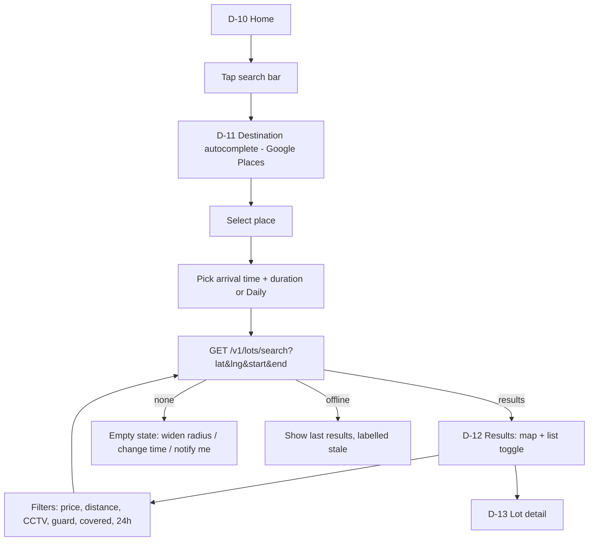

| # | Screen | User action | System response | Edge / error cases | Event |
|---|---|---|---|---|---|
| 1 | D-10 Home | Taps search, or "Near me" | Shows recent destinations and saved places | No location: hide "Near me" | `search_opened` |
| 2 | D-11 Autocomplete | Types a destination | Places autocomplete. Session token per search; debounce 300 ms; restricted to Lagos State bounds. | Places quota or error: fall back to free-text geocoding. Still failing: "Try a landmark or area name". | `destination_selected` |
| 3 | D-11 Time picker | Picks a start time and a duration (hourly) or "Full day" | Snaps to 15-min slots. Start can't be in the past. Max 30 days ahead. | Start outside lot hours is handled per lot in results (shown as "Closed at that time") | `search_time_set` |
| 4 | D-12 Results | Views the map or list. Default sort: distance, then price. | `GET /v1/lots/search` returns only `LIVE` lots with availability. Each card shows the price for the chosen window, walking distance, verified badge, spaces-left band ("Few left" if < 5). | 0 results: widen to 3 km automatically, then show the empty state and a "Notify me when a lot opens here" (`POST /v1/demand-signals`). Stale data offline: grey banner. | `search_results_viewed` (props: `result_count`, `radius_m`) |
| 5 | D-12 Filters | Applies filters | Re-queries | — | `search_filter_applied` |
| 6 | D-12 → D-13 | Taps a lot | Opens lot detail | Lot became unavailable: toast and refresh the list | `lot_viewed` |

### 1.3 Lot detail

| Element | Rule |
|---|---|
| Verified badge | Shown only when the permit is `APPROVED` and unexpired **and** the VerificationRecord is `APPROVED` and < 12 months old. Tapping it opens a sheet with the checks passed: LASPA permit (number masked except the last 4), guard, lighting, CCTV, access control, capacity, owner identity, verification date. |
| Price | The exact total for the chosen window: base + driver service fee, shown separately. No hidden fees. |
| Hours | Today's hours are highlighted, and "Open 24h" when it applies. |
| Amenities | Icon chips: CCTV, guard, covered, EV charging (future), accessible bay. |
| Photos | Up to 8, admin-approved, served from the Supabase Storage bucket `lot-photos-public` through its CDN (resized variants via image transformations). Lazy-loaded with low-res placeholders. |
| Location | Static map with a "Get directions" link. Entrance notes from the operator (e.g. "Enter via Gate B, Adeola Odeku"). |
| Policies | Cancellation (free until 30 min before start), no-show grace (30 min), overstay charge rule. |
| CTA | "Book for ₦X". Disabled with a reason if the window is unavailable. Monthly pass CTA if the lot sells passes. |

Event: `lot_viewed` (props `lot_id`, `price_kobo`, `has_pass`), `verified_badge_opened`.

### 1.4 Book hourly or daily, then pay

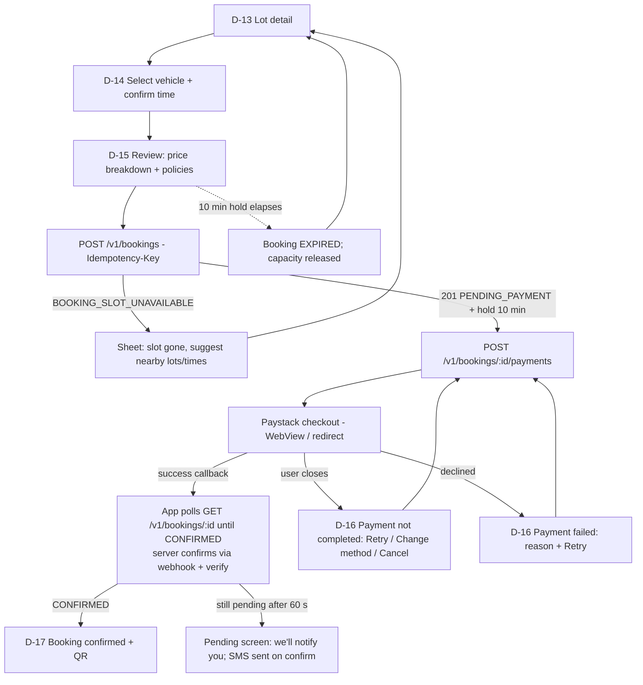

| # | Screen | User action | System response | Edge / error cases | Event |
|---|---|---|---|---|---|
| 1 | D-14 Select vehicle | Picks a vehicle (defaults to the last used) and confirms the time | Re-checks availability (`GET /v1/lots/:id/availability`) | No vehicle: inline add-vehicle sheet | `booking_started` |
| 2 | D-15 Review | Sees base price, service fee and total, plus the policies. Taps "Pay ₦X". | `POST /v1/bookings` with `Idempotency-Key` creates a `PENDING_PAYMENT` booking and holds capacity for 10 min. The price comes from the server (`packages/domain/pricing`), never the client. | `BOOKING_SLOT_UNAVAILABLE`, `LOT_NOT_LIVE`, `PRICE_CHANGED` (show the new price and ask to confirm again) | `booking_created` |
| 3 | Paystack checkout | Pays by card, bank transfer, USSD or bank | `POST /v1/bookings/:id/payments` returns a Paystack `authorization_url`, using the operator subaccount split. Opens in an in-app browser. | Network drop mid-payment: on return, poll the status. Never charge twice: the server dedupes on the booking and the idempotency key. | `payment_initiated` (prop `channel`) |
| 4 | Confirm | Returns to the app | The app polls `GET /v1/bookings/:id` every 2 s for 60 s. The server moves the booking to `CONFIRMED` **only** after a signature-verified webhook **or** a server-side `transaction/verify`. | Webhook delayed: show the pending screen, and push + SMS go out on confirm. Payment succeeds after the hold expired: auto-refund, or confirm if capacity still exists (server rule in doc 02). | `payment_succeeded` / `payment_failed` / `payment_abandoned` |
| 5 | D-16 Failed / abandoned | Retry / change method / cancel | A retry reuses the same booking while the hold is valid | Hold expired: "Your hold expired" and back to lot detail | `payment_retry_tapped` |
| 6 | D-17 Confirmed | Views the ticket | Shows the booking code `PK-XXXXXX`, the QR, lot, time, vehicle plate and entrance notes. Push + SMS (the code and lot, which is the SMS fallback) + email receipt if an email is set. | — | `booking_confirmed` |

### 1.5 Booking ticket and QR (offline available)

- The ticket is stored on the device (encrypted MMKV / SecureStore) as soon as the booking is confirmed. It renders with **no network**.
- The QR encodes a **signed check-in token**: booking id, lot id, plate hash, validity window and signature (scheme in doc 02 / doc 05). The attendant PWA verifies it offline with the lot's cached verification key.
- Screen brightness is raised to max while the QR is shown. A large booking code is shown under the QR for manual entry.
- The SMS fallback contains `PK-XXXXXX`, the lot name, the time window and the plate. That's enough for the attendant to find the booking by code or plate.
- Wallet passes (Google Wallet) are out of scope for MVP.

Events: `ticket_viewed` (prop `offline: bool`).

### 1.6 Navigate to lot

| Step | Behaviour | Event |
|---|---|---|
| "Get directions" on D-17 / D-13 | Opens Google Maps or Apple Maps with the lot's **entrance** coordinates (not the centroid) | `directions_opened` |
| Reminder | Push 30 min before start: "Your spot at {lot} starts at 9:00. Show this QR at Gate B." | `reminder_sent` (server) |
| Running late | The banner shows the grace rule: "We hold your spot until 9:30" | — |

### 1.7 Check-in at the gate (driver side)

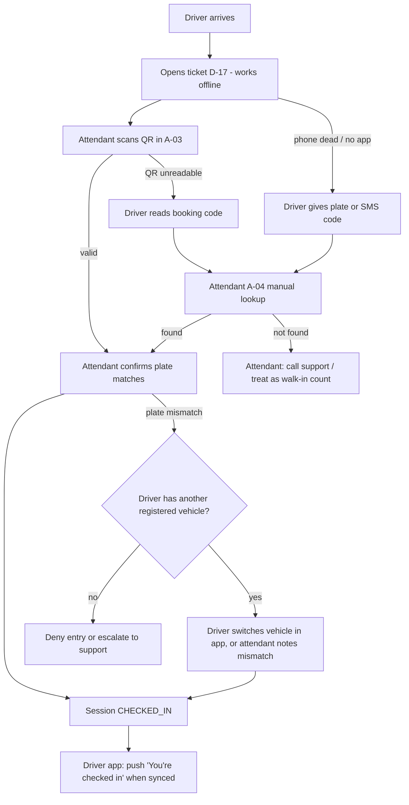

| # | Screen | User action | System response | Edge / error cases | Event |
|---|---|---|---|---|---|
| 1 | D-17 Ticket | Shows the QR | — | Too early (> 30 min before start): the attendant sees "Early: allow?" (operator setting, default allow if capacity exists) | `ticket_shown_at_gate` |
| 2 | — | — | The attendant check-in creates a `CHECKED_IN` booking and a Session. The driver gets a push when the attendant device syncs. | Attendant offline: the driver's app shows "Checked in (pending sync)" after a local QR handshake is not possible. The app simply says "Show your ticket to the attendant". | `checkin_completed` (server) |
| 3 | D-18 Active session | Views a live timer, end time, Extend, Exit info | Polls / gets a push about time remaining. A push 15 min before the end offers Extend. | — | `session_viewed` |

### 1.8 Extend

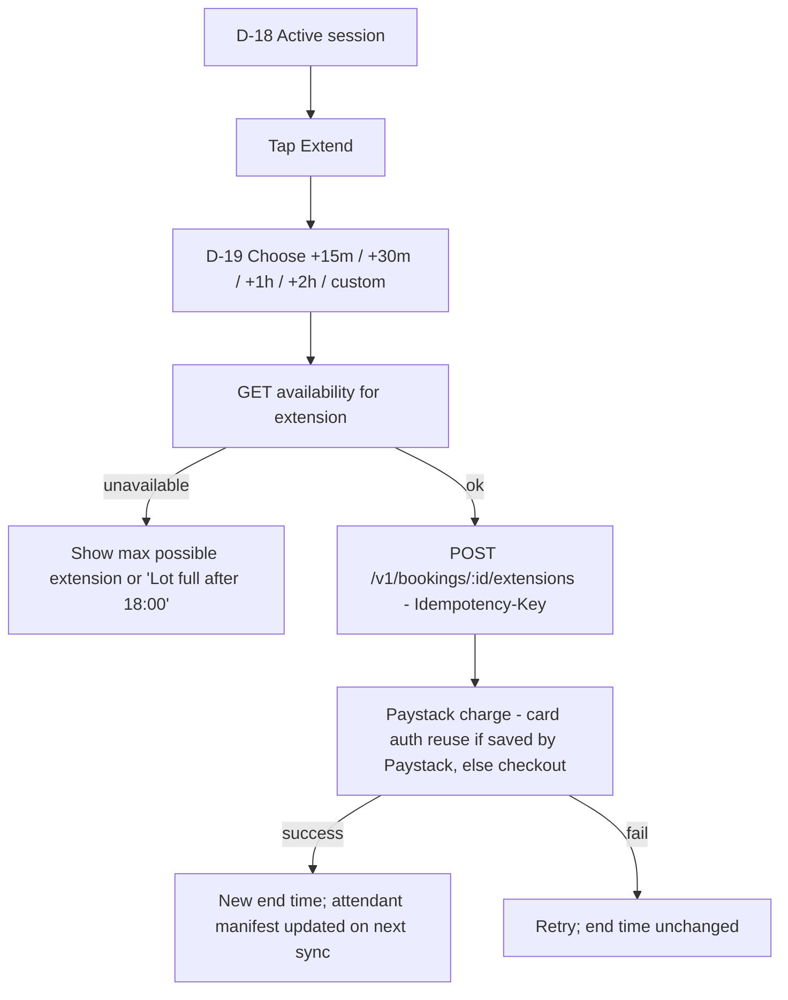

| # | Screen | User action | System response | Edge / error cases | Event |
|---|---|---|---|---|---|
| 1 | D-19 Extend | Picks the extra time | Price for the extra blocks, at the lot's hourly rate. No extra service fee in MVP. | Past lot closing time: cap it and explain. Booking not `CHECKED_IN`/`CONFIRMED`: hide Extend. | `extend_started` |
| 2 | Paystack | Pays | A separate `Payment` (type `EXTENSION`) with the same split | Fails: end time unchanged | `extend_paid` / `extend_failed` |

### 1.9 Early exit and check-out

| Rule | Behaviour |
|---|---|
| Who checks out | The attendant marks the exit in A-05 (primary). The driver can also tap "I've left" in D-18. That's recorded as `driver_reported_exit` and reconciled with the attendant record. |
| Early exit | No partial refund in MVP (the booking is for a window). Copy: "Leaving early? Your booking covers until 18:00. Early exits are not refunded." |
| On check-out | Session closed, booking `COMPLETED`, receipt generated (§1.11). |
| No check-out recorded | Auto-complete at `end + 2h` by a job if no overstay flag. Ops report "unclosed sessions". |

Events: `checkout_completed` (server, prop `source: attendant|driver|auto`).

### 1.10 Overstay payment

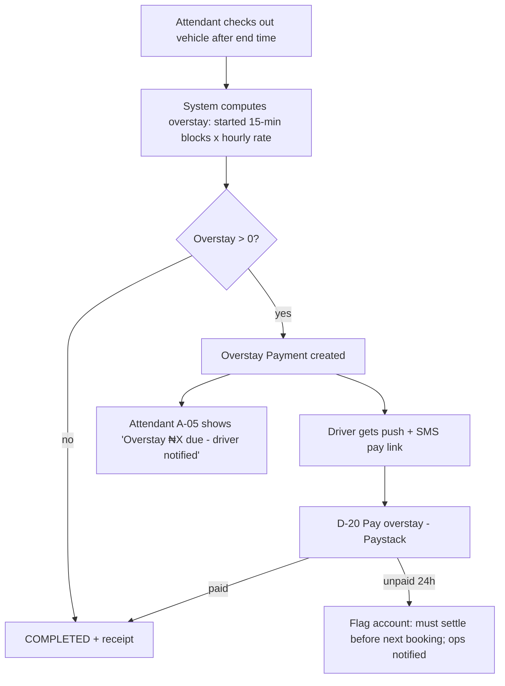

| # | Screen | User action | System response | Edge / error cases | Event |
|---|---|---|---|---|---|
| 1 | D-20 Overstay | Taps the pay link (deep link `parkly://overstay/:id`, or a web link via `apps/web`) | Shows the minutes over, the rate and the total | Disputes the time: "Contact support" with the booking prefilled | `overstay_viewed` |
| 2 | Paystack | Pays | Payment type `OVERSTAY`, same split | Unpaid: an `OUTSTANDING_BALANCE` block on new bookings (it's a debt flag, **not** a wallet balance) | `overstay_paid` |

Attendants never collect cash for overstay in MVP. If the driver insists on cash, the attendant records "cash collected offline". Ops reconciles it, and it's reported as leakage.

### 1.11 Receipt

- Generated on `COMPLETED`, and on every successful Payment (extension, overstay, pass).
- Content: Parkly legal entity, the operator name and lot, the booking code, the plate (masked to the last 3), the time window, the actual check-in and check-out, a line-item breakdown (parking, service fee, extension, overstay), the payment method (brand + last 4 from Paystack only), and the Paystack reference.
- Delivery: in-app (D-21 Receipts list → detail), email (if verified), PDF download (`GET /v1/receipts/:id.pdf`).
- Events: `receipt_viewed`, `receipt_downloaded`.

### 1.12 Cancel booking

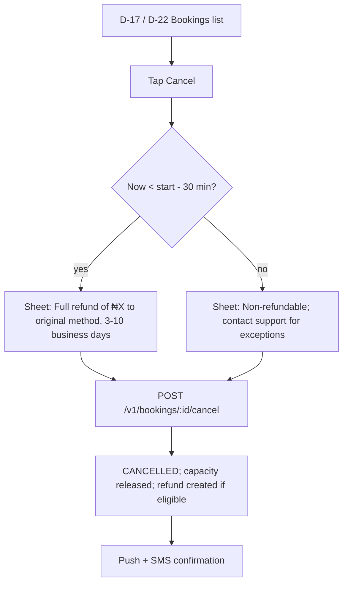

| Edge case | Behaviour |
|---|---|
| Already `CHECKED_IN` | Cancel is hidden. Use exit instead. |
| Refund fails at provider | The refund is retried by the job. After 3 failures it's flagged to `ADMIN_FINANCE`. The driver sees "Refund processing". |
| Service fee | Refunded with free cancellations; not refunded otherwise |

Events: `booking_cancel_started`, `booking_cancelled` (prop `refund_eligible`).

### 1.13 Buy a monthly pass

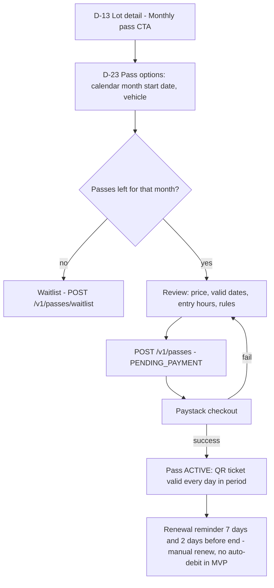

| Rule | Behaviour |
|---|---|
| Capacity | Passes consume a configurable share of lot capacity (`pass_capacity`), set by the operator. |
| Vehicle | One vehicle per pass. Changing the vehicle is allowed once per month, via support or in-app. |
| Check-in | The same QR flow. Each day creates a Session linked to the Pass. |
| Pro-rating | None in MVP. A pass bought mid-month covers start date → end of the calendar month at a pro-rated price only if the operator enables `pass_prorate`. |

Events: `pass_viewed`, `pass_purchase_started`, `pass_purchased`, `pass_waitlisted`, `pass_renewal_reminder_sent`.

### 1.14 Report an incident

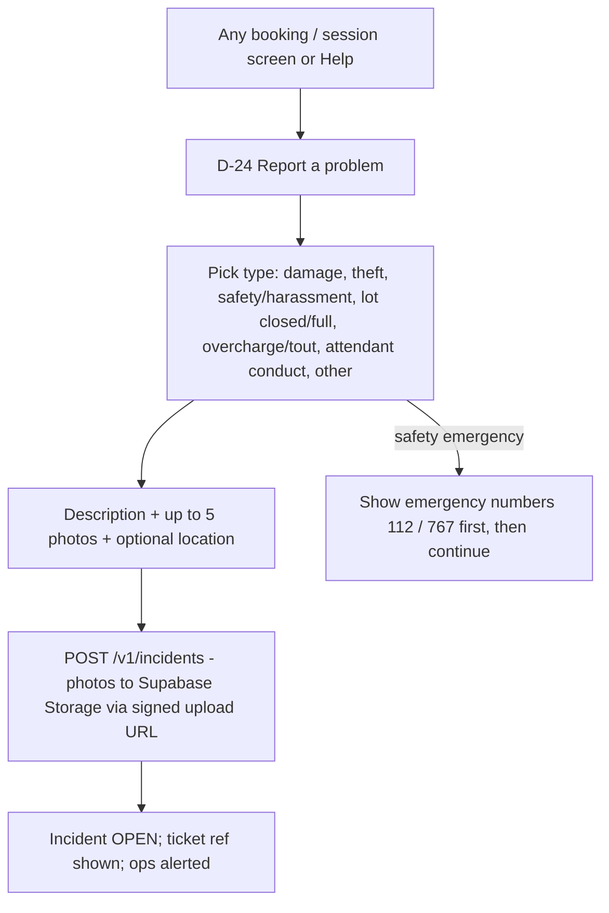

| Edge case | Behaviour |
|---|---|
| Offline | Saved as a draft. Auto-submitted when back online, with a visible "Queued" state. |
| Severity | `safety` and `theft` are created with `severity=HIGH`. The on-call ops person gets an SMS + Slack alert within 1 min. |
| Claims | MVP: an incident of type damage or theft shows "Our team will contact you within 24 h". The full claim workflow is Sprint 12 (`claims_enabled` flag). |

Events: `incident_report_started`, `incident_reported` (prop `type`, `severity`).

### 1.15 Support contact

| Entry | Behaviour |
|---|---|
| D-25 Help | FAQ (static, CMS-free markdown in the repo). "Chat on WhatsApp" (`https://wa.me/<support number>?text=` prefilled with the booking code, **no PII beyond the code**). "Call support" (tel: link). Support hours are shown. |
| Contextual | Every booking screen has "Get help with this booking". |
| Events | `support_opened`, `support_whatsapp_tapped`, `support_call_tapped` |

### 1.16 Account deletion (and data export)

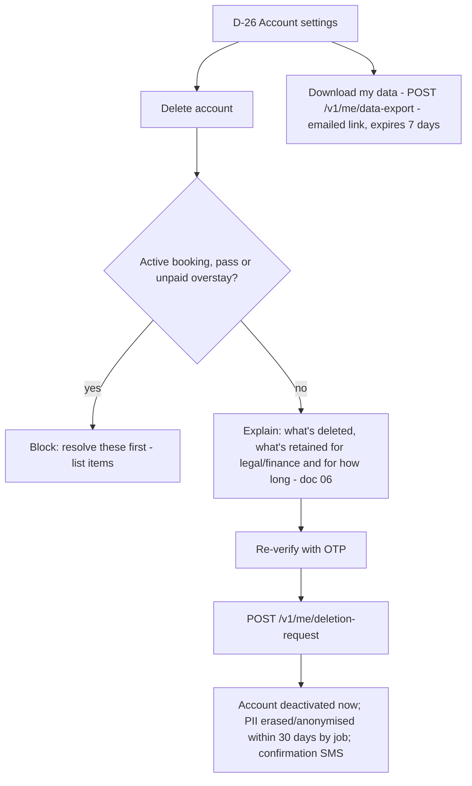

Play Store needs an account-deletion web URL. `apps/web/account/delete` offers the same flow, using OTP.

Events: `account_deletion_requested`, `data_export_requested`.

---

## 2. Operator flows (`apps/portal`)

### 2.0 Operator journey overview

```mermaid
flowchart LR
  A[Sign up] --> B[KYB: business details + docs]
  B --> C[Bank account -> Paystack subaccount]
  C --> D[Add lot]
  D --> E[Upload LASPA permit]
  E --> F[Rate plans, capacity, hours]
  F --> G[Invite attendants]
  G --> H[Schedule verification visit]
  H --> I[Admin approves permit + verification]
  I --> J[Go live]
  J --> K[Dashboard, bookings, settlements]
```

### 2.1 Sign up and KYB

| # | Screen | User action | System response | Edge / error cases | Event |
|---|---|---|---|---|---|
| 1 | O-01 Sign up | Email + password (min 12 chars, breached-password check). | Email verification link (lands on O-03). The user has no role until the Operator is created, then becomes `OPERATOR_OWNER`. The Operator Agreement + Privacy are accepted on O-03, where the operator is created. Phone OTP for owners: not in MVP (contact phone is captured on O-03). | Email already used: generic "check your email" (no account enumeration) | `operator_signup_started` |
| 2 | O-02 MFA setup | Scans TOTP QR (Supabase Auth MFA). Prompted to enrol a second TOTP factor on a backup device (Supabase has no recovery codes). | MFA is **required** for `OPERATOR_OWNER` and `OPERATOR_MANAGER` | Lost device: use the backup factor, or support-assisted reset with KYB re-check | `operator_mfa_enabled` |
| 3 | O-03 Business details | Legal name, CAC RC/BN number, business type, address, contact person | Saves the Operator as `KYB_PENDING` | — | `operator_kyb_started` |
| 4 | O-04 KYB documents | Uploads the CAC certificate, director ID (NIN slip / passport / driver's licence), proof of address | Supabase Storage signed upload URL (private bucket `kyb-docs`). Malware scan. File types pdf/jpg/png ≤ 10 MB. | Wrong type or size: inline. Scan fails: rejected with a reason. | `operator_kyb_docs_uploaded` |
| 5 | O-05 Payout account | Picks a bank and enters the account number | Paystack bank resolve shows the **account name** for confirmation. Creates the Paystack subaccount with the platform commission %. | Account name ≠ legal name: needs admin review. Resolve API down: retry later and save as a draft. | `operator_payout_account_added` |
| 6 | O-06 KYB submitted | — | Admin queue (X-05). Email when approved or rejected. | Rejected: reasons per field, resubmit | `operator_kyb_submitted` |

### 2.2 Add lot, permit, rate plans, capacity and hours

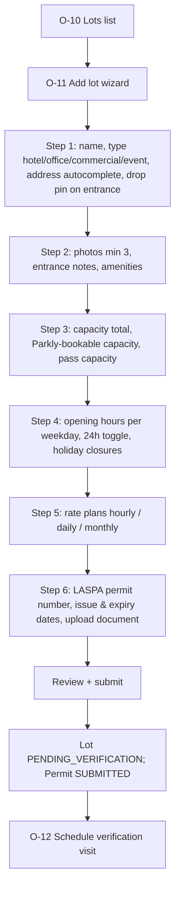

| Step | Validation and rules | Event |
|---|---|---|
| Location | Pin required, inside Lagos State bounds. Warns if within 50 m of another lot (possible duplicate). | `lot_draft_created` |
| Capacity | `bookable_capacity ≤ total_capacity`. `pass_capacity ≤ bookable_capacity`. Integer > 0. | `lot_capacity_set` |
| Hours | Closing after opening. Overnight allowed (e.g. 18:00–06:00). Timezone fixed to Africa/Lagos. | `lot_hours_set` |
| Rate plans | Hourly: first-hour minimum + per-15-min block. Daily: flat. Monthly: flat per calendar month. Prices in naira, stored in kobo. Price changes need admin approval only if the change is > 50% (anti-fraud); otherwise they're live for **new** bookings only. | `rate_plan_saved` |
| Permit | Permit number, dates, document. An expiry in the past blocks submission. An expiry < 30 days away warns. | `permit_submitted` |
| Submit | All steps complete | `lot_submitted_for_verification` |

### 2.3 Invite attendants

| # | Screen | User action | System response | Edge / error cases | Event |
|---|---|---|---|---|---|
| 1 | O-20 Team | Taps "Invite", enters name + phone (attendant) or email (manager), picks role (`OPERATOR_ATTENDANT` / `OPERATOR_MANAGER`), picks lots (attendants only) | Shows the invite link once (expires 72 h) to copy or share on WhatsApp; the SMS/email invite follows with notifications (S6) | Phone already a member: show it. Phone belongs to a driver: allowed; roles are additive. | `member_invited` |
| 2 | Attendant device | Opens the link | Goes to A-01 to set up a 6-digit PIN after OTP | Expired link: ask the manager to resend | `member_invite_accepted` |
| 3 | O-20 Team | Removes a member | Revokes all of their sessions and refresh tokens immediately. Their device's offline manifest is wiped on next contact and expires anyway in ≤ 24 h. | — | `member_removed` |

### 2.4 Verification visit scheduling and go-live

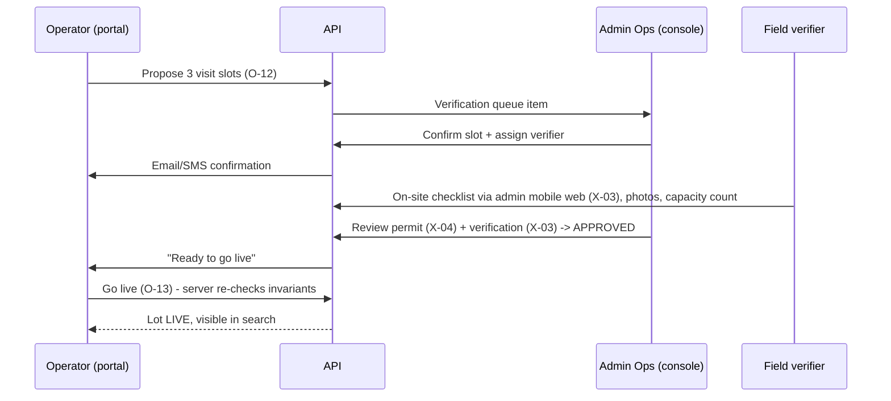

| Rule | Behaviour |
|---|---|
| Go-live invariant | Server-side check: Operator KYB `APPROVED`, payout subaccount active, Permit `APPROVED` with an unexpired expiry, VerificationRecord `APPROVED` and < 12 months old, ≥ 1 rate plan, hours set, ≥ 1 attendant active. Each failing item is shown as a checklist on O-13. |
| Pause | Operator can `PAUSE`/resume. Existing bookings are honoured; the operator is warned about how many are affected. |
| Events | `verification_visit_proposed`, `verification_visit_confirmed`, `lot_went_live`, `lot_paused`, `lot_resumed` |

### 2.5 Dashboard: occupancy and revenue

| Widget (O-30) | Definition |
|---|---|
| Live occupancy | Parkly sessions `CHECKED_IN` now + walk-in count recorded by attendants, against `total_capacity`, per lot |
| Today | Bookings, check-ins, no-shows, cancellations |
| Revenue | Gross booking value, Parkly commission, operator net. Today, 7 d, 30 d, custom. |
| Upcoming | Next 4 h of arrivals (list) |
| Issues | Open incidents at their lots, unresolved check-in conflicts, permit status |
| Export | CSV of bookings and payments (operator-scoped, generated async, link emailed, expires 24 h) |

Events: `operator_dashboard_viewed`, `operator_export_requested`.

### 2.6 Settlements

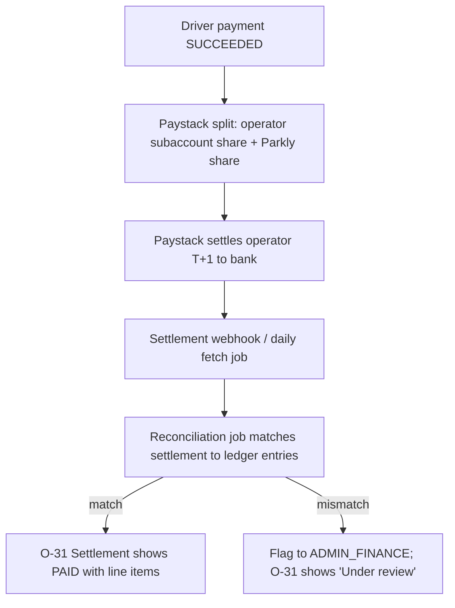

O-31 shows: settlement date, amount, the bank account (masked), the bookings included (drill-down), and refunds deducted. Download a statement PDF/CSV per settlement and per month.

Events: `settlement_viewed`, `statement_downloaded`.

### 2.7 Permit expiry reminders

| Trigger (daily job 08:00 WAT) | Action |
|---|---|
| Expiry in 30, 14 and 7 days | Email + SMS to the owner and managers. Banner on O-30 and O-11. |
| Expiry in 1 day | Plus an alert to `ADMIN_COMPLIANCE` |
| Expired | Lot → `SUSPENDED` automatically (`reason=PERMIT_EXPIRED`). Hidden from search. **Existing confirmed bookings are honoured** and ops is alerted to contact affected drivers. No new bookings. |
| New permit uploaded | Permit `SUBMITTED` → admin review → lot back to `LIVE` once approved (if all other invariants hold) |

Events: `permit_reminder_sent` (prop `days_left`), `lot_auto_suspended`.

---

## 3. Attendant PWA flows (`apps/portal` `/attend`)

Design target: a low-end Android (2 GB RAM, Android 9+, Chrome), sunlight-readable, one-handed, works **offline for at least 8 hours**.

### 3.0 Attendant shift overview

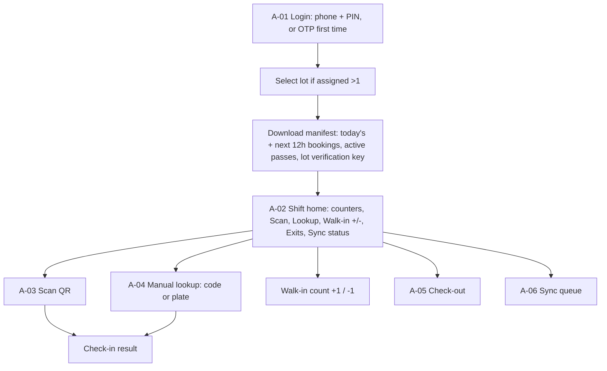

### 3.1 Login

| # | Screen | User action | System response | Edge / error cases | Event |
|---|---|---|---|---|---|
| 1 | A-01 Login | First time: phone OTP, then set a 6-digit PIN. Later: phone + PIN. | Device registered (`device_id`). Supabase Auth session; the API only honours it for this registered, manager-approved device (`devices.auth_session_id`) and for 12 h since the last OTP sign-in. | Wrong PIN 5×: locked, manager unlocks in O-20. Offline login: allowed with the PIN for ≤ 24 h since the last online auth, verified against a locally stored salted hash. | `attendant_login` |
| 2 | Lot picker | Picks a lot | Only assigned lots | — | `attendant_lot_selected` |

### 3.2 Offline manifest download

| Item | Rule |
|---|---|
| Contents | Bookings for the lot with start in [now − 12 h, now + 12 h], active passes, minimal fields only: booking id, code, plate (normalised), vehicle make/colour, start, end, status, driver first name + last initial. **No full phone numbers.** |
| Storage | IndexedDB, encrypted with a key derived from the PIN (WebCrypto AES-GCM). Wiped on logout or removal. |
| Refresh | Every 5 min when online (delta via `?since=` cursor), and on pull-to-refresh |
| Verification key | Lot public key / HMAC key id for offline QR signature checks, with rotation id |
| Staleness | Header shows "Updated 3 min ago". If > 30 min it turns amber; > 2 h turns red, with "Bookings made after HH:MM may not appear — use Lookup online or call support". |

Events: `manifest_downloaded` (props `count`, `delta`), `manifest_stale_warning`.

### 3.3 Scan QR → check-in

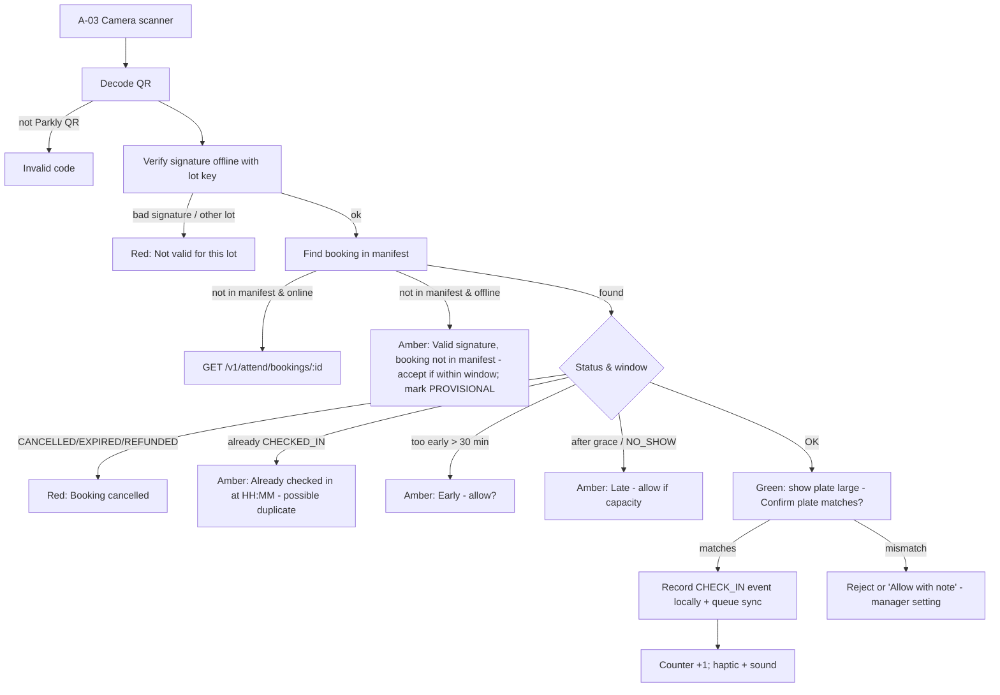

| Result colour | Meaning | Attendant action |
|---|---|---|
| Green | Valid, in window, plate confirmed | Let in |
| Amber | Needs judgement (early, late, duplicate, provisional) | Follow the on-screen rule. Every override needs a reason chip. |
| Red | Invalid | Deny. "Call support" button. |

Every check-in event carries: `event_id` (UUIDv7, also the idempotency key), `booking_id`, `device_id`, `attendant_user_id`, `occurred_at` (device clock + server offset estimate), `method` (`QR|CODE|PLATE`), and `override_reason?`.

Events: `checkin_scanned`, `checkin_completed` (prop `method`, `offline`), `checkin_rejected` (prop `reason`).

### 3.4 Manual lookup: code or plate

| # | Action | Behaviour | Edge cases |
|---|---|---|---|
| 1 | Enter `PK-` code | Searches the manifest. If online and not found, does an API lookup. | Typos: the alphabet excludes 0/O/1/I to reduce errors |
| 2 | Enter plate | Normalises and searches the manifest (exact first, then fuzzy within 1 edit) | Several matches: list them with times. The attendant picks one. |
| 3 | Found | Same result screen as the QR path, `method=CODE|PLATE` | — |
| 4 | Not found | "No booking found" → Walk-in count, or Call support | — |

Events: `lookup_performed` (prop `type`, `found`).

### 3.5 Walk-ins (MVP)

- Walk-ins are **counted only**: `+1` on arrival, `−1` on departure. **No payment and no PII is collected through Parkly** in MVP.
- They feed occupancy (so availability stays honest) and the operator dashboard.
- Events: `walkin_counted` (prop `delta`).

### 3.6 Check-out

| # | Action | Behaviour | Edge cases | Event |
|---|---|---|---|---|
| 1 | A-05 Exits: scan QR, or pick from the "Parked now" list, or a plate search | Records a `CHECK_OUT` event | Not checked in on this device or manifest: allowed. The server merges it. | `checkout_scanned` |
| 2 | Overstay computed locally (same `packages/domain/pricing`, bundled) | Shows "Overstay ₦X — driver will be notified to pay in app. Do not collect cash." | Device clock skew > 5 min: show a warning; the server recomputes authoritatively | `overstay_detected` |

### 3.7 Sync

```mermaid
sequenceDiagram
  participant P as Attendant PWA
  participant Q as Local queue (IndexedDB)
  participant API
  P->>Q: Append event (CHECK_IN / CHECK_OUT / WALKIN / NOTE) with event_id
  loop Every 15s when online + Background Sync
    Q->>API: POST /v1/attend/events:batch (<=100, ordered)
    API-->>Q: Per-event result: APPLIED | DUPLICATE | CONFLICT(reason) | REJECTED(reason)
    Q->>P: Update badges; CONFLICT items to A-06
  end
```

- A-06 Sync shows: queued count, last successful sync, failed items with the reason.
- Events are **never deleted locally until the server returns APPLIED or DUPLICATE**.
- The logout button is disabled while unsynced events exist (with "Sync first" and support override).

### 3.8 Conflict cases (server resolution rules)

| Conflict | Server rule | PWA display |
|---|---|---|
| Same booking checked in on two devices | First `occurred_at` wins. The second becomes `DUPLICATE` with an audit note. | "Already checked in by {name} at 09:02" |
| Check-in for a booking cancelled while offline | Applied as `CHECKED_IN`. Booking flagged `CONFLICT_CANCELLED_ENTERED`. Ops task: either reinstate (driver charged per policy) or contact the driver. | Amber item in A-06 |
| Provisional check-in, booking unknown to server | `REJECTED(UNKNOWN_BOOKING)` → incident auto-created for ops | Red item: "Unknown booking — supervisor review" |
| Check-out before check-in arrives | Server holds the check-out up to 24 h waiting for the check-in, then applies it with `checkin_missing=true` | Normal |
| Device clock skew | Server stores both `occurred_at` and `received_at`. If skew > 10 min, `occurred_at` is corrected using the device's last known offset and flagged | — |
| Plate mismatch override | Applied. Logged with the reason. Driver notified: "Your booking was used for plate XXX — not you? Report it." | — |
| Walk-in counter would go negative | Clamped at 0, logged | — |

Events: `sync_batch_sent`, `sync_conflict` (prop `type`).

---

## 4. Admin / Ops flows (`apps/admin`)

Access: SSO + MFA required, IP allowlist, and session timeout of 30 min idle. Every action below writes an `AuditLog` row (actor, action, target, before/after, reason, IP).

### 4.1 Verification review

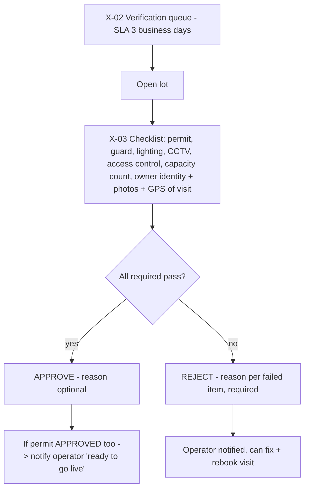

Rules: the verifier and the approver must be different people (four-eyes) when `ADMIN_OPS` headcount ≥ 2 (config flag `four_eyes_verification`). The capacity counted on site overrides the operator's figure if it's lower. Events: `verification_approved`, `verification_rejected`.

### 4.2 Permit review

| Step | Behaviour |
|---|---|
| X-04 Permit queue | Shows the document viewer side by side with the declared number and dates |
| Check | Manual check against LASPA (phone/email/portal, outside the app). Record the method and the reference in `verification_note`. |
| Approve / Reject | Approve sets `APPROVED` and the expiry. Reject needs a reason. |
| Expiry | Handled by the job in §2.7 |
| Events | `permit_approved`, `permit_rejected` |

### 4.3 Suspend a lot

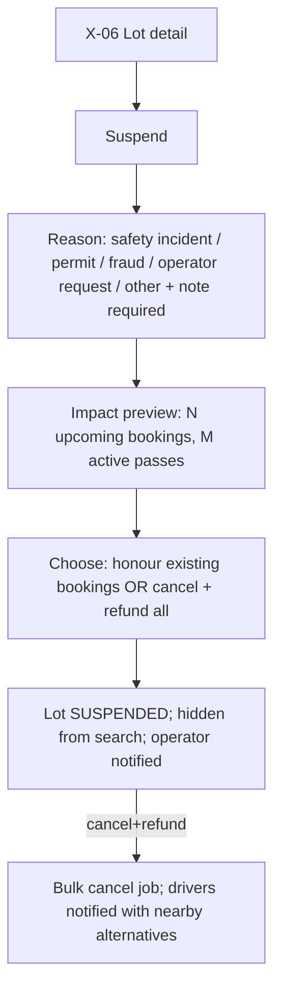

Events: `lot_suspended` (prop `reason`, `bulk_refund`), `lot_reinstated`.

### 4.4 Refund

| Step | Rule |
|---|---|
| X-07 Booking / payment detail | Shows the full payment timeline from the ledger |
| Refund | Full or partial (in kobo, ≤ the refundable remainder). Reason code required. Free text optional. |
| Limits | `ADMIN_SUPPORT` can refund ≤ ₦10,000 per booking. Above that needs `ADMIN_FINANCE`. Over ₦50,000/day per agent triggers a finance alert. (Config.) |
| Execution | `POST /v1/admin/payments/:id/refunds` with an `Idempotency-Key`. Provider refund. Ledger reversal entries. Operator share clawed back per Paystack split refund rules. |
| Driver comms | Push + SMS + email: amount and expected timeline |
| Events | `refund_issued` (props `amount_kobo`, `reason`, `partial`) |

### 4.5 Incident triage

```mermaid
flowchart TD
  A[Incident OPEN] --> B[X-08 Incident queue sorted by severity then age]
  B --> C[Assign owner -> TRIAGED; SLA HIGH 1h, MEDIUM 8h, LOW 48h]
  C --> D[Contact driver / operator; add notes; attach evidence]
  D --> E{Action}
  E -- refund --> F[Refund flow 4.4]
  E -- lot issue --> G[Warn operator / suspend 4.3]
  E -- attendant issue --> H[Notify operator; can deactivate attendant]
  E -- claim-worthy --> I[Create Claim - Sprint 12+]
  F --> J[RESOLVED with resolution code]
  G --> J
  H --> J
  I --> J
  J --> K[CLOSED after 7 days or driver confirms]
```

Weekly incident review report (strategy: "weekly review of incidents"): `X-09 Reports → Incidents`, incidents per 1,000 sessions by lot.

Events: `incident_triaged`, `incident_resolved` (prop `resolution_code`), `incident_sla_breached`.

### 4.6 DSAR (data subject requests)

```mermaid
flowchart TD
  A[Request arrives: in-app, web form, email to DPO] --> B[X-10 DSAR queue - legal deadline tracked]
  B --> C[Verify identity: OTP to account phone or documents]
  C --> D{Type}
  D -- Access/Export --> E[Generate export job: JSON + PDF summary; secure link 7 days]
  D -- Rectification --> F[Edit fields with before/after audit]
  D -- Erasure --> G[Run erasure job per doc 06 rules; retained-by-law fields kept & listed]
  D -- Objection/Restrict marketing --> H[Update consents]
  E --> I[Respond, close, record date]
  F --> I
  G --> I
  H --> I
```

Only `ADMIN_COMPLIANCE` and `SUPER_ADMIN` can run erasure or export. Deadline: as required by NDPA 2023 and GAID 2025 (counsel to confirm). The dashboard shows days remaining. Events: `dsar_received`, `dsar_completed` (prop `type`).

---

## 5. Screen inventory

### 5.1 Driver (`apps/mobile`; `apps/web` = W where it's also on web)

| ID | Screen | Sprint* | Web | Auth |
|---|---|---|---|---|
| D-01 | Welcome | 1 | W | No |
| D-02 | Enter phone | 1 | W | No |
| D-03 | Enter OTP | 1 | W | No |
| D-04 | Your name | 1 | W | Yes |
| D-05 | Add / edit vehicle | 1 | W | Yes |
| D-06 | Consents | 1 | W | Yes |
| D-10 | Home | 3 | W | Optional |
| D-11 | Destination search + time picker | 3 | W | Optional |
| D-12 | Results map / list + filters | 3 | W | Optional |
| D-13 | Lot detail + verified sheet | 3 | W (public SEO page) | Optional |
| D-14 | Select vehicle + time | 4 | W | Yes |
| D-15 | Review & pay | 4 | W | Yes |
| D-16 | Payment failed / abandoned / pending | 4 | W | Yes |
| D-17 | Booking ticket + QR | 4 | W | Yes |
| D-18 | Active session | 6 | W | Yes |
| D-19 | Extend | 6 | W | Yes |
| D-20 | Pay overstay | 6 | W | Yes / link token |
| D-21 | Receipts list + detail | 6 | W | Yes |
| D-22 | My bookings (upcoming / past) | 4 | W | Yes |
| D-23 | Monthly pass purchase + my passes | 9 | W | Yes |
| D-24 | Report a problem | 8 | W | Yes |
| D-25 | Help & support | 8 | W | Optional |
| D-26 | Account settings, vehicles, consents, delete, export | 1/8 | W | Yes |
| D-27 | Notifications inbox | 6 | — | Yes |

### 5.2 Operator portal (`apps/portal`)

| ID | Screen | Sprint* | Roles |
|---|---|---|---|
| O-01 | Sign up / log in / reset password | 2 | All operator |
| O-02 | MFA setup / challenge | 2 | Owner, Manager |
| O-03 | Business details (KYB) | 2 | Owner |
| O-04 | KYB documents | 2 | Owner |
| O-05 | Payout account | 2 | Owner |
| O-06 | KYB status | 2 | Owner |
| O-10 | Lots list | 2 | Owner, Manager |
| O-11 | Add / edit lot wizard (incl. rate plans, capacity, hours, permit) | 2 | Owner, Manager |
| O-12 | Verification visit scheduling | 2 | Owner, Manager |
| O-13 | Go-live checklist | 2 | Owner |
| O-20 | Team & invitations | 2 | Owner, Manager |
| O-21 | Bookings list + detail | 7 | Owner, Manager |
| O-30 | Dashboard | 7 | Owner, Manager |
| O-31 | Settlements + statements | 7 | Owner |
| O-32 | Incidents at my lots | 8 | Owner, Manager |
| O-40 | Organisation settings, audit log (own org) | 7 | Owner |

### 5.3 Attendant PWA (`apps/portal` `/attend`)

| ID | Screen | Sprint* |
|---|---|---|
| A-01 | Login (OTP first time, then PIN) + lot picker | 5 |
| A-02 | Shift home (counters, actions, sync status, manifest freshness) | 5 |
| A-03 | Scan QR + result | 5 |
| A-04 | Manual lookup (code / plate) + result | 5 |
| A-05 | Exits / check-out + "Parked now" | 5 |
| A-06 | Sync queue & conflicts | 5 |
| A-07 | Report incident (attendant) | 8 |

### 5.4 Admin console (`apps/admin`)

| ID | Screen | Sprint* | Roles |
|---|---|---|---|
| X-01 | Login (SSO + MFA) | 8 | All admin |
| X-02 | Verification queue | 2 (basic) / 8 | Ops |
| X-03 | Verification checklist (mobile-friendly for field use) | 2 / 8 | Ops |
| X-04 | Permit review | 2 / 8 | Ops, Compliance |
| X-05 | Operator KYB review | 2 / 8 | Ops, Compliance |
| X-06 | Lots (detail, suspend, reinstate) | 8 | Ops |
| X-07 | Bookings & payments (search, timeline, refund) | 8 | Support, Finance |
| X-08 | Incidents queue + detail | 8 | Support, Ops |
| X-09 | Reports (KPIs, incidents, reconciliation exceptions) | 8 | Ops, Finance |
| X-10 | DSAR queue | 8 | Compliance |
| X-11 | Users & roles, platform settings, feature flags | 8 | Super admin |
| X-12 | Audit log viewer | 8 | Compliance, Super admin |

\*Sprint numbers are indicative. [Doc 20 — Sprint Plan](20%20-%20Sprint%20Plan%20and%20Delivery%20Roadmap.md) is authoritative.

---

## 6. Analytics event dictionary

**Implementation rules**

- One wrapper, `track(event, props)`, in each app. The server emits server-side events from domain events. **Server events are the source of truth for money and state** (`payment_succeeded`, `booking_confirmed`, `checkin_completed`, …). Client events are for funnels and UX.
- Common props on every event: `event_id`, `occurred_at`, `app` (`mobile|web|portal|attend|admin|api`), `app_version`, `platform`, `screen`, `user_id` (internal UUID, **never phone or email**), `session_id`, `network` (`online|offline`).
- **Forbidden in props:** phone, email, full name, full plate, OTP, tokens, card data, precise GPS (round to 3 decimals ≈ 110 m when location is needed). See doc 06.
- Naming: `object_action`, snake_case, past tense.
- Pipeline (MVP): events go to `POST /v1/events` → a Postgres `analytics_events` table (partitioned monthly) → metabase/SQL. No third-party SDK is sent PII. Tooling can change later; names must not.

| Event | Source | Key props | Funnel / metric |
|---|---|---|---|
| `onboarding_started` | client | — | Activation |
| `otp_requested` | client | `resend: bool` | Activation |
| `otp_verified` | server | `is_new_user` | Activation |
| `otp_failed` | server | `reason` | Reliability |
| `profile_name_set` | client | — | Activation |
| `vehicle_added` | server | `is_first` | Activation |
| `consents_recorded` | server | `marketing_opt_in` | Compliance |
| `onboarding_completed` | client | `duration_s` | Activation |
| `search_opened` | client | `entry` | Demand |
| `destination_selected` | client | `source: autocomplete|recent|near_me` | Demand |
| `search_time_set` | client | `mode: hourly|daily`, `lead_time_min` | Demand |
| `search_results_viewed` | client | `result_count`, `radius_m` | Supply coverage |
| `search_filter_applied` | client | `filter` | UX |
| `demand_signal_created` | server | `area_geohash5` | Supply planning |
| `lot_viewed` | client | `lot_id`, `price_kobo`, `has_pass` | Conversion |
| `verified_badge_opened` | client | `lot_id` | Trust |
| `booking_started` | client | `lot_id` | Conversion |
| `booking_created` | server | `booking_id`, `lot_id`, `amount_kobo`, `type` | Conversion |
| `payment_initiated` | server | `payment_id`, `type: INITIAL|EXTENSION|OVERSTAY|PASS`, `channel` | Payments |
| `payment_succeeded` | server | `payment_id`, `amount_kobo`, `channel`, `latency_ms` | **Payment success rate** |
| `payment_failed` | server | `payment_id`, `reason` | Payment success rate |
| `payment_abandoned` | server | `payment_id` | Payment success rate |
| `payment_retry_tapped` | client | `attempt` | Payments |
| `booking_confirmed` | server | `booking_id`, `lead_time_min` | **North Star input** |
| `booking_expired` | server | `booking_id` | Payments |
| `ticket_viewed` | client | `offline` | Reliability |
| `directions_opened` | client | `provider` | UX |
| `reminder_sent` | server | `channel` | Engagement |
| `checkin_scanned` | client (attend) | `result_colour` | Ops |
| `checkin_completed` | server | `method`, `offline`, `override_reason?` | **Check-in failures** |
| `checkin_rejected` | client (attend) | `reason` | **Check-in failures** |
| `lookup_performed` | client (attend) | `type`, `found` | Ops |
| `walkin_counted` | server | `delta` | Occupancy |
| `session_viewed` | client | — | UX |
| `extend_started` | client | `minutes` | Revenue |
| `extend_paid` / `extend_failed` | server | `amount_kobo` / `reason` | Revenue |
| `checkout_scanned` | client (attend) | — | Ops |
| `checkout_completed` | server | `source`, `duration_min` | **North Star (paid, completed session)** |
| `overstay_detected` | server | `minutes`, `amount_kobo` | Revenue |
| `overstay_viewed` / `overstay_paid` | client / server | `amount_kobo` | Revenue |
| `receipt_viewed` / `receipt_downloaded` | client | — | Trust |
| `booking_cancel_started` | client | — | Retention |
| `booking_cancelled` | server | `refund_eligible`, `minutes_before_start` | Retention |
| `booking_no_show` | server | `booking_id` | Ops |
| `pass_viewed` / `pass_purchase_started` | client | `lot_id` | Pass funnel |
| `pass_purchased` | server | `pass_id`, `amount_kobo` | Revenue |
| `pass_waitlisted` | server | `lot_id` | Supply planning |
| `pass_renewal_reminder_sent` | server | `days_left` | Retention |
| `incident_report_started` | client | `type` | Trust |
| `incident_reported` | server | `type`, `severity`, `reporter_role` | **Incident rate / 1,000 sessions** |
| `support_opened` / `support_whatsapp_tapped` / `support_call_tapped` | client | `context` | Support |
| `account_deletion_requested` / `data_export_requested` | server | — | Compliance |
| `operator_signup_started` | client | — | Supply funnel |
| `operator_mfa_enabled` | server | — | Security |
| `operator_kyb_started` / `operator_kyb_docs_uploaded` / `operator_kyb_submitted` | server | — | Supply funnel |
| `operator_payout_account_added` | server | `bank_code` | Supply funnel |
| `lot_draft_created` / `lot_capacity_set` / `lot_hours_set` / `rate_plan_saved` | server | `lot_id` | Supply funnel |
| `permit_submitted` | server | `lot_id`, `days_to_expiry` | Compliance |
| `lot_submitted_for_verification` | server | `lot_id` | Supply funnel |
| `member_invited` / `member_invite_accepted` / `member_removed` | server | `role` | Supply ops |
| `verification_visit_proposed` / `verification_visit_confirmed` | server | `lot_id` | Supply funnel |
| `lot_went_live` | server | `lot_id`, `days_since_signup` | **Verified lots live** |
| `lot_paused` / `lot_resumed` | server | `lot_id` | Supply |
| `operator_dashboard_viewed` / `operator_export_requested` | client / server | — | Operator engagement |
| `settlement_viewed` / `statement_downloaded` | client | — | Operator engagement |
| `settlement_reconciled` | server | `status: matched|mismatch`, `amount_kobo` | Finance |
| `permit_reminder_sent` | server | `days_left` | **Compliance: % lots with valid permit** |
| `lot_auto_suspended` | server | `reason` | Compliance |
| `attendant_login` / `attendant_lot_selected` | server | `offline` | Ops |
| `manifest_downloaded` | server | `count`, `delta` | Reliability |
| `manifest_stale_warning` | client (attend) | `age_min` | Reliability |
| `sync_batch_sent` | server | `count`, `applied`, `duplicates`, `conflicts` | Reliability |
| `sync_conflict` | server | `type` | Reliability |
| `verification_approved` / `verification_rejected` | server | `lot_id`, `failed_items[]` | Supply quality |
| `permit_approved` / `permit_rejected` | server | `lot_id` | Compliance |
| `lot_suspended` / `lot_reinstated` | server | `reason`, `bulk_refund` | Trust |
| `refund_issued` | server | `amount_kobo`, `reason`, `partial`, `actor_role` | Finance |
| `incident_triaged` / `incident_resolved` / `incident_sla_breached` | server | `severity`, `resolution_code`, `ttr_min` | **Support response time** |
| `dsar_received` / `dsar_completed` | server | `type`, `days_taken` | Compliance |

**Metric mapping to the strategy (§10 of strategy.md)**

| Strategy metric | Derived from |
|---|---|
| North Star: paid, completed sessions / week at verified lots | `checkout_completed` where the booking has `payment_succeeded` and the lot was `LIVE` |
| Verified lots live / verified bays | `lot_went_live`, current `LIVE` lots × `bookable_capacity` |
| Booking conversion | `lot_viewed` → `booking_confirmed` |
| Repeat rate within 30 days | Drivers with ≥ 2 `booking_confirmed` within 30 days of the first |
| Payment success rate | `payment_succeeded` ÷ (`payment_succeeded` + `payment_failed` + `payment_abandoned`) |
| Check-in failures | `checkin_rejected` + `sync_conflict` ÷ check-in attempts |
| Incident rate / 1,000 sessions | `incident_reported` ÷ `checkout_completed` × 1000 |
| Support response time | `incident_triaged.occurred_at − incident_reported.occurred_at` |
| Share of live lots with a valid permit | Daily snapshot job (target 100%) |
