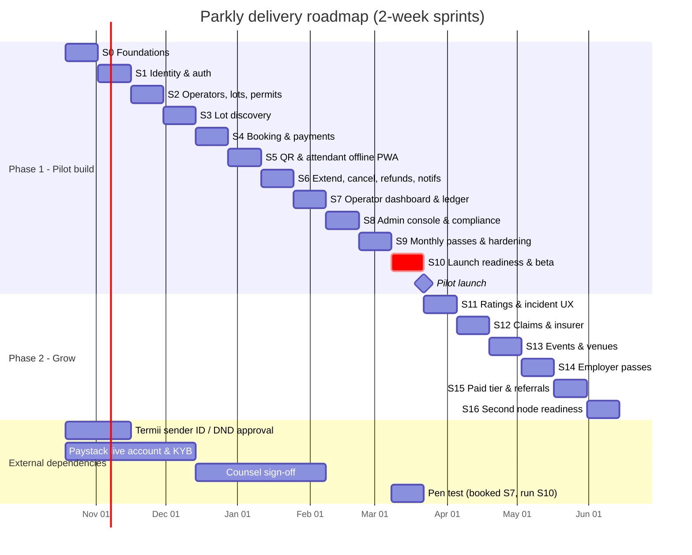

# 20 — Sprint Plan and Delivery Roadmap

> **Cadence:** 2-week sprints. **Phase 1 (Pilot build):** S0–S10 (~22 weeks). **Phase 2 (Grow):** S11–S16. **Phase 3 (Scale):** epics.
> FR/NFR IDs refer to doc 19 (PRD). Names, stack and rules come from doc 00.
> **Rule for agents:** work on **one sprint at a time**, in order. Do not start a sprint until the previous sprint's exit criteria are met (or the gap is recorded as carry-over in this file).

---

## 1. Ways of working

### 1.1 Definition of Ready (a story can start when…)

- It references an FR/NFR ID and has Gherkin acceptance criteria (doc 19).
- Data model changes are identified (doc 02) and classified (doc 06).
- Security impact noted (doc 05): auth, PII, payments, external calls.
- UI stories reference a flow (doc 03) and use tokens/components (docs 04, 07–16).
- External dependencies (keys, accounts) are available in `dev` or faked.

### 1.2 Definition of Done (global — every story)

1. Tests written **first** and passing: unit (domain), integration (API), e2e for user-facing flows (doc 02 §TDD).
2. Coverage: `packages/domain` ≥ 90% lines; `apps/api` ≥ 80%; no drop on touched files.
3. Lint, typecheck, format, `pnpm audit` (no High/Critical) and secret scan pass in CI.
4. OpenAPI regenerated and committed if the API changed; clients use generated types.
5. Migrations are forward-only, reversible in plan, and tested on a copy of the schema.
6. AuthZ tests exist for every new endpoint (allowed role + at least one denied role + cross-tenant).
7. New PII fields are listed in doc 06; logs scrubbed.
8. Privileged actions write AuditLog.
9. Accessibility checked (axe for web, RN labels) on new screens.
10. Docs updated when behaviour changes (PRD, TDD, flows); ADR added for any decision change.
11. Deployed to `dev` automatically; to `staging` at sprint end; demo performed from staging.

### 1.3 Branching and PR rules

- Trunk-based: `main` is always deployable. Short-lived branches `feat/<sprint>-<short-name>`, `fix/…`, `chore/…`.
- PRs ≤ ~400 changed lines where possible; one story per PR.
- Conventional Commits (`feat(api): add booking hold`), squash-merge.
- PR template includes: FR IDs, test evidence, security checklist (AGENTS.md §7), screenshots for UI, migration notes.
- Required checks: CI green, 1 review (human or reviewer agent + human for payments/auth/security code), no unresolved comments.
- Feature flags for anything incomplete that lands on `main`.
- Releases: staging deploy every merge to `main`; production via tagged release `vX.Y.Z` with manual approval (from S10).

### 1.4 Sprint ceremonies (agent-friendly)

Start: read this sprint section + listed docs → create a task list → confirm dependencies. End: run demo script on staging → check exit criteria → write `docs/sprints/S<n>-report.md` (done, carried over, risks, decisions).

---

## 2. Roadmap at a glance

Dependency chain: S0 → S1 → S2 → S3 → S4 → S5 → S6 → S7. S8 depends on S2, S4, S6. S9 depends on S4, S5. S10 depends on all.

---

## 3. Phase 1 — Pilot build

### Sprint 0 — Foundations

**Goal:** A working monorepo where every app builds, tests run, CI deploys to `dev`, and the skeleton enforces our rules from day one.

**Stories / IDs:** NFR-SEC-002, NFR-OBS-001, FR-AUTH-008 (audit table skeleton).

**Read:** 00, 01, 02 (§repo, §testing), 05 (§secrets, §CI), 06 (§classification), 04 + 07–16 (tokens), AGENTS.md.

**Technical tasks**
1. pnpm + Turborepo monorepo with layout from doc 00 §4; `packages/config` (tsconfig strict, eslint, prettier).
2. `apps/api` Hono skeleton deployed as Vercel Functions (Node.js runtime): health (`/health/live`, `/health/ready`, per doc 02 §6.11), pino logging with redaction, `@vercel/otel`, problem+json error handler, request-id, secure headers middleware, CORS allowlist, Zod validation from `packages/contracts` via `@hono/zod-openapi`, rate-limit middleware (Upstash `@upstash/ratelimit`).
3. Supabase: create projects `parkly-dev`, `parkly-staging`, `parkly-prod` in the region from ADR 0002 (default Ireland); Supabase CLI + `supabase/config.toml`; first migration enables `postgis`, `pg_cron`, `pgmq`, `pg_net`, `pgcrypto`. `packages/db` with Drizzle (schema, client via **Supavisor transaction mode**, `prepare: false`); `pnpm db:generate` writes drizzle-kit SQL into `supabase/migrations/`. First tables: `users`, `roles`, `audit_logs`, `platform_settings`, `feature_flags`, each with **RLS enabled and no `anon`/`authenticated` policies (deny-all)**.
4. Jobs skeleton: `/internal/jobs/:job` route with HMAC-signed header check (secret in Vercel env + Supabase Vault); one sample `pg_cron` → `pg_net` job and one `pgmq` queue consumer; jobs idempotent and chunked for the Vercel function time limit.
5. Local stack: `supabase start` (Postgres+PostGIS, Auth, Storage, Studio, Inbucket mail) + `supabase/seed.sql`. No docker compose.
6. `packages/domain` with first pure modules (money in kobo, time slot alignment, plate normalisation) — TDD.
7. `packages/tokens` with Style Dictionary → CSS variables + RN theme from docs 07–16; `packages/ui` and `packages/ui-native` with Button, Text, Input as proof.
8. Skeletons: `apps/mobile` (Expo Router, theme from tokens), `apps/web`, `apps/portal`, `apps/admin` (Next.js, tokens applied).
9. Interfaces + fakes: `PaymentProvider`, `SmsProvider`, `PushProvider`, `EmailProvider`, `MapsProvider`, `StorageProvider`, `Clock`.
10. GitHub Actions: install, lint, typecheck, test (integration tests against `supabase start` in CI), build, secret scan (gitleaks), dependency audit, SAST (CodeQL), OpenAPI drift check, migration check; on merge: `supabase db push` to the target project **before** Vercel promotes the deployment.
11. Vercel: projects `parkly-api`, `parkly-web`, `parkly-portal`, `parkly-admin` (Pro plan), PR previews via Git integration against `parkly-dev`; `main` → `staging` environment and tags → production via `.github/workflows/deploy.yml` (migrations first), Functions region pinned to the DB region (`dub1`), environment variables per environment marked Sensitive (Supabase secret key + DB URL server-side only; clients get only URL + publishable key), `vercel.json` per app, Firewall baseline rules, admin domain + IP allowlist + Deployment Protection. No Terraform or AWS.
12. Sentry for all apps; `@vercel/otel` traces; Vercel Log Drains → Better Stack (log search, uptime monitors, status page); basic dashboard.
13. ADRs 0003–0006 (monorepo, Hono + Drizzle on Supabase, Paystack split, PWA for attendant); ADR 0002 (Supabase + Vercel) is already accepted.
14. Start external accounts: Termii sender ID + DND route, Paystack test + live KYB, Google Maps keys, Play Console, Resend domain verification, Upstash.

**Test requirements:** domain unit tests (money, plate, slots) written first; API e2e for health; CI fails on a deliberately committed fake secret (verify once, then remove).

**Deliverables:** green CI; `dev` URL for API + 3 web apps; Expo dev build; tokens visible in all apps.

**DoD / exit criteria:** `pnpm i && supabase start && pnpm dev` runs the full stack locally from README in < 15 min; `pnpm test` green; `dev` deploy automatic (Preview + `supabase db push`); Supabase security advisor shows no RLS-disabled tables; logs show redacted fields; ADRs merged.

**Demo:** clone → `supabase start` → open each app showing tokenised Button → hit `/health/ready` → show trace in observability → show CI blocking a lint error.

**Risks:** account approvals (Termii/Paystack) are slow → start now; use fakes until ready.

---

### Sprint 1 — Identity and access

**Goal:** Drivers sign in with phone OTP and manage vehicles; operators and admins sign in with password + MFA; RBAC and audit logging enforced everywhere.

**Stories:** FR-AUTH-001…008, NFR-SEC-001 (auth controls).

**Read:** 02 (§auth, data model users/vehicles), 03 (sign-in flows), 05 (§authN/Z, OTP, sessions), 06 (phone, name, plate classification), ADR 0002.

**Technical tasks**
1. Driver phone OTP with **Supabase Auth**: 6 digits, 5-min expiry, Supabase Auth rate limits configured, plus our own limits (3 sends/15 min per phone and per IP/device) via Upstash. SMS goes through Supabase's **Send SMS Hook** → `apps/api` hook endpoint (signature verified) → `SmsProvider` (Termii adapter + fake, DND route).
2. Session tokens from Supabase Auth: **asymmetric ES256 signing keys**, access-token lifetime 15 min, refresh-token rotation with reuse detection on. API middleware verifies JWTs against the project JWKS (cached) and checks `aud`/`iss`/`exp`. A **Custom Access Token Hook** (SQL function) adds `app_roles`, `operator_id` and `lot_ids` claims from our tables.
3. Operator/admin email + password via Supabase Auth (min 12 chars, leaked-password protection on); **Supabase MFA (TOTP)** enrolment + recovery; the API rejects admin and `OPERATOR_OWNER` requests below `aal2`.
4. Attendant sign-in: phone OTP + lot PIN; device registration.
5. RBAC guard + policy layer (`can(user, action, resource)`), operator/lot scoping; tenancy tests.
6. AuditLog Hono middleware for privileged routes; append-only (DB trigger blocks update/delete).
7. Consents table (terms/privacy/marketing with versions).
8. Vehicles CRUD with plate normalisation.
9. Mobile: onboarding, phone entry, OTP (auto-read SMS on Android), profile, vehicles; secure token storage (Expo SecureStore).
10. Portal/admin: sign-in, MFA enrolment, session list, sign out all.
11. Account deletion request endpoint (processing in S8).

12. RLS baseline: a CI test asserts every table in `public` has RLS enabled and no `anon`/`authenticated` policies; a request with the publishable key + a driver JWT straight to the Supabase Data API returns no rows.

**Tests (write first):** OTP rate limits (our limiter + hook behaviour); JWT verification (expired, wrong `aud`, wrong `alg`, admin below `aal2`); custom claims hook output; refresh reuse detection (integration against local Supabase); RBAC matrix test (every role × every endpoint generated table); cross-tenant denial; audit row on privileged action; plate uniqueness.

**Deliverables:** working sign-in on mobile, portal, admin; RBAC matrix in `apps/api/test/rbac-matrix.spec.ts`.

**Exit criteria:** all FR-AUTH P0 AC pass; OTP delivered on a real Nigerian number in staging; MFA enforced for admin.

**Demo:** new driver signs up → adds vehicle → signs out → admin signs in with TOTP → views audit entries → manager from operator A tries operator B resource → 404.

**Risks:** Termii DND approval not ready → use fake + whitelisted test numbers.

---

### Sprint 2 — Operators, lots, permits, verification

**Goal:** Operators onboard and create lots; ops verifies permits and sites; a lot can only go LIVE through the permit + verification gate.

**Stories:** FR-LOT-001…007, FR-OPS-004, FR-OPS-005, FR-ADM-001.

**Read:** 02 (Lot, Permit, VerificationRecord, RatePlan models; Lot state machine), 03 (operator onboarding, verification flows), 05 (file uploads, KYB data), 06 (permit docs, ID docs retention).

**Technical tasks**
1. Operator KYB model + Paystack bank resolve + subaccount creation on approval (fake in tests).
2. Lot CRUD with PostGIS point, opening hours, capacity, amenities, photos (signed upload URLs to private **Supabase Storage** buckets, MIME sniffing, size limits, image re-encode to WebP, EXIF strip).
3. Permit upload + review; VerificationRecord with checklist, photos, GPS, reviewer.
4. Lot state machine in `packages/domain/lot` with guard `canGoLive(lot, permit, verification, now)`.
5. RatePlan CRUD + admin approval; effective-from for new bookings.
6. Team invites (OWNER/MANAGER/ATTENDANT, lot scoping).
7. Permit expiry job (daily 06:00 WAT, `pg_cron` → `/internal/jobs/permit-expiry`): reminders 30/14/7/1 days; auto-suspend at expiry.
8. Portal screens: onboarding wizard, lots list/detail/edit, rate plans, permits, team.
9. Admin screens: review queues (operators, permits, verifications, rate plans), lot detail, status actions with reason.

**Tests:** state machine (every transition valid/invalid); `canGoLive` truth table; expiry job with fake Clock; upload rejects wrong MIME/oversize; tenancy on all lot endpoints.

**Exit criteria:** a lot goes DRAFT → PENDING_VERIFICATION → LIVE only with approved permit + verification; expired permit auto-suspends in staging with time-travel test.

**Demo:** operator signs up → adds bank → creates lot with photos → uploads permit → admin approves KYB, permit, verification → lot LIVE → fast-forward clock → lot SUSPENDED + emails.

**Risks:** LASPA has no API to validate permits → manual review + photo of permit; record in ADR.

---

### Sprint 3 — Lot discovery

**Goal:** Drivers find verified lots near a destination and see accurate prices and availability.

**Stories:** FR-LOT-101, FR-LOT-102, FR-LOT-103 (P1), FR-BOOK-002 (quote engine), NFR-PERF-001, NFR-LOWEND-001.

**Read:** 02 (search query, availability algorithm, pricing), 03 (search & lot detail flows), 04, 15 (components: map pin, lot card, price breakdown).

**Technical tasks**
1. Pricing engine in `packages/domain/pricing` (hourly first-hour min + 15-min blocks, daily, monthly, service fee, commission split) — pure, TDD.
2. Availability calculation (capacity offered − overlapping confirmed/held bookings − passes − blackouts) per window, read from `lot_slot_inventory`; no cache in MVP (add a materialised view or Upstash cache only if k6 shows the need).
3. `GET /v1/lots/search` (PostGIS `ST_DWithin`, only LIVE, sorted by distance, price for window); `GET /v1/lots/:id`; `POST /v1/quotes`.
4. Google Places autocomplete proxied via API (key never in client for server calls; Android key restricted by package/SHA).
5. Mobile: home/search, results list + map, lot detail, time picker (15-min), quote screen; offline/empty/error states.
6. Web: search + lot detail responsive; public lot SEO page.
7. Seed script with realistic VI lots (doc 00 Q1).

**Tests:** pricing table-driven tests (≥ 30 cases incl. boundaries, midnight, multi-day); availability with overlapping intervals; search excludes non-LIVE; p95 latency in k6 smoke.

**Exit criteria:** search p95 < 800 ms with 500 seeded lots; prices match domain engine on all clients (clients display server quote only).

**Demo:** driver searches "Eko Hotel" for tomorrow 08:00–18:00 → sees lots, verified badges, prices → opens lot → sees breakdown.

---

### Sprint 4 — Booking, availability holds and payments

**Goal:** Drivers book and pay; capacity is never overbooked; webhooks drive confirmation; ledger records every kobo.

**Stories:** FR-BOOK-001…004, FR-PAY-001, FR-PAY-002, FR-PAY-004, FR-PAY-006, NFR-PERF-003.

**Read:** 01 (payments sequence), 02 (Booking/Payment/Ledger models, state machines, idempotency, concurrency), 05 (§payments, webhook security), 06 (payment data).

**Technical tasks**
1. Booking create with capacity hold: Postgres function `fn_hold_booking(...)` (SECURITY DEFINER, pinned `search_path`, executable only by the API role) doing ordered `SELECT … FOR UPDATE` on `lot_slot_inventory` rows + booking insert in one transaction; 10-min hold; `Idempotency-Key` store.
2. Hold expiry: pure-SQL `pg_cron` job every minute → EXPIRED + inventory released.
3. Paystack adapter: initialise transaction with split (subaccount, `transaction_charge`), verify, webhook endpoint with HMAC SHA-512 verification, IP allowlist, replay-safe processing via `webhook_events` table (unique provider event id).
4. Booking state machine in `packages/domain/booking`.
5. Ledger: journals + entries (double entry), accounts (driver_receivable, operator_payable, platform_revenue, service_fee_revenue, provider_fees).
6. Booking code generator + QR token signing (Ed25519 per lot key; key management doc 05) — QR display only (scanning in S5).
7. Mobile: checkout (Paystack in WebView/SDK), pending/processing state, confirmation with QR + code, My bookings (cached offline).
8. Web: same checkout.

**Tests:** concurrency test against local Supabase through Supavisor — 50 parallel requests for last space → exactly 1 hold; webhook signature invalid → 401; duplicate webhook idempotent; payment success after hold expiry → auto-refund path; ledger journals sum to zero (property-based test); split math.

**Exit criteria:** end-to-end paid booking on staging with Paystack test cards; k6 overbooking test passes; reconciliation of ledger vs test transactions manual check OK.

**Demo:** two phones race for last space → one wins → pays with test card → webhook confirms → QR shown offline in airplane mode.

**Risks:** Paystack split limits/fees → ADR; live keys depend on KYB (d2).

---

### Sprint 5 — QR ticket and attendant offline PWA

**Goal:** Attendants check vehicles in and out in under 10 seconds, with or without network.

**Stories:** FR-CHK-001…005, FR-CHK-006 (P1 if time), NFR-OFFLINE-001, FR-INC-002.

**Read:** 01 (offline sync design), 02 (Session model, sync protocol, conflict rules), 03 (attendant flows), 05 (device security, key distribution), 04/15 (attendant high-contrast UI).

**Technical tasks**
1. `/attend` PWA: installable, service worker (Workbox), IndexedDB store, camera QR scanning (lightweight lib), large-tap high-contrast UI, works on Chrome Android 8+.
2. Manifest endpoint: bookings/passes for lot for next 24 h + lot public verification key; delta sync every 5 min.
3. Offline verification of QR signature + window + lot.
4. Event queue: `CHECK_IN`, `CHECK_OUT`, `WALK_IN`, `ISSUE` with client UUID idempotency keys, device time + monotonic counter; batch sync endpoint; conflict resolution per PRD FR-CHK-004.
5. Session model; booking → CHECKED_IN / COMPLETED transitions from synced events.
6. Booking-code and plate lookup in manifest.
7. Device registration + remote wipe of cached manifest on attendant removal.
8. Clock-skew handling (server time offset stored at last sync).

**Tests:** sync protocol unit tests (duplicates, out-of-order, conflicting devices); Playwright offline e2e (network offline → 20 check-ins → online → all synced); QR tamper test; wrong-lot and wrong-day tests; 8-hour cache TTL test with fake clock.

**Exit criteria:** field test on a 2 GB RAM Android 8 device: scan-to-confirm < 3 s offline; 0 lost events across 100 offline operations.

**Demo:** attendant phone in airplane mode → check in 3 cars (QR, code, plate) → reconnect → portal shows occupancy updated.

---

### Sprint 6 — Extend, overstay, cancel, refunds, receipts, notifications

**Goal:** The full session lifecycle is handled cashlessly, and drivers/operators are told what they need, reliably.

**Stories:** FR-BOOK-005…009, FR-PAY-003, FR-NOT-001…003, FR-NOT-004 (P1).

**Read:** 02 (refund rules, notification events), 03 (extend/cancel/overstay flows), 05 (§notifications content rules), 06 (receipt retention).

**Technical tasks**
1. Extension: availability check + incremental payment + manifest update.
2. Overstay calculation at checkout; pay link; unpaid-overstay block; ops waive.
3. Cancellation policy engine (config-driven) + refund via provider; refund webhooks.
4. No-show job (`pg_cron` every 5 min; start + 30 min).
5. Receipts: HTML/PDF generation, email via Resend, in-app view (PDFs in a private Supabase Storage bucket).
6. Notification service: templates (versioned), channel routing, `pgmq` `notifications` queue drained by a `pg_cron`-triggered job with retries/backoff (visibility timeout + attempt count), SMS fallback for critical events, delivery status, quiet hours for non-critical.
7. Scheduled reminders (60 min before start, 15 min before end) via `pg_cron` sweep → `notifications` queue.
8. Push token registration in mobile.

**Tests:** policy table tests (cancel times × refund amounts); overstay block maths; refund idempotency; notification retry and fallback; template rendering snapshot tests (no PII beyond needed).

**Exit criteria:** every event in FR-NOT-002 fires in staging with real SMS/push/email; refunds visible in Paystack test dashboard.

**Demo:** book → reminder → check in → extend 1h → check out late → overstay pay link → cancel another booking → refund → receipts emailed.

---

### Sprint 7 — Operator dashboard, ledger, settlement and reconciliation

**Goal:** Operators trust the numbers: live occupancy, bookings, revenue and settlements that match Paystack to the kobo.

**Stories:** FR-OPS-001…003, FR-OPS-006 (P1), FR-PAY-005, FR-ADM-007.

**Read:** 01 (reporting/read models), 02 (ledger, settlement, reconciliation), 05 (finance controls), 06 (export rules).

**Technical tasks**
1. Occupancy read model (expected, in, available) updated from events; portal live dashboard (polling every 15 s; Supabase Realtime only later, and only with RLS read policies scoped per operator).
2. Bookings list with filters + CSV export (owner/manager; exports audited, watermark user id).
3. Settlement ingestion from Paystack (settlements API + webhooks) → `settlements` table → ledger.
4. Daily reconciliation job (07:00 WAT, `pg_cron` → `/internal/jobs/reconciliation`, chunked per operator via the `pgmq` `reconciliation` queue to stay inside function time limits): provider txns vs payments vs ledger vs settlements; mismatch tasks; report.
5. Revenue report per operator/lot/day; monthly statement PDF (P1).
6. Admin finance views.
7. Book pen-test vendor for S10.

**Tests:** reconciliation scenarios (missing webhook, amount mismatch, refund after settlement, duplicate); report totals equal ledger sums; export permission tests.

**Exit criteria:** 7 days of staging test transactions reconcile with zero unexplained mismatches.

**Demo:** operator opens dashboard during simulated morning rush → numbers move live → revenue report matches Paystack test dashboard.

---

### Sprint 8 — Admin console, support and compliance operations

**Goal:** Parkly ops can run the pilot: find anything, fix bookings, handle incidents, suspend lots, and meet NDPA obligations.

**Stories:** FR-ADM-002…006, FR-ADM-008 (P1), FR-INC-001, FR-INC-004 (P1), FR-LOT-006, FR-AUTH-007, NFR-PRIV-001.

**Read:** 05 (admin security, DSAR, incident response), 06 (retention schedule, deletion/pseudonymisation), 03 (support flows).

**Technical tasks**
1. Global support search (phone, code, plate, payment ref); booking timeline; PII masking with audited reveal.
2. Booking actions (cancel, refund, waive, relocate, resend) with reasons; maker-checker for refunds > ₦50,000.
3. Incident model + console (types, severity, assignment, SLA); S1 paging hook.
4. Lot suspension workflow → affected bookings task list + driver notifications.
5. Platform settings + feature flags UI (SUPER_ADMIN).
6. DSAR: export bundle; deletion/pseudonymisation job per doc 06; retention purge jobs.
7. Admin hardening: separate domain, IP allowlist, session timeout 15 min idle, re-auth for sensitive actions.
8. Counsel review of terms/privacy notice text; legal pages in apps.

**Tests:** maker-checker; reveal audit; DSAR export contains all PII categories from doc 06; deletion keeps financial records but removes identity; retention job with fake clock.

**Exit criteria:** support can resolve top 10 support scenarios (doc 03) end-to-end in staging; DSAR export/delete executed on test account.

**Demo:** driver calls "attendant says I'm not booked" → agent finds booking by plate → resends ticket → logs incident → suspends lot → affected drivers notified and refunded.

---

### Sprint 9 — Monthly passes and hardening

**Goal:** Commuters can buy monthly passes; the system is hardened for launch.

**Stories:** FR-PASS-001…003, FR-PASS-004 (P1), FR-PAY-007 (P1), FR-LOT-008 (P1), NFR-LOWEND-001, NFR-A11Y-001.

**Read:** 02 (Pass model, capacity), 03 (pass flows), 05 (full checklist), 17 (launch checklist).

**Technical tasks**
1. Pass purchase, capacity per month, QR check-in rules (one vehicle in lot at a time), renewal reminders.
2. Flutterwave adapter behind `PaymentProvider` (P1).
3. Capacity blackouts (P1).
4. Performance: bundle size audit (AAB < 30 MB), image pipeline, API query plans/indexes, N+1 checks.
5. Accessibility audit (axe, TalkBack pass).
6. Security hardening sweep against doc 05 checklist; dependency upgrades; threat model review.
7. Backups: Supabase PITR add-on enabled on `parkly-prod`; nightly encrypted off-platform `pg_dump` (GitHub Actions → separate cloud bucket) plus Storage objects export; restore script tested.

**Tests:** pass capacity and in-lot rules; renewal job; a11y automated tests in CI; mobile Maestro e2e covering book → check-in → pass.

**Exit criteria:** doc 17 checklist ≥ 80% complete; no P0 bugs open.

**Demo:** buy November pass → enter/exit twice in a day → second vehicle denied while first is in → renewal reminder.

---

### Sprint 10 — Launch readiness and closed beta → pilot launch

**Goal:** Prove it is safe to launch, then launch to 3–5 lots in closed beta and expand to 10–15.

**Stories:** NFR-SEC-003, NFR-PERF-003, NFR-AVAIL-001/002, PRD §9 release criteria.

**Read:** 17 (every item), 05 (incident response), 01 (DR).

**Technical tasks**
1. External pen test; fix all High/Critical; retest.
2. k6 load test at 2× pilot load; fix bottlenecks.
3. DR drill in two parts, measuring RPO/RTO: (a) Supabase **PITR restore** to a chosen timestamp; (b) restore the **off-platform `pg_dump`** into a fresh Supabase project and point a Vercel Preview at it.
4. Production go-live config: `supabase db push` to `parkly-prod`; Vercel prod env vars (Sensitive); live Paystack keys; Termii live sender; Vercel Firewall rules + admin IP allowlist; Supabase security and performance advisors clean; Supabase and Vercel on Pro plans; Better Stack alerts and on-call rota.
5. Play Store internal testing → closed testing track; privacy/data-safety form.
6. Attendant training kit (one-page guide, video), device setup.
7. Closed beta with 3–5 lots and invited commuters; daily triage; fix-forward.
8. Go/no-go meeting against PRD §9.

**Exit criteria (= pilot launch gate):** PRD §9 all true; doc 17 100% signed.

**Demo:** go/no-go review with metrics dashboard: paid sessions, payment success, check-in failures, incidents.

---

## 4. Phase 2 — Grow

### Sprint 11 — Ratings and incident reporting UX
**Goal:** Drivers rate sessions and report incidents; poor lots surface automatically.
**Stories:** FR-RAT-001…003, FR-INC-003, FR-INC-004.
**Read:** 02 (Rating, Incident), 03, 06 (incident photos retention).
**Tasks:** rating prompt after completion; tags; lot average (≥ 5 ratings); in-app incident report with photos (72 h window); auto-flag rules; ops review tasks.
**Tests:** rating eligibility (only completed, once); threshold rules; photo upload security.
**Exit:** ratings visible on lot detail; flag rule creates ops task in staging.
**Demo:** complete session → rate 2★ "unsafe" ×20 (seeded) → lot flagged.

### Sprint 12 — Claims workflow and insurer integration
**Goal:** Damage/theft claims handled end to end with an insurer, within caps.
**Stories:** FR-CLM-001…004. **Depends on:** insurer contract, counsel (Q4).
**Read:** 05 (claims data, fraud), 06 (claims retention), 02 (Claim model).
**Tasks:** claim submission; workflow + SLAs; insurer adapter (API or secure email with encrypted attachments); per-session cover add-on in quote (flagged); caps; claims reports.
**Tests:** state machine; caps; eligibility windows; fraud signals (multiple claims, claim without check-in).
**Exit:** `claims_enabled` on in staging; full claim lifecycle demo.

### Sprint 13 — Event and venue booking
**Goal:** Venues sell event parking; attendants handle peak entry.
**Stories:** FR-EVT-001…003.
**Tasks:** Event entity linked to lot; event booking flow; peak mode in PWA (bulk manifest, continuous scan); organiser share link.
**Tests:** event capacity; 500-car manifest offline performance (< 1 s lookup).
**Exit:** pilot venue (church/event centre) runs one event via Parkly.

### Sprint 14 — Employer passes and invoicing
**Goal:** Companies buy passes for staff on one invoice.
**Stories:** FR-EMP-001…004.
**Read:** 18 (enterprise readiness: SSO roadmap, invoicing, data-processing terms).
**Tasks:** Employer org + admins; assign passes by phone; monthly invoice (Paystack invoice/transfer); VAT handling; employer reports.
**Tests:** invoice totals = ledger; seat assignment limits; employer cannot see staff locations beyond pass usage (privacy).
**Exit:** one pilot employer invoiced in staging.

### Sprint 15 — Paid operator tier and referrals
**Goal:** Monetise operator software; grow drivers through referrals.
**Stories:** FR-OPS-007, FR-GRO-001, FR-GRO-002.
**Tasks:** subscription billing (Paystack plans) + entitlements; analytics dashboards; referral codes, discount-only rewards, fraud limits (device/phone/payment fingerprint).
**Tests:** entitlement gating; referral abuse cases; discount never cash-redeemable (FR-PAY-006).
**Exit:** paid tier purchasable; referral loop works end to end.

### Sprint 16 — Second node readiness
**Goal:** Launch a second district with no code changes beyond config.
**Tasks:** multi-node config (map centre, service areas), ops tooling for bulk onboarding, performance at 5× pilot load, 99.9% availability work (runbooks, Supabase compute size + read replica review, Supavisor pool sizing, Vercel function concurrency/duration review), doc 18 gap review. **Scale review against the ADR 0002 revisit triggers:** sustained > 50 req/s, jobs near function time limits, enterprise demand for in-country hosting, Supabase cost vs managed alternatives. If any trigger is hit, write a superseding ADR.
**Exit:** second node seeded in staging; load test 5× passes; doc 18 gaps planned; ADR 0002 revisit decision recorded.

---

## 5. Phase 3 — Scale (epics only, plan later)

| Epic | Summary | Pre-conditions |
|---|---|---|
| E1 Fleet accounts | Ride-hail/fleet companies manage drivers, budgets, invoices | Employer model (S14) |
| E2 Plate recognition at partner lots | Integrate partner ANPR cameras (no Parkly hardware) for ticketless entry | Partner API, privacy DPIA update |
| E3 Partner API | Public API (OAuth2 client credentials) for ride-hail/fintech partners to search and book | doc 18 criteria, rate limits, SLAs |
| E4 LASPA data integration | Permit validation / data sharing with LASPA if offered | LASPA agreement |
| E5 New cities | Abuja, Port Harcourt | Repeatable onboarding cost |
| E6 iOS store release | Publish iOS app | Demand signal |
| E7 Localisation | Yoruba, Pidgin | i18n already in place |

---

## 6. Carry-over log

| Sprint | Item | Reason | New target |
|---|---|---|---|
| S0 | Vercel projects/env/Firewall, Sentry + Better Stack, external accounts (tasks 11, 12, 14) | Need owner accounts and approvals | Owner setup, before S4 |
| S1 | Attendant sign-in: phone OTP + lot PIN, device registration (task 4) | Attendant flow lives in the `/attend` PWA built in S5; lot assignments only exist from S2 | S5 |
| S1 | OTP delivered on a real Nigerian number in staging; Send SMS + Custom Access Token hooks enabled on hosted projects | Termii sender ID / DND approval; hosted dashboard access | When Termii approves; fake SMS + test numbers until then |
| S2 | Lot closures and operator pause/resume | Only matter once drivers can book | S4 |
| S2 | Operator "Go live" button (O-13), "ready to go live" email, ≥ 1 active attendant in the go-live gate | Ops take lots live (doc 02 §3.3); notifications S6; attendants sign in from S5 | S5/S6 |
| S2 | Emails (permit reminders, suspension, KYB decision) and SMS invites | Email provider + notification outbox are S6; SMS needs Termii | S6 |
| S2 | Suspend impact preview, bulk cancel/refund; site-visit evidence photos | No bookings until S4; X-03 field use | S8 |
| S2 | Rejected price changes shown on the portal | Ops send the lot back with a reason meanwhile | S7 |
| S2 | Staging demo; `supabase migration repair` for hand-applied dev migrations; recorded Paystack sandbox fixtures | Staging waits (owner); CI secrets not set | Before S4 |
