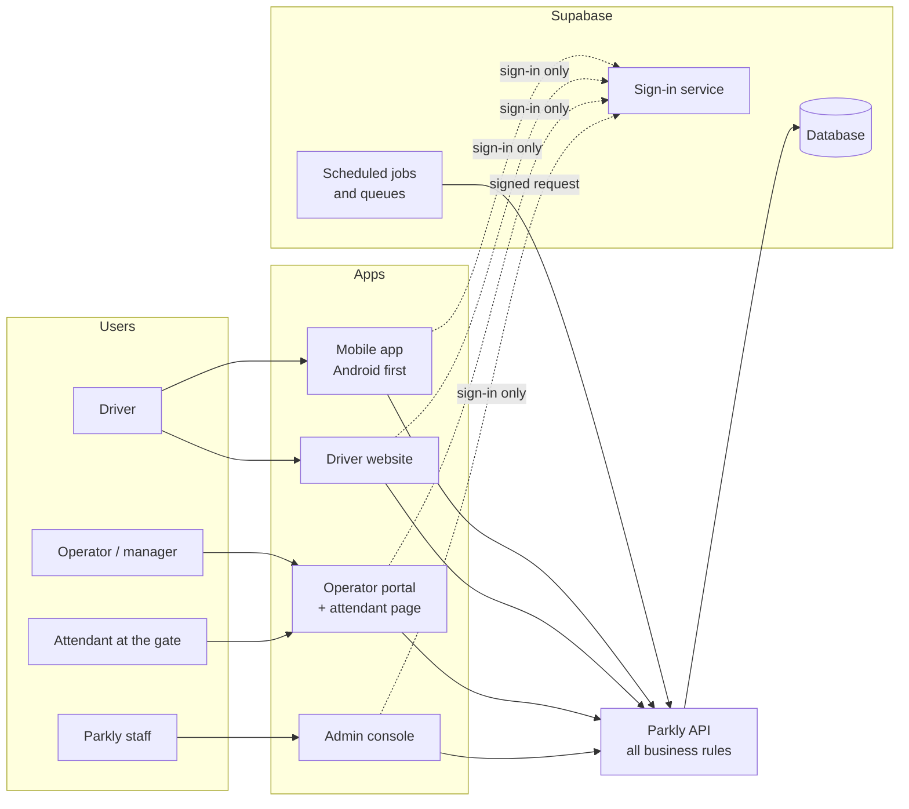
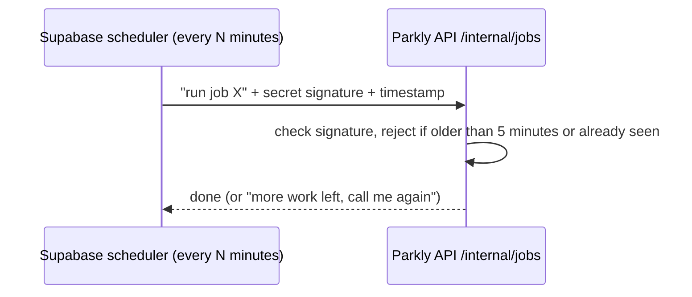
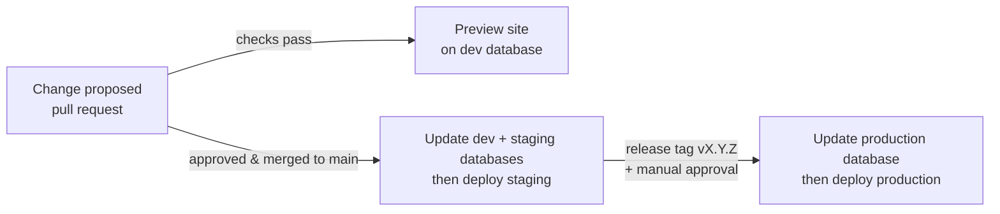

# 21 — Phase 1, Sprint 0 (Foundations): Build Guide

> **Who this is for:** the product owner and anyone joining the project who wants to understand what has been built so far, in plain language.
> **Covers:** Sprint 0 of Phase 1 (Pilot build). Status as of 15 October 2026.
> **Companion docs:** the plan is in doc 20 (Sprint Plan), the technical detail in docs 01–02, the status log in `docs/sprints/S0-report.md`.

---

## 1. Summary

Phase 1 builds the pilot version of Parkly in eleven two-week sprints (S0–S10). **Sprint 0 builds the foundations**: the project structure, the shared building blocks, the database, the security baseline and the automation that checks and deploys the code. It contains **no user features yet**; the screens you can open today are placeholders that prove everything is wired together.

Building the foundation first means each later sprint can add features quickly and safely, because the rules (money handling, security, testing, design) are already in place and enforced automatically.

| | Status |
|---|---|
| Code foundations | ✅ Done and tested (193 automated tests passing) |
| Database on Supabase (dev project) | ✅ Live, security advisor reports no issues |
| Apps running on your computer | ✅ Driver site, operator portal + attendant page, admin, mobile app, API |
| Hosting on Vercel, GitHub repo, provider accounts | ⏳ Waiting on owner setup (section 10) |

---

## 2. The big picture

Parkly is made of **five apps** that all talk to **one API**, which is the only thing allowed to touch the **database**.



**Key rule:** the apps never read or write the database directly. They only use Supabase to **sign in**; everything else (search, bookings, payments) goes through the API, which checks permissions and applies the business rules. This keeps money and booking logic in one place, where it is tested.

### Where it all runs

| Piece | Runs on | Region |
|---|---|---|
| API and the three websites | **Vercel** (hosting) | Dublin (`dub1`) |
| Database, sign-in, file storage, scheduled jobs | **Supabase** | Ireland (`eu-west-1`) |
| Mobile app | Drivers' Android phones (built with Expo) | — |

The API runs in the same region as the database because every request talks to the database, so keeping them close makes the app faster.

---

## 3. The project folder, explained

Everything lives in one folder (`parkly-app`), called a **monorepo**. One change can update the API and every app at once, so they never fall out of step.

```
parkly-app/
├── apps/                 ← things people use
│   ├── api/              the Parkly API (the "brain")
│   ├── mobile/           driver Android app
│   ├── web/              driver website
│   ├── portal/           operator portal + attendant page (/attend)
│   └── admin/            internal admin console
├── packages/             ← shared building blocks used by the apps
│   ├── domain/           business rules (money, time slots, plates, codes)
│   ├── contracts/        the "language" API and apps share (error codes, data shapes)
│   ├── db/               database table definitions
│   ├── tokens/           design tokens (colours, fonts, spacing)
│   ├── ui/               website components (Button, Text, Input)
│   ├── ui-native/        mobile components (Button, Text, Input)
│   └── config/           shared settings (code style, security headers, brand name)
├── supabase/             database setup: config + migrations (change scripts)
├── docs/                 all project documentation (you are here)
├── .github/workflows/    automatic checks and deployments
├── AGENTS.md             working rules for coding agents
└── README.md             how to install and run
```

**Language:** everything is written in **TypeScript**, so one team can work across the API, websites and mobile app.

---

## 4. What each part does

### 4.1 Business rules — `packages/domain`

The most important logic lives here as small, pure functions with no internet or database access, so it can be tested thoroughly. Built so far:

| Rule | What it does | Example |
|---|---|---|
| **Money in kobo** | All money is stored as whole kobo (₦1 = 100 kobo), never decimals, so totals are never off by a fraction | ₦1,500.50 → `150050` |
| **Rounding** | Commission and per-15-minute prices round half-up, exactly | ₦52.03125 → ₦52.03 |
| **Naira display** | Formats prices the same on web and phone | `150050` → "₦1,500.50" |
| **15-minute slots** | Bookings start and end on 15-minute marks; this is how the system will prevent overbooking | 08:00, 08:15, 08:30 … |
| **Lagos dates** | Converts times to Lagos calendar days for daily pricing and reports | 23:30 UTC on 31 Dec = 1 Jan in Lagos |
| **Plate numbers** | Cleans up how a plate is typed so the gate can match it | "lnd 123-ab" → `LND123AB` |
| **Booking codes** | Short codes that are easy to read aloud at a gate (no 0/O or 1/I/L) | `PK-7HQ4MZ` |

**85 tests, 100% of the code covered.** These were written *before* the code (test-driven development), as the project rules require.

### 4.2 The API — `apps/api`

The API is the server every app talks to. In Sprint 0 it has the plumbing that every future feature relies on:

| Feature | Why it matters |
|---|---|
| **Health checks** `/health/live` and `/health/ready` | Monitoring tools use these to tell whether the API and database are up |
| **Standard error messages** | Every error has a fixed code (e.g. `BOOKING_SLOT_UNAVAILABLE`) that apps translate into friendly messages; internal details are never shown to users |
| **Security headers** | Stop the API from being embedded in other sites and block common browser attacks |
| **CORS allowlist** | Only Parkly's own websites can call the API from a browser |
| **Rate limiting** | Slows down anyone sending too many requests (abuse, bots) |
| **Safe logs** | Logs hide phone numbers (`+234******4567`), and never record codes, passwords or tokens |
| **Error tracking (Sentry)** | Unexpected crashes are reported to the team, without personal data |
| **Input checking** | Bad input is rejected with a clear `VALIDATION_FAILED` error before it reaches any logic |
| **Internal jobs endpoint** | Lets the database's scheduler trigger background work (section 4.4), protected by a secret signature |
| **API description file** (`openapi.json`) | Generated automatically from the code, so the apps always know exactly what the API accepts |

**33 tests.** All outside services (payments, SMS, maps, email, push, storage) are defined as connectors with **test stand-ins**, so tests never call real services or spend real money.

### 4.3 The database — `supabase/` and `packages/db`

The database is **PostgreSQL on Supabase**. Changes are made only through **migrations**: numbered scripts kept in `supabase/migrations/` and applied in order. Every environment (dev, staging, production) therefore ends up identical, and every change is reviewable.

**Tables created so far:**

| Table | Holds |
|---|---|
| `users` | Each person's profile (name, status). Phone and email stay in Supabase's protected sign-in tables. |
| `user_roles` | What each person is allowed to be: Driver, Operator owner/manager/attendant, or a Parkly staff role |
| `audit_logs` | A permanent record of sensitive actions (who did what, when). Can be added to, **never edited or deleted** |
| `platform_settings` | The business settings: 12% commission, ₦100 service fee, 10-minute payment hold, 30-minute free cancellation, etc. (27 settings). Changeable without new code |
| `feature_flags` | On/off switches for features not yet launched (claims, ratings, passes, … — 10 flags, all off) |

**Automatic behaviour already in place:**
- When someone signs up with a phone number, a profile and the **Driver** role are created for them automatically.
- Background-job scheduling and three work queues (`outbox`, `notifications`, `reconciliation`) are ready for later sprints.

**Sign-in settings** (in `supabase/config.toml`) already match the security design: 6-digit SMS codes, 15-minute login tokens that refresh securely, 30-day maximum sessions, authenticator-app MFA switched on, and staff accounts by invitation only.

### 4.4 Background jobs

Some work must happen on a schedule: releasing unpaid bookings after 10 minutes, nightly payment reconciliation, permit-expiry reminders.



The signature means nobody else can trigger these jobs, and a captured request can't be replayed. Sprint 0 includes one test job (`ping`, every 5 minutes) to prove the wiring; real jobs arrive with their sprints.

### 4.5 Design system — `packages/tokens`, `ui`, `ui-native`

The colours, fonts, spacing and shapes from docs 04 and 07–16 are turned into **design tokens**: named values every screen must use instead of hard-coded colours.

- **Brand:** deep teal primary, amber for "Verified" and attention, light and dark mode.
- **Fonts:** Plus Jakarta Sans (headings), Inter (text and prices; it has the ₦ sign), JetBrains Mono (booking codes and plates).
- **Accessibility:** an automated test checks that text colours meet contrast standards (WCAG AA).
- **First components:** Button, Text and Input, for both web and mobile. Every later screen is built from these.

### 4.6 The apps

| App | Address on your computer | What you see today | Real screens arrive |
|---|---|---|---|
| Driver website | http://localhost:3000 | "Safe, verified parking in Lagos" starter page | Sprint 1 (sign-in), 3–4 (search, booking) |
| Operator portal | http://localhost:3001 | Starter page | Sprint 1 (sign-in), 2 (lots, permits), 7 (dashboard) |
| Attendant page | http://localhost:3001/attend | Placeholder | Sprint 1 (sign-in), **Sprint 5** (offline QR check-in) |
| Admin console | http://localhost:3002 | Starter page | Sprint 1 (sign-in), 2 and 8 (verification, support) |
| Mobile app | http://localhost:8081 (preview) or Expo Go on a phone | Starter screen | Sprint 1 (sign-up, vehicles) onward |
| API | http://localhost:4000/health/ready | `{"status":"ok"}` | Grows every sprint |

The three websites already send strict security headers, and the portal and admin are hidden from search engines.

---

## 5. Security built in from day one

| Protection | What it means in practice |
|---|---|
| **Row-level security on every table** | Even if someone gets the app's public key, the database returns nothing to them. Only the API's own database account has access. |
| **No direct client access** | Signed-out and signed-in client accounts have no table permissions at all; verified on the live database |
| **Audit log can't be changed** | The API can add audit entries but cannot edit or delete them |
| **Secrets never in code** | Passwords and keys live in Vercel and Supabase settings. An automatic scan (gitleaks) blocks any commit that contains one. |
| **Supabase security advisor** | Run on the live dev database: two warnings found and fixed, now **no issues** |
| **Signed background jobs** | Only the database scheduler can trigger jobs (section 4.4) |
| **Private logs** | Phone numbers masked; codes, passwords and tokens never logged |
| **Dependency checks** | Automatic scans for vulnerable libraries and insecure code (CodeQL) on every change |

The full security design is in doc 05.

---

## 6. How quality is enforced

Every change has to pass automatic checks before it can be merged. They live in `.github/workflows/ci.yml` **at the repository root** (one level above `parkly-app/`, because GitHub only reads workflows from there) and run on every pull request and every push to `main`:

1. **Formatting and lint**: consistent code style, common mistakes caught
2. **Type check**: catches mismatched data before the code runs
3. **Tests**: 193 so far across business rules, API, database rules, design tokens and UI
4. **Build**: every app must build
5. **Drift checks**: the API description file and the database migrations must match the code
6. **Database tests**: a temporary Supabase is started and security rules are checked (RLS on, no client access, audit log protected, sign-up trigger works)
7. **Security scans**: secrets, vulnerable dependencies, CodeQL

### How code reaches users



Database changes always run **before** the code that needs them, so the live app never runs against an older database. Production releases need a human to approve.

---

## 7. Decisions made during Sprint 0

These are recorded in `docs/decisions/` (ADRs) so future work doesn't reopen them:

| # | Decision | In one line |
|---|---|---|
| 0002 | Supabase + Vercel | Managed database/sign-in plus managed hosting, so a small team can move fast |
| 0003 | One monorepo | Shared code stays in sync across all apps |
| 0004 | Paystack split payments | Drivers pay through Paystack; operators are paid their share directly. **Parkly never holds money** (holding customer funds would need a CBN licence) |
| 0005 | Attendant app as a web app (PWA) | Opens from a link on cheap phones, works offline, no Play Store install |
| 0006 | Slot-based booking locks *(proposed)* | How overbooking will be prevented; confirmed in Sprint 4 |

**Adjustments made along the way:**
- The API's database account uses an explicit permission rule on each table, instead of a blanket "bypass security" permission that hosted Supabase may not allow.
- Releases: `main` deploys to staging; production only from a tagged, approved release.
- Region set to Ireland/Dublin to match the Supabase projects.
- Two error codes added: `INTERNAL_ERROR` and `OTP_RATE_LIMITED`.

---

## 8. How to run and view it

From the `parkly-app` folder:

```bash
pnpm install     # first time only
pnpm build       # first time only: prepares the shared packages
pnpm dev         # starts everything; wait ~20 seconds for "Ready"
```

Then open the addresses in section 4.6.

- **On your phone:** install Expo Go, connect to the same Wi-Fi, and scan the QR code in the terminal. If it fails with "Failed to download remote update", either allow port 8081 through Windows Firewall on a private network, or run `npx expo start --tunnel` inside `apps/mobile`.
- **Running the tests:** `pnpm test`.
- **The database:** the dev project (`devproject`) is visible in the Supabase dashboard under Table Editor.

---

## 9. The numbers

| | Count |
|---|---|
| Apps | 5 (API, mobile, driver web, portal + attendant, admin) |
| Shared packages | 7 |
| Database tables | 5 |
| Database migrations applied | 5 |
| Automated tests | 193: business rules 85, design tokens 51, API 33, database schema 11, UI 11, contracts 2 (plus 6 live-database security tests that run in CI) |
| Business-rule test coverage | 100% |
| Security advisor issues on live dev database | 0 |

---

## 10. What's still open in Sprint 0 (owner actions)

| Action | Why it's needed |
|---|---|
| Add the two Vault secrets and the `parkly_api` password on devproject (SQL in the README) | Lets scheduled jobs reach the API and the API reach the database |
| Create the GitHub repository and add the deploy secrets | Turns on the automatic checks and deployments |
| Create the four Vercel projects (`parkly-api`, `-web`, `-portal`, `-admin`), Dublin region | Hosting for the staging and production websites |
| Create Supabase **staging** and **production** projects | Separate environments from dev |
| Start accounts with slow approvals: **Termii** (SMS, needed for Sprint 1), **Paystack** (needed for Sprint 4), Google Maps, Upstash, Resend, Sentry, Better Stack, Google Play Console | Real services replace the test stand-ins as each sprint needs them |
| First git commit | Saves Sprint 0 as the starting point |

---

## 11. What comes next: Sprint 1, Identity and access

**Goal:** real people can sign in safely, and every action is permission-checked and logged.

- **Drivers:** sign up with phone number + 6-digit SMS code, enter their name, accept terms, add their car plates.
- **Operators and admins:** email + password + authenticator app (required for admins, owners and managers).
- **Attendants:** phone code + a lot PIN, on an approved device.
- **Permissions:** each role can only do its own job, and only within its own operator and lots, with a test for every role against every endpoint.
- **Audit and consent:** sensitive actions logged; consent to terms and privacy recorded with versions.

**End-of-sprint demo:** a new driver signs up and adds a car → an admin signs in with an authenticator code and views the audit log → a manager from operator A is blocked from operator B's data.

After that: **Sprint 2** (operators, lots, LASPA permits, verification) → **Sprint 3** (lot search) → **Sprint 4** (booking and Paystack payments) → **Sprint 5** (QR tickets and offline attendant check-in) … → **Sprint 10** (launch readiness and pilot launch). See doc 20 for the full plan.

---

## 12. Glossary

| Term | Meaning |
|---|---|
| **API** | The server that apps talk to; it holds all business rules |
| **Monorepo** | One code repository containing all apps and shared packages |
| **Migration** | A numbered script that changes the database structure; applied in order everywhere |
| **RLS (row-level security)** | Database rules that decide who can see which rows; ours deny everything except the API |
| **Kobo** | 1/100 of a naira; all money is stored in kobo |
| **Design tokens** | Named design values (colours, sizes) used instead of hard-coded styles |
| **Test stand-in (fake)** | A pretend version of an outside service used in tests |
| **CI/CD** | Automatic checking (CI) and deployment (CD) of code changes |
| **Staging** | A copy of the live system used to test before release |
| **ADR** | Architecture Decision Record: a short note explaining a technical decision |
| **PWA** | A website that can be installed on a phone and work offline |
| **Expo / Expo Go** | The toolkit for the mobile app, and the phone app used to preview it during development |
| **Vault** | Supabase's encrypted store for secrets |
| **MFA / authenticator app** | A second sign-in step using a 6-digit code from an app like Google Authenticator |
